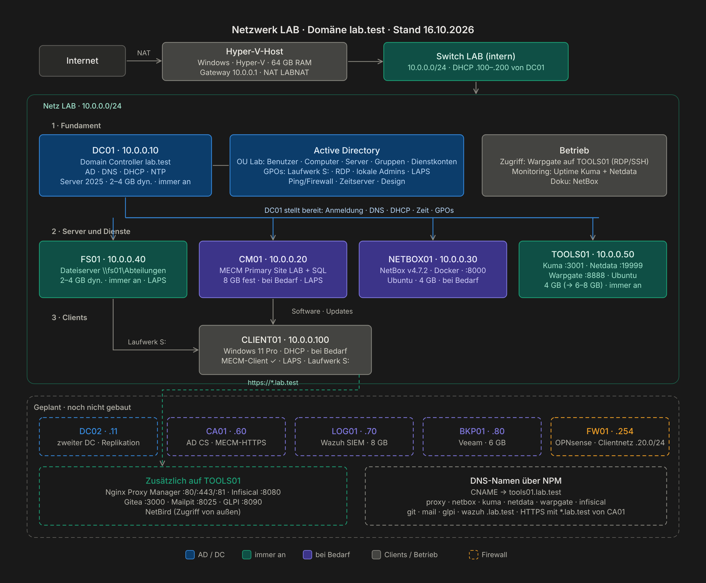
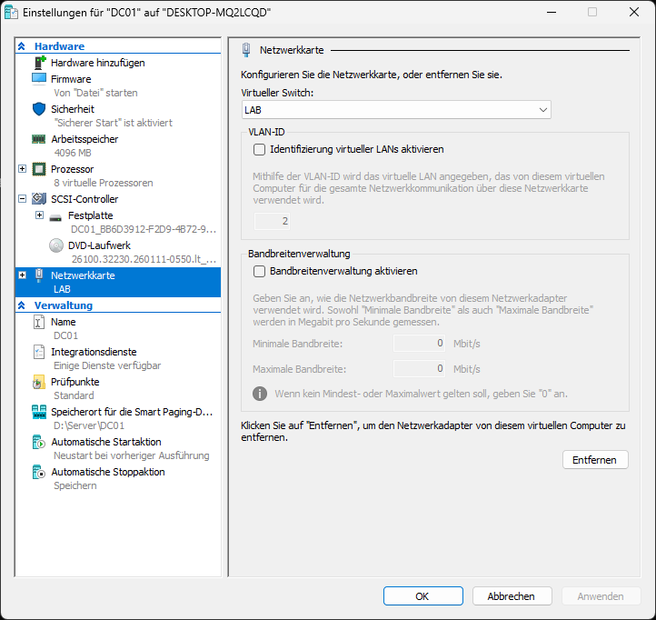
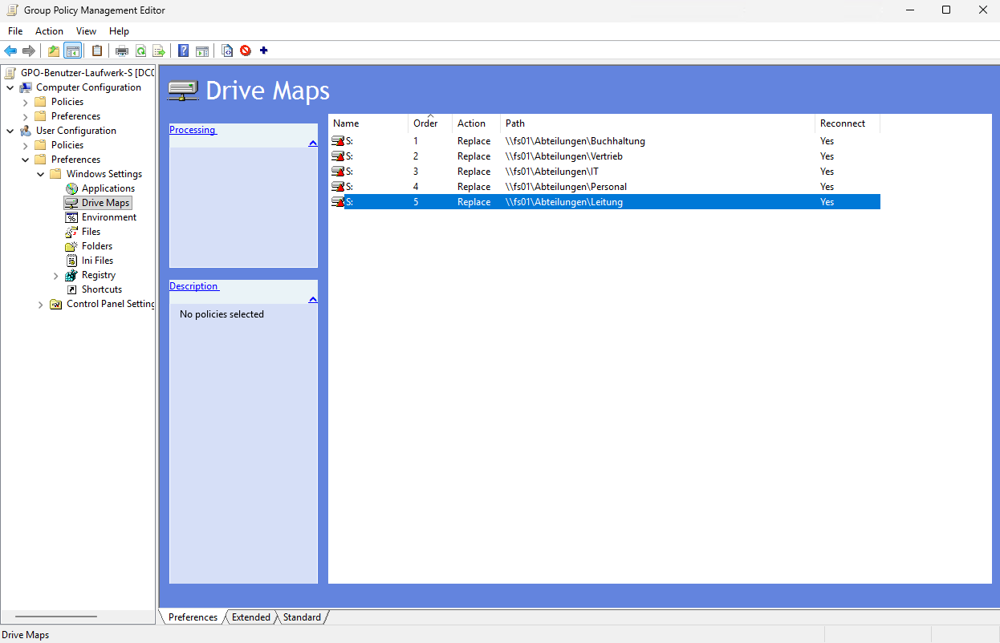
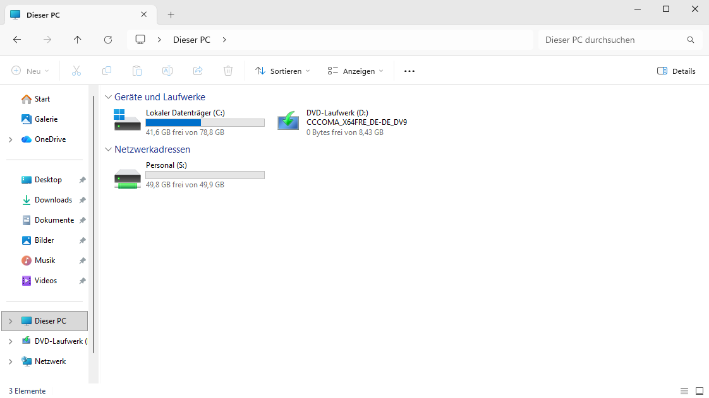
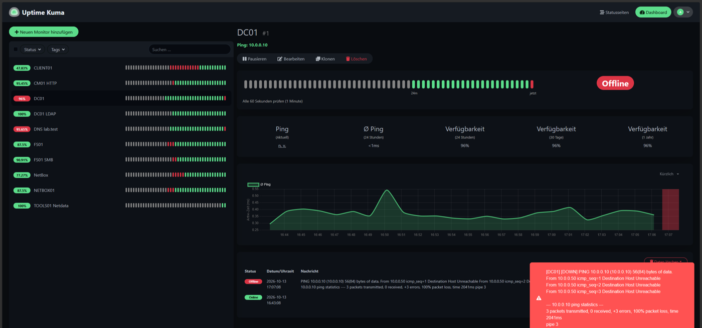
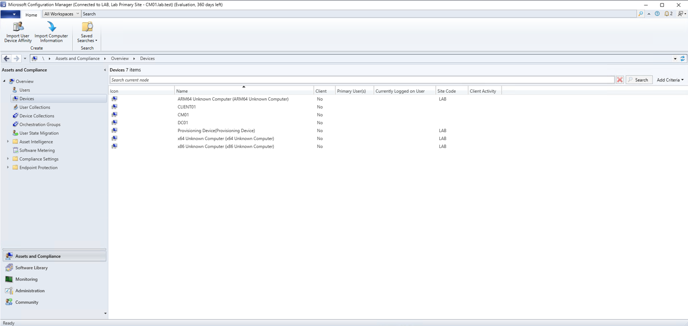

# Homelab `lab.test`: Windows-Firmennetz in Hyper-V

**Eine Schritt-für-Schritt-Anleitung zum Nachbauen.** Active Directory, DNS, DHCP, Dateiserver mit Abteilungsrechten, Gruppenrichtlinien, Windows LAPS und MECM, alles auf einem einzigen PC mit Hyper-V.




---

## Inhaltsverzeichnis

1. [Einführung](#einführung)
2. [Teil 1 · Vorbereitung](#teil-1--vorbereitung)
3. [Teil 2 · Active Directory](#teil-2--active-directory)
4. [Teil 3 · Client, Dateiserver und Gruppenrichtlinien](#teil-3--client-dateiserver-und-gruppenrichtlinien)
5. [Teil 4 · Testen](#teil-4--testen)
6. [Teil 5 · Optional: Linux-Dienste und MECM](#teil-5--optional-linux-dienste-und-mecm)
7. [Betrieb: Starten und Stoppen](#betrieb-starten-und-stoppen)
8. [Fehler, aus denen ich am meisten gelernt habe](#fehler-aus-denen-ich-am-meisten-gelernt-habe)
9. [Wie es weitergeht](#wie-es-weitergeht)
10. [Aufbau des Repos](#aufbau-des-repos)

---

## Einführung

Ich habe dieses Lab als Junior Admin aufgebaut, um Alltagsaufgaben aus der Firma gefahrlos zu üben: Benutzer anlegen, Rechte vergeben, Laufwerke verteilen, Software ausrollen. Diese Anleitung beschreibt jeden Schritt so, dass du ihn nachklicken kannst, **inklusive der Fehler, die mir dabei passiert sind**, und wie man sie findet.

**Für wen:** Azubis und Einsteiger in der Systemintegration und alle, die sich auf ein Vorstellungsgespräch als Windows-Admin vorbereiten.

**Was am Ende läuft:**

- Domäne `lab.test` mit sauberer OU-Struktur unter `Lab/`
- Rund 120 Testbenutzer in 5 Abteilungen, per [Skript](scripts/New-LabBulkUsers.ps1) aus einer CSV angelegt
- Freigabe `\\fs01\Abteilungen`, in der jeder nur seinen Abteilungsordner sieht
- Laufwerk **S:** automatisch je nach Abteilung
- RDP nur für bestimmte Abteilungen, lokale Admin-Kennwörter per Windows LAPS
- MECM mit Client-Push auf den Windows-11-Client
- Optional: Uptime Kuma, Netdata, Nginx Proxy Manager, NetBox, Warpgate und Infisical

**So sind die Kapitel aufgebaut:** Ziel und Dauer · nummerierte Schritte mit Angabe, auf welchem Rechner du gerade bist · Prüfen · häufige Fehler. Rund 40 Screenshots stammen direkt aus dem Lab. Gearbeitet wird überwiegend mit der Oberfläche, PowerShell nur dort, wo es deutlich schneller ist.

> [!TIP]
> Die Server laufen auf Englisch. Klickwege stehen deshalb so da: **English name** (deutscher Name).

**Zeitbedarf:** Teil 1–4 etwa ein Tag. Teil 5 ist optional, MECM allein braucht einen halben Tag.

---

## Teil 1 · Vorbereitung

Bevor die erste VM läuft: Hardware prüfen, Hyper-V einschalten und ein eigenes Netz für das Lab bauen.

| Kapitel | Was du machst |
|---|---|
| [0 · Voraussetzungen](docs/anleitung/00-voraussetzungen.md) | Hardware, ISOs herunterladen, Hyper-V aktivieren, VM-Assistent |
| [1 · Netzwerk](docs/anleitung/01-netzwerk.md) | Interner Switch `LAB` mit NAT, damit die VMs ins Internet kommen |

<p align="center">
  
  
</p>

**[→ Los geht's mit Kapitel 0](docs/anleitung/00-voraussetzungen.md)**

---

## Teil 2 · Active Directory

Das Herz des Labs: DC01 wird Domain Controller für `lab.test`, bekommt DNS und DHCP, und du legst die Struktur an, an die später alle Richtlinien gehängt werden.

| Kapitel | Was du machst |
|---|---|
| [2 · Domain Controller](docs/anleitung/02-domain-controller.md) | Windows Server installieren, AD DS, neue Gesamtstruktur `lab.test` |
| [3 · DNS und DHCP](docs/anleitung/03-dns-dhcp.md) | Reverse-Zone, A- und PTR-Einträge, DHCP-Bereich, AD-Subnetz |
| [4 · AD-Struktur](docs/anleitung/04-ad-struktur.md) | OUs, Abteilungsgruppen, getrennte Admin-Konten, AD-Papierkorb |
| [5 · Benutzer per Skript](docs/anleitung/05-benutzer-per-skript.md) | Über 100 Testbenutzer aus einer CSV, mit Probelauf |


**[→ Weiter mit Kapitel 2](docs/anleitung/02-domain-controller.md)**

---

## Teil 3 · Client, Dateiserver und Gruppenrichtlinien

Jetzt wird es ein echtes Firmennetz: ein Windows-11-Client tritt der Domäne bei, FS01 stellt Abteilungsordner bereit, und Gruppenrichtlinien verteilen Laufwerke und Rechte.

| Kapitel | Was du machst |
|---|---|
| [6 · Client](docs/anleitung/06-client.md) | Windows 11 installieren und der Domäne beitreten |
| [7 · Dateiserver](docs/anleitung/07-dateiserver.md) | Zweite Platte, Freigabe, NTFS-Rechte pro Abteilung, zugriffsbasierte Aufzählung |
| [8 · Gruppenrichtlinien](docs/anleitung/08-gruppenrichtlinien.md) | Laufwerk S:, RDP für bestimmte Abteilungen, Windows LAPS, Zeitquelle |

<p align="center">
  
  
</p>

**[→ Weiter mit Kapitel 6](docs/anleitung/06-client.md)**

---

## Teil 4 · Testen

Mit einem Benutzer **jeder** Abteilung prüfen, ob Laufwerk, Ordner und RDP so funktionieren wie geplant. Hier findest du die Fehler, die beim Einrichten nicht auffallen.

| Kapitel | Was du machst |
|---|---|
| [9 · Testen](docs/anleitung/09-testen.md) | Testplan pro Abteilung, `gpresult`, was tun, wenn S: fehlt |

**[→ Weiter mit Kapitel 9](docs/anleitung/09-testen.md)**

---

## Teil 5 · Optional: Linux-Dienste und MECM

Für alle, die mehr wollen: eine Ubuntu-VM mit Docker für Überwachung und Verwaltung und ein Configuration Manager, wie er in vielen Firmen läuft.

| Kapitel | Was du machst |
|---|---|
| [10 · Linux-Dienste](docs/anleitung/10-linux-dienste.md) | Ubuntu, Docker, Uptime Kuma, Nginx Proxy Manager, Infisical, NetBox |
| [11 · MECM](docs/anleitung/11-mecm.md) | SQL Server, Configuration Manager, Enhanced HTTP, Client-Push |

<p align="center">
  
  
</p>

**[→ Weiter mit Kapitel 10](docs/anleitung/10-linux-dienste.md)**

---

## Betrieb: Starten und Stoppen

DC01 startet immer zuerst und fährt zuletzt herunter. Ohne DC01 gibt es kein DNS, und die anderen VMs laufen in Fehler.


Alle Server, GPOs und Rechte im fertigen Lab: [Aufbau](docs/aufbau.md)

---

## Fehler, aus denen ich am meisten gelernt habe

| Problem | Ursache | Lösung |
|---|---|---|
| Laufwerk S: fehlt, ohne Fehlermeldung | NTFS-Rechte von zwei Ordnern beim Anlegen vertauscht | Rechte korrigiert. Fehlt der Zugriff aufs Ziel, scheitert die Zuordnung still |
| Kollegen können Dateien der eigenen Abteilung nicht öffnen | NTFS-Recht galt nur für *This folder only* | *This folder, subfolders and files* |
| GPO macht Dienstkonto nicht zum lokalen Admin, es entsteht eine Gruppe „ad“ | Gruppenname von Hand eingetippt | Eingebaute Gruppe per Dropdown wählen |
| MECM-Client: `CCM_E_NO_CLIENT_PKI_CERT` | Site auf HTTPS only, keine PKI | Enhanced HTTP |
| Linux-VMs stürzen ab (OOM, Kernel Panic) | Dynamischer Arbeitsspeicher | Fester RAM für Linux und SQL Server |

Alle 25 Fälle: [Fehlerbehebung](docs/fehlerbehebung.md)

---

## Wie es weitergeht


Details: [Roadmap](docs/roadmap.md) · Warum etwas so gebaut ist: [Entscheidungen](docs/entscheidungen.md) · Was wann dazukam: [Changelog](docs/changelog.md)

---

## Aufbau des Repos

```
docs/
  anleitung/          Schritt-für-Schritt-Anleitung, Kapitel 0–11
  bilder/             Screenshots aus dem Lab
  diagramme/          Übersichtsgrafiken
  aufbau.md           Referenz des fertigen Labs
  fehlerbehebung.md   Gelöste Fehler mit Ursache und Lösung
  entscheidungen.md   Begründungen
  roadmap.md          Nächste Ausbaustufen
  changelog.md        Was wann dazukam
scripts/
  New-LabBulkUsers.ps1   Testbenutzer per CSV anlegen
  benutzer.example.csv   Beispiel-CSV
```

---

Alle Namen, Benutzer und Adressen sind Testdaten. Kennwörter stehen nicht in diesem Repo. Nutzung auf eigene Gefahr, bitte nur in einer eigenen Testumgebung.
