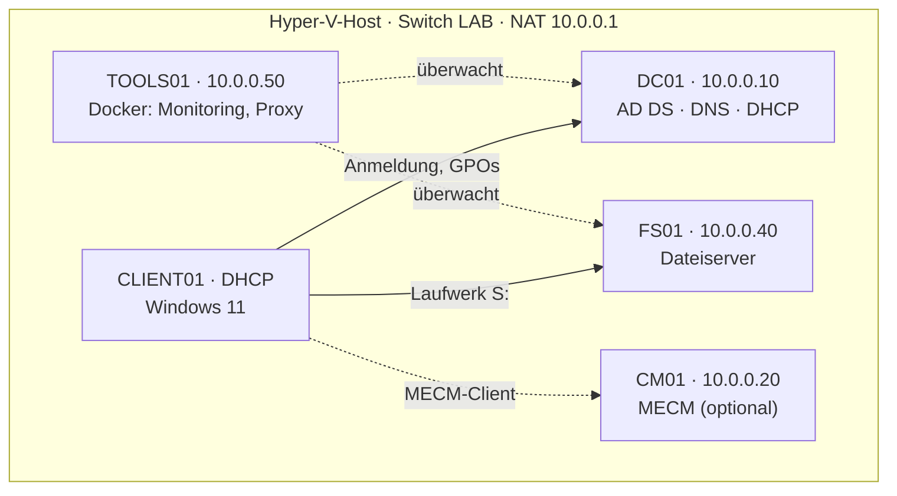

# Homelab `lab.test`: Windows-Firmennetz in Hyper-V

Ein komplettes kleines Firmennetz zum Nachbauen: **Active Directory, DNS, DHCP, Dateiserver mit Abteilungsrechten, Gruppenrichtlinien, Windows LAPS** und ein paar Linux-Dienste, alles auf einem PC mit Hyper-V.

Ich habe das Lab als Junior Admin aufgebaut, um Alltagsaufgaben gefahrlos zu üben. Diese Anleitung beschreibt Schritt für Schritt, wie du es nachbaust, **inklusive der Fehler, die mir dabei passiert sind**, und wie man sie findet.

## Was am Ende läuft



- Domäne `lab.test` mit sauberer OU-Struktur unter `Lab/`
- Rund 120 Testbenutzer in 5 Abteilungen, per [Skript](scripts/New-LabBulkUsers.ps1) aus einer CSV angelegt
- Freigabe `\\fs01\Abteilungen`: jeder sieht nur seinen Abteilungsordner
- Laufwerk **S:** automatisch je nach Abteilung
- RDP nur für bestimmte Abteilungen, lokale Admin-Kennwörter per Windows LAPS
- Zeit, DNS mit Reverse-Zone, AD-Papierkorb
- Optional: Uptime Kuma, Netdata, Nginx Proxy Manager, NetBox, Warpgate, Infisical und MECM

## Anleitung

| # | Kapitel | Inhalt |
|---|---|---|
| 0 | [Voraussetzungen](docs/anleitung/00-voraussetzungen.md) | Hardware, ISOs, Hyper-V aktivieren |
| 1 | [Netzwerk](docs/anleitung/01-netzwerk.md) | Interner Switch mit NAT |
| 2 | [Domain Controller](docs/anleitung/02-domain-controller.md) | DC01 installieren, Domäne `lab.test` |
| 3 | [DNS und DHCP](docs/anleitung/03-dns-dhcp.md) | Reverse-Zone, DHCP-Bereich, AD-Subnetz |
| 4 | [AD-Struktur](docs/anleitung/04-ad-struktur.md) | OUs, Gruppen, Konten, `redircmp`, Papierkorb |
| 5 | [Benutzer per Skript](docs/anleitung/05-benutzer-per-skript.md) | Testbenutzer aus CSV, mit Probelauf |
| 6 | [Client](docs/anleitung/06-client.md) | Windows 11 der Domäne beitreten |
| 7 | [Dateiserver](docs/anleitung/07-dateiserver.md) | Freigabe, NTFS-Rechte, zugriffsbasierte Aufzählung |
| 8 | [Gruppenrichtlinien](docs/anleitung/08-gruppenrichtlinien.md) | Laufwerk S:, RDP, LAPS, Zeit |
| 9 | [Testen](docs/anleitung/09-testen.md) | Testplan, `gpresult`, wenn S: fehlt |
| 10 | [Linux-Dienste](docs/anleitung/10-linux-dienste.md) | Ubuntu, Docker, Uptime Kuma, NetBox |
| 11 | [MECM](docs/anleitung/11-mecm.md) | SQL Server, Configuration Manager, Client-Push |

**So sind die Kapitel aufgebaut:** Ziel und Dauer · Voraussetzungen · nummerierte Schritte mit Angabe, auf welchem Rechner du gerade bist · Prüfen · häufige Fehler. Rund 40 Screenshots stammen direkt aus dem Lab.

Gearbeitet wird überwiegend mit der Oberfläche. PowerShell nur dort, wo es nicht anders geht oder deutlich schneller ist. Für Kapitel 0–9 solltest du etwa einen Tag einplanen, Kapitel 10 und 11 sind optional.

<p align="center">
  
  
</p>

## Fehler, aus denen ich am meisten gelernt habe

| Problem | Ursache | Lösung |
|---|---|---|
| Laufwerk S: fehlt, ohne Fehlermeldung | NTFS-Rechte von zwei Ordnern beim Anlegen vertauscht | Rechte korrigiert. Fehlt der Zugriff aufs Ziel, scheitert die Zuordnung still |
| Kollegen können Dateien der eigenen Abteilung nicht öffnen | NTFS-Recht galt nur für *This folder only* | *This folder, subfolders and files* |
| GPO macht Dienstkonto nicht zum lokalen Admin, es entsteht eine Gruppe „ad“ | Gruppenname von Hand eingetippt | Eingebaute Gruppe per Dropdown wählen |
| MECM-Client: `CCM_E_NO_CLIENT_PKI_CERT` | Site auf HTTPS only, keine PKI | Enhanced HTTP |
| Linux-VMs stürzen ab (OOM, Kernel Panic) | Dynamischer Arbeitsspeicher | Fester RAM für Linux und SQL Server |

Alle 25 Fälle: [Fehlerbehebung](docs/fehlerbehebung.md)

## Weitere Doku

- [Aufbau](docs/aufbau.md): Referenz aller Server, GPOs und Rechte im fertigen Lab
- [Entscheidungen](docs/entscheidungen.md): warum etwas so gebaut ist
- [Roadmap](docs/roadmap.md): eigene CA, Backup, Wazuh, OPNsense, Intune
- [Changelog](docs/changelog.md)

## Inhalt

```
docs/
  anleitung/          Schritt-für-Schritt-Anleitung (Kapitel 0–11)
  bilder/             Screenshots
  aufbau.md           Referenz des fertigen Labs
  fehlerbehebung.md   Gelöste Fehler mit Ursache und Lösung
  entscheidungen.md   Begründungen
  roadmap.md          Nächste Ausbaustufen
  changelog.md        Was wann dazukam
scripts/
  New-LabBulkUsers.ps1   Testbenutzer per CSV anlegen
  benutzer.example.csv   Beispiel-CSV
```

---

Alle Namen, Benutzer und Adressen sind Testdaten. Kennwörter stehen nicht in diesem Repo. Nutzung auf eigene Gefahr, bitte nur in einer eigenen Testumgebung.
