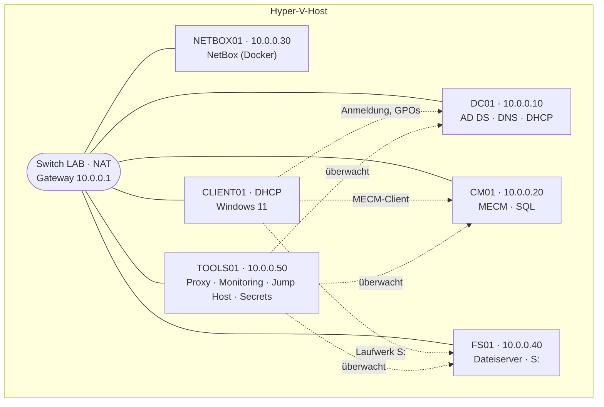

# Homelab `lab.test`

Ein Windows-Firmennetz im Kleinformat: Active Directory, Gruppenrichtlinien, Dateiserver, MECM und ein paar Linux-Dienste, alles in Hyper-V. Ich baue es seit Oktober 2026 auf, um Dinge, die ich als Junior Admin im Alltag brauche, in Ruhe auszuprobieren, kaputt zu machen und wieder zu reparieren.

Die laufende Doku (Aufgaben, Änderungsprotokoll, Runbooks) führe ich in Notion. Dieses Repo ist die bereinigte, öffentliche Fassung davon.

## Auf einen Blick

| | |
|---|---|
| **Domäne** | `lab.test` (NetBIOS `LAB`), Windows Server 2025 |
| **Netz** | `10.0.0.0/24`, interner Hyper-V-Switch mit NAT |
| **VMs** | 6 (3× Windows Server, 1× Windows 11, 2× Ubuntu Server) |
| **Benutzer** | rund 120 Testkonten in 5 Abteilungen, größtenteils per Skript angelegt |
| **GPOs** | 10+ (RDP, lokale Admins, LAPS, Laufwerke, Design, Zeit, Ping …) |
| **Dienste** | AD DS, DNS, DHCP, Dateiserver, MECM, NetBox, Uptime Kuma, Netdata, Nginx Proxy Manager, Warpgate, Infisical |
| **Gelöste Fehler** | 25+ dokumentiert, siehe [Fehlerbehebung](docs/fehlerbehebung.md) |

## Aufbau



| VM | OS | Rolle | RAM |
|---|---|---|---|
| DC01 | Windows Server 2025 | Domain Controller, DNS, DHCP, Zeitquelle | dynamisch, max. 4 GB |
| CM01 | Windows Server 2025 | Microsoft Configuration Manager (Site `LAB`), SQL Server | 8 GB fest |
| FS01 | Windows Server 2025 | Dateiserver `\\fs01\Abteilungen` | dynamisch, max. 4 GB |
| CLIENT01 | Windows 11 Pro | Testclient, MECM-Client | dynamisch, max. 4 GB |
| NETBOX01 | Ubuntu Server | NetBox (IP-Adressen, VMs) | 4 GB fest |
| TOOLS01 | Ubuntu Server | Docker: Nginx Proxy Manager, Uptime Kuma, Netdata, Warpgate, Infisical | 6 GB fest |

Mehr Details: [docs/aufbau.md](docs/aufbau.md)

## Was ich umgesetzt habe

**Active Directory und Gruppenrichtlinien**
- OU-Struktur `Lab/Benutzer`, `Computer`, `Server`, `Gruppen`, `Dienstkonten`; neue Computer landen per `redircmp` automatisch in `Lab/Computer`
- Abteilungen über globale Sicherheitsgruppen (`GG-IT`, `GG-Buchhaltung`, `GG-Vertrieb`, `GG-Personal`, `GG-Leitung`)
- Laufwerk **S:** per Gruppenrichtlinien-Einstellung mit Zielgruppenadressierung, Aktion *Ersetzen*
- RDP-Zugriff, lokale Administratoren und Desktop-Design per GPO
- **Windows LAPS** für lokale Admin-Kennwörter auf Clients und Servern
- Kennwortrichtlinie (12 Zeichen, Sperre nach 10 Fehlversuchen), AD-Papierkorb
- Zeitsynchronisation: DC01 holt die Zeit per NTP, Hyper-V-Zeitsync ist aus
- GPO-Sicherung per Skript

**Dateiserver**
- Freigabe `\\fs01\Abteilungen` mit Ordner pro Abteilung, Rechte nur über NTFS und GG-Gruppen
- Zugriffsbasierte Aufzählung: jeder sieht nur seinen eigenen Abteilungsordner

**Automatisierung**
- [`New-LabBulkUsers.ps1`](scripts/New-LabBulkUsers.ps1): legt Testbenutzer aus einer CSV an, inklusive Abteilungs-OUs und Gruppen; mit `-WhatIf`-Probelauf, Log und Startpasswort-Abfrage statt Klartext in der CSV

**MECM**
- Primärer Standort `LAB` auf CM01, AD System Discovery, Client-Push über ein eigenes Dienstkonto
- Client auf CLIENT01 läuft per Enhanced HTTP (bis eine eigene CA da ist)

**Linux und Docker**
- NetBox als Quelle der Wahrheit für IP-Adressen und VMs
- Uptime Kuma (Ping, Ports, DNS) und Netdata zur Überwachung
- Nginx Proxy Manager mit DNS-Namen wie `netbox.lab.test`
- Warpgate als Jump Host für RDP und SSH
- Infisical für Lab-Kennwörter

## Ausgewählte Fehler und was ich daraus gelernt habe

| Problem | Ursache | Lösung |
|---|---|---|
| Laufwerk S: fehlt bei einer neuen Abteilung, ohne Fehlermeldung | NTFS-Rechte von zwei Ordnern beim Anlegen vertauscht | Rechte korrigiert. Fehlt der Zugriff aufs Ziel, scheitert die Laufwerkszuordnung still |
| Kollegen können Dateien der eigenen Abteilung nicht öffnen | NTFS-Recht galt nur für *This folder only*, nur der Ersteller hatte Zugriff (CREATOR OWNER) | *This folder, subfolders and files* |
| MECM-Client-Installation bricht mit `CCM_E_NO_CLIENT_PKI_CERT` ab | Site stand auf HTTPS only, im Lab gibt es noch keine PKI | Enhanced HTTP, HTTPS folgt mit eigener CA |
| GPO macht Dienstkonto nicht zum lokalen Admin, stattdessen entsteht eine Gruppe „ad“ | Gruppenname von Hand eingetippt statt per Dropdown gewählt | Eingebaute Gruppe *Administrators (built-in)* auswählen |
| Linux-VMs stürzen ab (OOM, Kernel Panic) | Dynamischer Arbeitsspeicher, Linux bekommt beim Start nicht schnell genug RAM | Fester RAM für Linux-VMs und SQL Server |

Alle Fälle: [docs/fehlerbehebung.md](docs/fehlerbehebung.md)

## Wie es weitergeht

Umzug auf einen eigenen Mini-PC im 10-Zoll-Rack für den Dauerbetrieb, danach eigene CA mit HTTPS, Backup mit Veeam, Patch-Management über MECM, Logging mit Wazuh, OPNsense mit getrenntem Clientnetz und Entra ID / Intune. Details: [docs/roadmap.md](docs/roadmap.md)

## Inhalt

```
docs/
  aufbau.md           Netz, Server, AD-Struktur, GPOs, Dateiserver, Dienste
  fehlerbehebung.md   Gelöste Fehler mit Ursache und Lösung
  entscheidungen.md   Warum ich etwas so gemacht habe
  roadmap.md          Nächste Ausbaustufen
  changelog.md        Was wann dazukam
scripts/
  New-LabBulkUsers.ps1   Testbenutzer per CSV anlegen
  benutzer.example.csv   Beispiel-CSV
```

---

Alle Namen, Benutzer und Adressen sind Testdaten. Kennwörter stehen nicht in diesem Repo.
