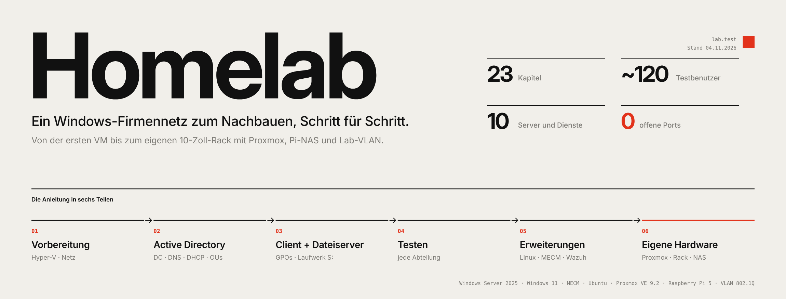

<p align="center">
  <a href="docs/anleitung/00-voraussetzungen.md"><b>→ Mit Kapitel 0 starten</b></a> &nbsp;·&nbsp;
  <a href="#inhaltsverzeichnis">Alle Kapitel</a> &nbsp;·&nbsp;
  <a href="docs/aufbau.md">Das fertige Lab</a> &nbsp;·&nbsp;
  <a href="docs/fehlerbehebung.md">Fehlerbehebung</a> &nbsp;·&nbsp;
  <a href="docs/changelog.md">Changelog</a>
</p>

Ich habe dieses Lab als Junior Admin aufgebaut, um Alltagsaufgaben aus der Firma gefahrlos zu üben: Benutzer anlegen, Rechte vergeben, Laufwerke verteilen, Software ausrollen, Server überwachen. Die Anleitung beschreibt jeden Schritt so, dass du ihn nachklicken kannst, **inklusive der Fehler, die mir dabei passiert sind**, und wie man sie findet.

**Für wen:** Azubis und Einsteiger in der Systemintegration und alle, die sich auf ein Vorstellungsgespräch als Windows-Admin vorbereiten.

---

## Das Lab heute

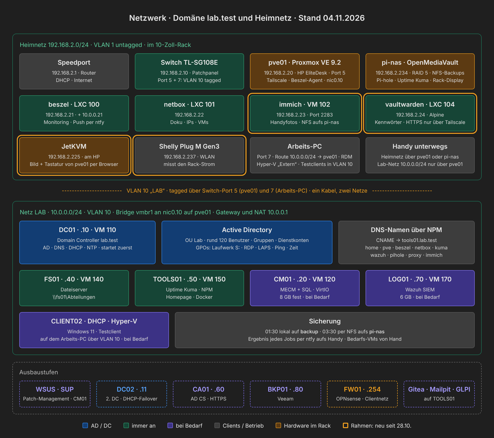

<sub>Auch als [Dark Mode](docs/diagramme/netzwerk-2026-11-04-dark.png) · Vektor-Datei: [SVG](docs/diagramme/netzwerk-2026-11-04.svg)</sub>

> [!NOTE]
> **Stand 04.11.2026**
> - Alle Server laufen auf dem Mini-PC `pve01` mit Proxmox, Hyper-V auf dem Arbeits-PC trägt nur noch Testclients ([Kapitel 17](docs/anleitung/17-umzug-hyperv-proxmox.md))
> - Das Lab-Netz läuft als VLAN 10 über einen Managed Switch, das Heimnetz bleibt unberührt ([Kapitel 19](docs/anleitung/19-vlan-testclient.md))
> - Jede Nacht sichert Proxmox alle VMs aufs Pi-NAS, Ausfälle und Backup-Berichte kommen per Push aufs Handy ([Kapitel 16](docs/anleitung/16-pi-nas.md), [18](docs/anleitung/18-betrieb.md))
> - Neu im Heimnetz: Immich für Handyfotos ([Kapitel 21](docs/anleitung/21-immich.md)) und Vaultwarden als Passwortmanager, nur über Tailscale erreichbar ([Kapitel 22](docs/anleitung/22-vaultwarden.md))

### Was am Ende läuft

| Bereich | Was du baust |
|---|---|
| **Active Directory** | Domäne `lab.test`, OU-Struktur unter `Lab/`, rund 120 Testbenutzer in 5 Abteilungen per [Skript](scripts/New-LabBulkUsers.ps1) |
| **Dateiserver** | `\\fs01\Abteilungen`: jeder sieht nur seinen Ordner, Laufwerk **S:** kommt automatisch je nach Abteilung |
| **Sicherheit** | RDP nur für bestimmte Abteilungen, Windows LAPS, getrennte Admin-Konten, Wazuh meldet Fehlanmeldungen |
| **Softwareverteilung** | MECM mit Client-Push, Anwendungen im Softwarecenter und als Pflicht-Installation |
| **Betrieb** | Beszel, Uptime Kuma, Nginx Proxy Manager, NetBox, Startseite mit allen Diensten |
| **Eigene Hardware** | Mini-PC mit Proxmox im 10-Zoll-Rack, Pi-NAS mit RAID 5, Pi-hole, Touch-Display im Rack |
| **Netzwerk** | Lab als VLAN 10, Testclients auf dem Arbeits-PC über dasselbe Kabel, Fernzugriff über Tailscale ohne offenen Port |

### Welcher Weg passt zu dir?

| Du willst … | Dann | Du brauchst | Zeit |
|---|---|---|---|
| ein Windows-Firmennetz verstehen und üben | Teil 1–4 | PC mit Windows 11 Pro und 32–64 GB RAM | ca. 1 Tag |
| Werkzeuge aus dem Firmenalltag dazu | Teil 5, Kapitel einzeln wählbar | denselben PC, MECM braucht viel RAM | je 1–4 Std. |
| das Lab rund um die Uhr laufen lassen | Teil 6 | Mini-PC, optional Rack, Switch und Raspberry Pi | ca. 1 Wochenende |

**So sind die Kapitel aufgebaut:** Ziel und Dauer · nummerierte Schritte mit Angabe, auf welchem Rechner du gerade bist · Prüfen · häufige Fehler. Gearbeitet wird überwiegend mit der Oberfläche, Befehle nur dort, wo es deutlich schneller ist. Die Server laufen auf Englisch, Klickwege stehen deshalb als **English name** (deutscher Name) da.

---

<a id="inhaltsverzeichnis"></a>

## Die Anleitung

### Teil 1 · Vorbereitung

Hardware prüfen, Hyper-V einschalten, ein eigenes Netz für das Lab.

| | Kapitel | Was du machst | Dauer |
|---|---|---|---|
| 0 | [Voraussetzungen](docs/anleitung/00-voraussetzungen.md) | Hardware, ISOs, Hyper-V aktivieren, VM-Assistent | 30 Min. |
| 1 | [Netzwerk](docs/anleitung/01-netzwerk.md) | Interner Switch `LAB` mit NAT | 10 Min. |

### Teil 2 · Active Directory

DC01 wird Domain Controller für `lab.test`, mit DNS, DHCP und der Struktur, an der später alle Richtlinien hängen.

| | Kapitel | Was du machst | Dauer |
|---|---|---|---|
| 2 | [Domain Controller](docs/anleitung/02-domain-controller.md) | Windows Server, AD DS, neue Gesamtstruktur | 45 Min. |
| 3 | [DNS und DHCP](docs/anleitung/03-dns-dhcp.md) | Reverse-Zone, A- und PTR-Einträge, DHCP-Bereich | 20 Min. |
| 4 | [AD-Struktur](docs/anleitung/04-ad-struktur.md) | OUs, Abteilungsgruppen, Admin-Konten, AD-Papierkorb | 30 Min. |
| 5 | [Benutzer per Skript](docs/anleitung/05-benutzer-per-skript.md) | Über 100 Testbenutzer aus einer CSV, mit Probelauf | 15 Min. |

### Teil 3 · Client, Dateiserver und Gruppenrichtlinien

Ein Windows-11-Client tritt bei, FS01 stellt Abteilungsordner bereit, GPOs verteilen Laufwerke und Rechte.

| | Kapitel | Was du machst | Dauer |
|---|---|---|---|
| 6 | [Client](docs/anleitung/06-client.md) | Windows 11 installieren, der Domäne beitreten | 40 Min. |
| 7 | [Dateiserver](docs/anleitung/07-dateiserver.md) | Freigabe, NTFS-Rechte pro Abteilung, zugriffsbasierte Aufzählung | 60 Min. |
| 8 | [Gruppenrichtlinien](docs/anleitung/08-gruppenrichtlinien.md) | Laufwerk S:, RDP für Abteilungen, Windows LAPS, Zeitquelle | 60 Min. |

### Teil 4 · Testen

| | Kapitel | Was du machst | Dauer |
|---|---|---|---|
| 9 | [Testen](docs/anleitung/09-testen.md) | Testplan mit einem Benutzer **jeder** Abteilung, `gpresult`, wenn S: fehlt | 30 Min. |

### Teil 5 · Erweiterungen: Linux, MECM und Sicherheit

Optional und einzeln wählbar.

| | Kapitel | Was du machst | Dauer |
|---|---|---|---|
| 10 | [Linux-Dienste](docs/anleitung/10-linux-dienste.md) | Ubuntu, Docker, Uptime Kuma, Nginx Proxy Manager, NetBox | 1,5 Std. |
| 11 | [MECM](docs/anleitung/11-mecm.md) | SQL Server, Configuration Manager, Enhanced HTTP, Client-Push | 3–4 Std. |
| 12 | [Software verteilen](docs/anleitung/12-softwareverteilung.md) | 7-Zip als Anwendung, Softwarecenter, Pflicht-Installation | 45 Min. |
| 13 | [Wazuh](docs/anleitung/13-wazuh.md) | SIEM auf LOG01, Agents auf allen Windows-Rechnern | 1,5 Std. |
| 14 | [Homelable](docs/anleitung/14-homelable.md) | Netzwerkkarte des Labs mit Live-Status | 1,5 Std. |

### Teil 6 · Eigene Hardware: Proxmox, Rack und NAS

Damit das Lab rund um die Uhr läuft, ohne dass der große PC an sein muss.

| | Kapitel | Was du machst | Dauer |
|---|---|---|---|
| 15 | [Proxmox auf dem Mini-PC](docs/anleitung/15-proxmox-host.md) | Mini-PC aufrüsten, Proxmox, Speicher, Beszel, Tailscale | 3 Std. |
| 16 | [NAS mit Raspberry Pi](docs/anleitung/16-pi-nas.md) | Pi 5 mit Penta SATA HAT, OpenMediaVault, RAID 5, nächtliche Backups | 3 Std. |
| 17 | [Umzug von Hyper-V](docs/anleitung/17-umzug-hyperv-proxmox.md) | VHDX übernehmen, Treiber nachrüsten, Guest Agent | 3–4 Std. |
| 18 | [Betrieb](docs/anleitung/18-betrieb.md) | Alarme aufs Handy, Backup-Berichte, Pi-hole, Startseite, Notzugang | 3 Std. |
| 19 | [VLAN und Testclient](docs/anleitung/19-vlan-testclient.md) | VLAN 10 auf Switch und pve01, Testclient auf dem Arbeits-PC | 1,5 Std. |
| 20 | [Rack-Display](docs/anleitung/20-rack-display.md) | Touch-Display als Kiosk mit Strom, Servern und Backups | 2–3 Std. |
| 21 | [Immich](docs/anleitung/21-immich.md) | Eigene Foto-Cloud, Fotos per NFS auf dem Pi-NAS | 1,5 Std. |
| 22 | [Vaultwarden](docs/anleitung/22-vaultwarden.md) | Eigener Passwortmanager, HTTPS über `tailscale serve`, 2FA | 45 Min. |
| – | [Hardware und Rack](docs/hardware.md) | Rack-Belegung, Patchpanel, Verkabelung, Managed Switch | – |

<details>
<summary><b>Bilder aus dem Lab</b> (Screenshots und Grafiken zu den Teilen)</summary>
<br>

<p align="center">
  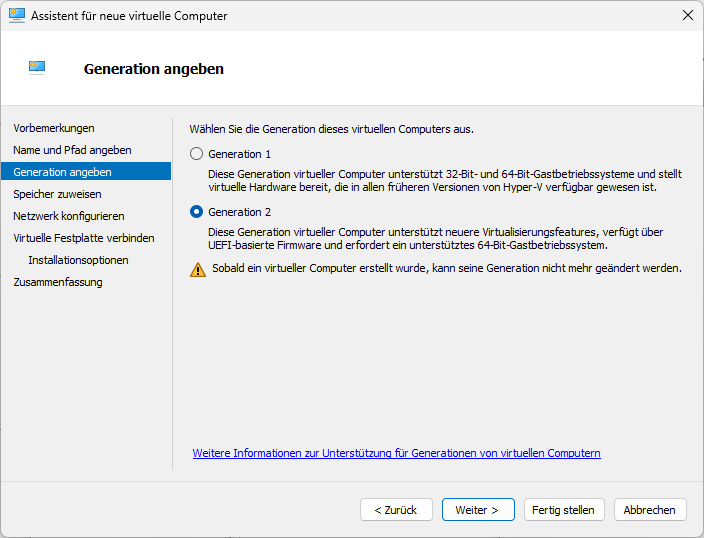
  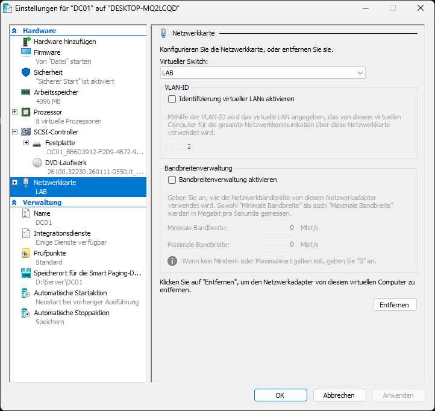
</p>
<p align="center">
  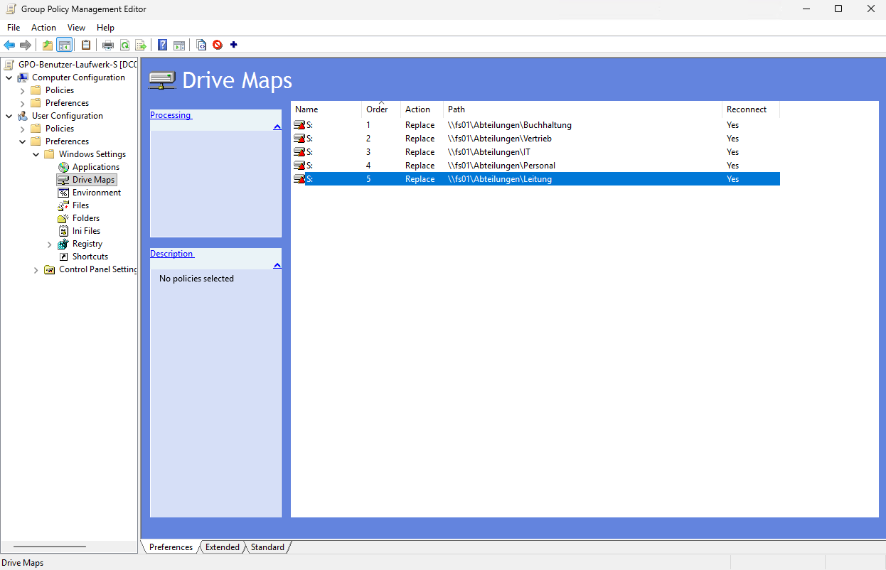
  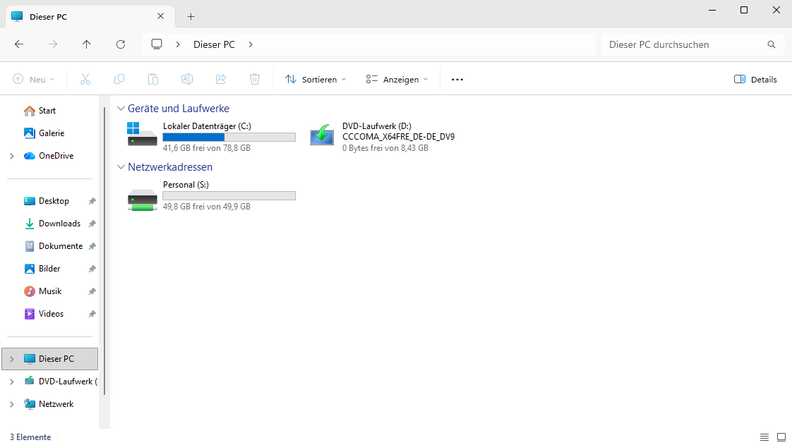
</p>
<p align="center">
  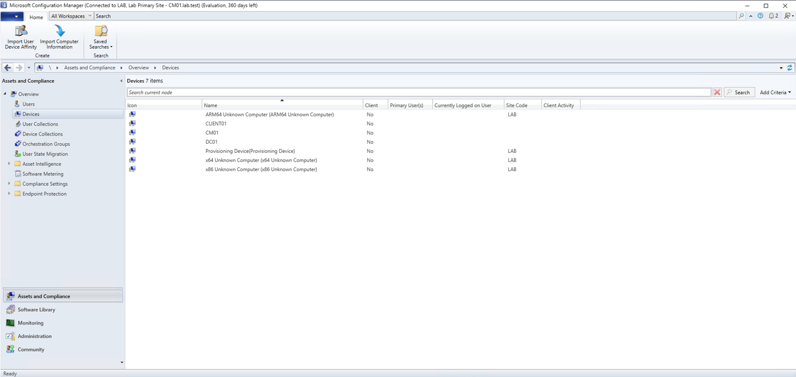
  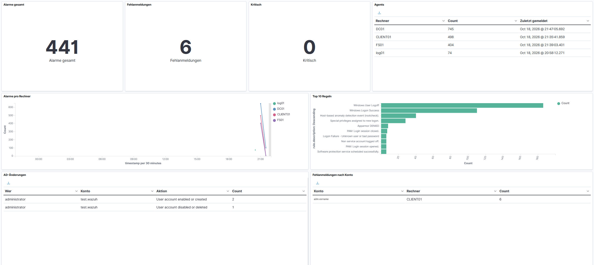
</p>

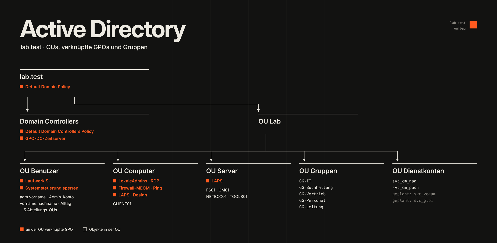

<p align="center">
  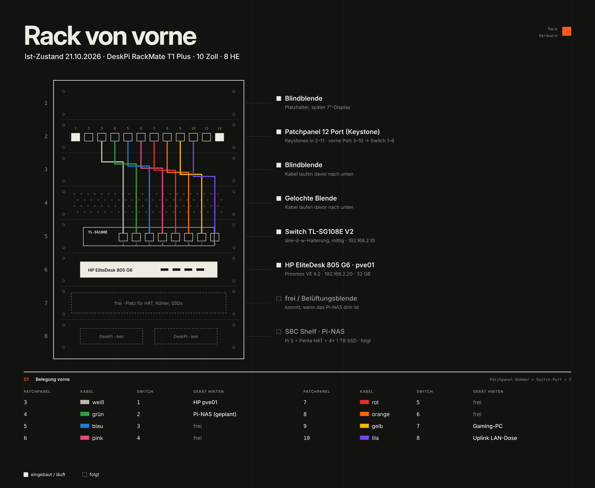
  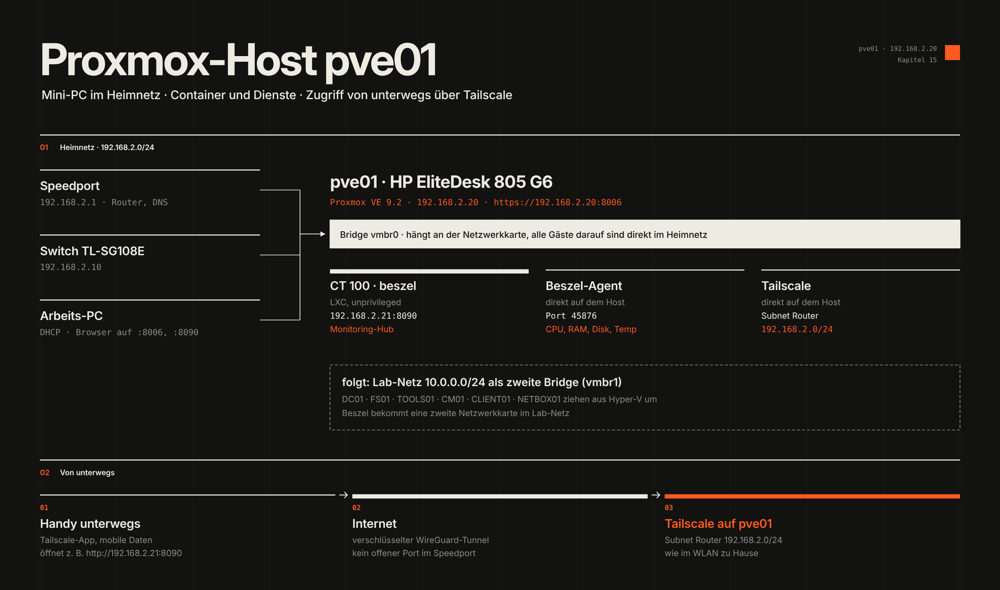
</p>

</details>

---

## Nach Thema

Jedes Kapitel hat oben Tags. Ein Klick darauf führt hierher.

| Thema | Kapitel |
|---|---|
| <a id="thema-ad"></a> | [2](docs/anleitung/02-domain-controller.md) · [3](docs/anleitung/03-dns-dhcp.md) · [4](docs/anleitung/04-ad-struktur.md) · [5](docs/anleitung/05-benutzer-per-skript.md) · [6](docs/anleitung/06-client.md) · [11](docs/anleitung/11-mecm.md) · [17](docs/anleitung/17-umzug-hyperv-proxmox.md) |
| <a id="thema-dns"></a> | [2](docs/anleitung/02-domain-controller.md) · [3](docs/anleitung/03-dns-dhcp.md) · [10](docs/anleitung/10-linux-dienste.md) · [18](docs/anleitung/18-betrieb.md) |
| <a id="thema-dhcp"></a> | [3](docs/anleitung/03-dns-dhcp.md) |
| <a id="thema-netz"></a> | [1](docs/anleitung/01-netzwerk.md) · [10](docs/anleitung/10-linux-dienste.md) · [14](docs/anleitung/14-homelable.md) · [15](docs/anleitung/15-proxmox-host.md) · [16](docs/anleitung/16-pi-nas.md) · [17](docs/anleitung/17-umzug-hyperv-proxmox.md) · [18](docs/anleitung/18-betrieb.md) · [19](docs/anleitung/19-vlan-testclient.md) · [Hardware](docs/hardware.md) |
| <a id="thema-gpo"></a> | [8](docs/anleitung/08-gruppenrichtlinien.md) · [9](docs/anleitung/09-testen.md) · [11](docs/anleitung/11-mecm.md) · [14](docs/anleitung/14-homelable.md) |
| <a id="thema-file"></a> | [7](docs/anleitung/07-dateiserver.md) · [8](docs/anleitung/08-gruppenrichtlinien.md) · [9](docs/anleitung/09-testen.md) · [16](docs/anleitung/16-pi-nas.md) |
| <a id="thema-sec"></a> | [4](docs/anleitung/04-ad-struktur.md) · [7](docs/anleitung/07-dateiserver.md) · [8](docs/anleitung/08-gruppenrichtlinien.md) · [13](docs/anleitung/13-wazuh.md) · [15](docs/anleitung/15-proxmox-host.md) |
| <a id="thema-client"></a> | [6](docs/anleitung/06-client.md) · [12](docs/anleitung/12-softwareverteilung.md) · [19](docs/anleitung/19-vlan-testclient.md) |
| <a id="thema-ps"></a> | [1](docs/anleitung/01-netzwerk.md) · [5](docs/anleitung/05-benutzer-per-skript.md) |
| <a id="thema-hyperv"></a> | [0](docs/anleitung/00-voraussetzungen.md) · [1](docs/anleitung/01-netzwerk.md) · [14](docs/anleitung/14-homelable.md) · [17](docs/anleitung/17-umzug-hyperv-proxmox.md) · [19](docs/anleitung/19-vlan-testclient.md) |
| <a id="thema-test"></a> | [9](docs/anleitung/09-testen.md) · [12](docs/anleitung/12-softwareverteilung.md) · [13](docs/anleitung/13-wazuh.md) |
| <a id="thema-linux"></a> | [10](docs/anleitung/10-linux-dienste.md) · [13](docs/anleitung/13-wazuh.md) · [14](docs/anleitung/14-homelable.md) · [15](docs/anleitung/15-proxmox-host.md) · [16](docs/anleitung/16-pi-nas.md) · [17](docs/anleitung/17-umzug-hyperv-proxmox.md) · [18](docs/anleitung/18-betrieb.md) · [20](docs/anleitung/20-rack-display.md) · [21](docs/anleitung/21-immich.md) · [22](docs/anleitung/22-vaultwarden.md) |
| <a id="thema-proxmox"></a> | [14](docs/anleitung/14-homelable.md) · [15](docs/anleitung/15-proxmox-host.md) · [16](docs/anleitung/16-pi-nas.md) · [17](docs/anleitung/17-umzug-hyperv-proxmox.md) · [18](docs/anleitung/18-betrieb.md) · [20](docs/anleitung/20-rack-display.md) · [21](docs/anleitung/21-immich.md) · [22](docs/anleitung/22-vaultwarden.md) |
| <a id="thema-mecm"></a> | [11](docs/anleitung/11-mecm.md) · [12](docs/anleitung/12-softwareverteilung.md) |

---

## Betrieb

DC01 startet immer zuerst und fährt zuletzt herunter. Ohne DC01 gibt es kein DNS.

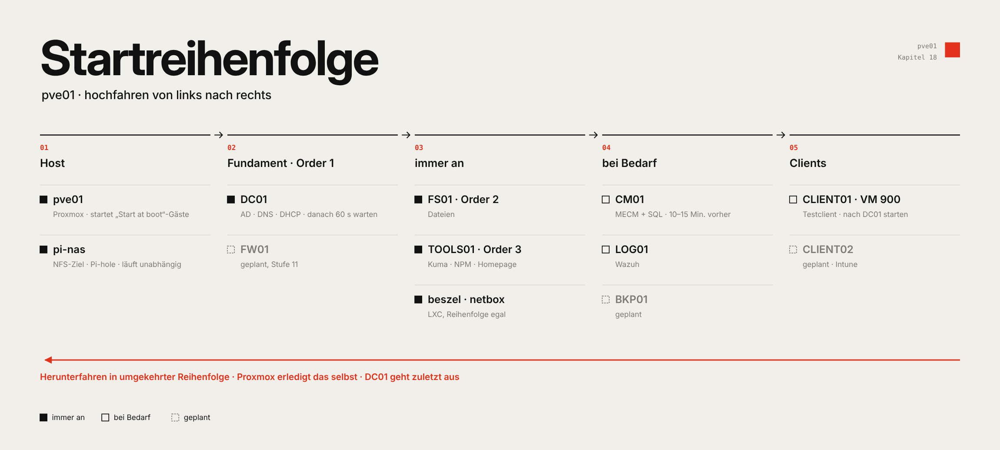

| Was | Wie |
|---|---|
| **Sicherung** | Jede Nacht 01:30 lokal und 03:30 per NFS aufs Pi-NAS (7 Tage, 4 Wochen, 3 Monate), Ergebnis per Push ([16](docs/anleitung/16-pi-nas.md), [18](docs/anleitung/18-betrieb.md#schritt-2--backup-ergebnis-aufs-handy-pve01-browser)) |
| **Überwachung** | Beszel für alle Server, Uptime Kuma für die Dienste, ein zweites Uptime Kuma auf dem Pi als Wächter von außen ([18](docs/anleitung/18-betrieb.md)) |
| **Fernzugriff** | Tailscale auf pve01 und als Ersatz auf dem Pi, kein offener Port im Router |
| **Startseite** | `home.lab.test` mit allen Diensten, Namen über Nginx Proxy Manager |

Alle Server, GPOs und Rechte im Detail: **[Aufbau](docs/aufbau.md)**

---

## Was ich dabei gelernt habe

- **Mit einem Benutzer jeder Abteilung testen.** Ein Testkonto pro Abteilung hat zwei vertauschte Ordnerrechte und ein falsches NTFS-Recht lange versteckt.
- **Fehler ohne Meldung systematisch eingrenzen.** Fehlt S:, die Kette Benutzer → Gruppe → GPO → Freigabe → NTFS von vorne prüfen, mit `gpresult /r` und `whoami /groups`, statt zu raten.
- **Rechte über Gruppen, Freigabe großzügig, NTFS streng.** So gibt es nur eine Stelle, an der Zugriffe gesteuert werden.
- **DNS zuerst.** Domänenbeitritt, Anmeldung, MECM und Reverse Proxy hängen davon ab.
- **Getrennte Konten und LAPS.** Verwaltet wird mit dem Admin-Konto, gearbeitet mit dem normalen Konto.
- **Vor jedem Umbau sichern.** Prüfpunkt oder Backup der VM und GPO-Sicherung kosten eine Minute und haben mehrmals eine Neuinstallation erspart.
- **Abhängigkeiten früh klären.** MECM braucht die richtige SQL-Sortierung und ohne eigene PKI Enhanced HTTP. Beides fällt sonst erst spät auf.
- **Hardware-Fehler eingrenzen wie Software-Fehler.** Fehler auf mehreren Platten gleichzeitig deuten auf Controller oder Verbindung, nicht auf die Platten.
- **Eine Kopie gehört woanders hin.** Backups nur auf dem Proxmox-Host helfen nicht, wenn genau der ausfällt. RAID ist kein Backup.
- **Dokumentieren, während man baut.** Jede Änderung steht im [Changelog](docs/changelog.md), IP-Adressen und VMs stehen in NetBox.

<details>
<summary><b>Fehler, aus denen ich am meisten gelernt habe</b> (9 Fälle)</summary>
<br>

| Problem | Ursache | Lösung |
|---|---|---|
| Laufwerk S: fehlt, ohne Fehlermeldung | NTFS-Rechte von zwei Ordnern vertauscht | Rechte korrigiert. Fehlt der Zugriff aufs Ziel, scheitert die Zuordnung still |
| Kollegen können Dateien der eigenen Abteilung nicht öffnen | NTFS-Recht galt nur für *This folder only* | *This folder, subfolders and files* |
| GPO macht Dienstkonto nicht zum lokalen Admin, es entsteht eine Gruppe „ad“ | Gruppenname von Hand eingetippt | Eingebaute Gruppe per Dropdown wählen |
| MECM-Client: `CCM_E_NO_CLIENT_PKI_CERT` | Site auf HTTPS only, keine PKI | Enhanced HTTP |
| Linux-VMs stürzen ab (OOM, Kernel Panic) | Dynamischer Arbeitsspeicher | Fester RAM für Linux und SQL Server |
| Proxmox startet nach dem Update nur bis `grub>` | GRUB findet seine Konfiguration nicht | Einmal von Hand booten, `grub-install` und `update-grub` |
| RAID auf dem Pi-NAS synchronisiert mit 0,5 MB/s | SATA-Controller JMB585 und Kernel 6.18 | `dtoverlay=pcie-32bit-dma-pi5` in der `config.txt` |
| Danach keine Fehler mehr, aber eine SSD liest fast nichts | Alte Samsung 840 EVO lesen lange liegende Daten extrem langsam | Alle SSDs komplett trimmen, RAID neu anlegen |
| Testclient in VLAN 10 bekommt nur 169.254.x.x | VLAN auf dem falschen Switch-Port | Port per *Port Statistics* geprüft, VLAN auf Port 5 und 7 |

Alle Fälle: [Fehlerbehebung](docs/fehlerbehebung.md)

</details>

---

## Wie es weitergeht

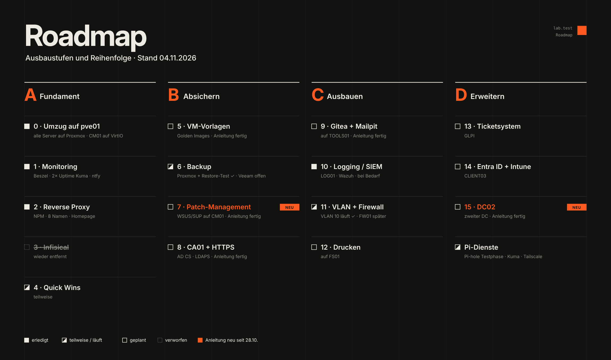

Als Nächstes: Patch-Management über MECM, ein zweiter Domain Controller, eine eigene CA und die Firewall.
Details: [Roadmap](docs/roadmap.md) · Warum etwas so gebaut ist: [Entscheidungen](docs/entscheidungen.md)

---

<details>
<summary><b>Getestet mit</b></summary>
<br>

Stand Oktober 2026.

| Komponente | Version |
|---|---|
| Hyper-V-Host (Kapitel 0–14) | Windows 11 mit Hyper-V (ab Pro), 64 GB RAM |
| Server | Windows Server 2025 Evaluation, englische Oberfläche |
| Client | Windows 11, deutsche Oberfläche |
| MECM | Configuration Manager Current Branch, Build 9141 · SQL Server 2022 Evaluation |
| Linux | Ubuntu Server 26.04 LTS mit Docker · NetBox 4.7.2 · Wazuh 4.14 |
| Proxmox | Proxmox VE 9.2 · Homelable 3.6 · Beszel 0.21 · Tailscale 1.104 |
| Mini-PC (Kapitel 15) | HP EliteDesk 805 G6 Mini, Ryzen 5 PRO 4650GE, 32 GB |
| NAS (Kapitel 16) | Raspberry Pi 5 (4 GB), Radxa Penta SATA HAT, Raspberry Pi OS Lite (Trixie), OpenMediaVault 8 |
| Switch (Kapitel 19) | TP-Link TL-SG108E V2, 802.1Q-VLAN |

</details>

<details>
<summary><b>Aufbau des Repos</b></summary>
<br>

```
docs/
  anleitung/          Schritt-für-Schritt-Anleitung, Kapitel 0–22
  bilder/             Screenshots und Fotos aus dem Lab
  diagramme/          Übersichtsgrafiken
  aufbau.md           Referenz des fertigen Labs
  hardware.md         Mini-PC, Switch und NAS im 10-Zoll-Rack
  fehlerbehebung.md   Gelöste Fehler mit Ursache und Lösung
  entscheidungen.md   Begründungen
  roadmap.md          Nächste Ausbaustufen
  changelog.md        Was wann dazukam
scripts/
  New-LabBulkUsers.ps1   Testbenutzer per CSV anlegen
  benutzer.example.csv   Beispiel-CSV
  rack-display/          Kiosk-Dashboard fürs Rack-Display (Kapitel 20)
```

</details>

---

<sub>Alle Namen, Benutzer und Adressen sind Testdaten. Kennwörter stehen nicht in diesem Repo. Nutzung auf eigene Gefahr, bitte nur in einer eigenen Testumgebung. Lizenz: Anleitung, Screenshots und Grafiken unter [CC BY 4.0](LICENSE-docs.md), Skripte unter [MIT](LICENSE).</sub>
