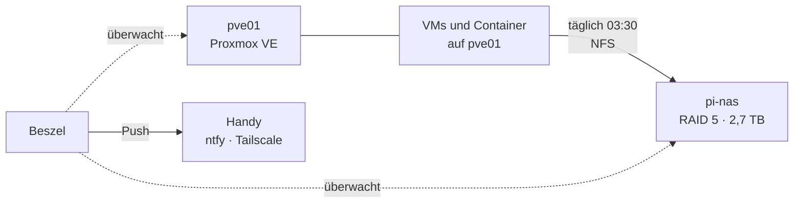
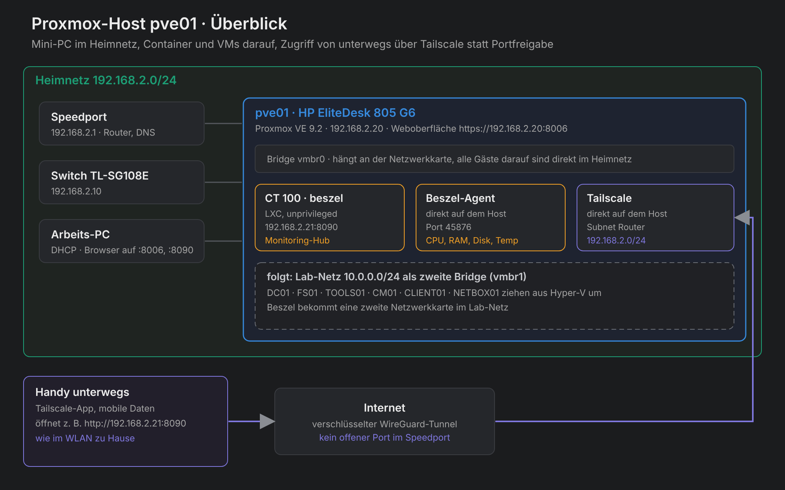

# Homelab `lab.test`

**Ein Windows-Firmennetz zum Nachbauen, Schritt für Schritt.** Von der ersten VM in Hyper-V über Active Directory, Gruppenrichtlinien und MECM bis zum eigenen 10-Zoll-Rack mit Proxmox-Mini-PC und Raspberry-Pi-NAS.


> [!NOTE]
> **Stand 25.10.2026:** Alle Server (DC01, FS01, TOOLS01, CM01, LOG01) sind aus Hyper-V auf den Mini-PC `pve01` mit Proxmox umgezogen ([Kapitel 17](docs/anleitung/17-umzug-hyperv-proxmox.md)). Das Pi-NAS sichert jede Nacht alle VMs und Container. Hyper-V auf dem Arbeits-PC bleibt nur noch für Testclients. Beszel, zwei Uptime Kumas und Proxmox melden Ausfälle und Backup-Ergebnisse per Push aufs Handy ([Kapitel 18](docs/anleitung/18-betrieb.md)). Was wann dazukam: [Changelog](docs/changelog.md)

---

## Inhaltsverzeichnis

- [Einführung](#einführung) · [Welcher Weg passt zu dir?](#welcher-weg-passt-zu-dir) · [Getestet mit](#getestet-mit)
- **Die Anleitung**
  - [Teil 1 · Vorbereitung](#teil-1--vorbereitung): [0 · Voraussetzungen](docs/anleitung/00-voraussetzungen.md) · [1 · Netzwerk](docs/anleitung/01-netzwerk.md)
  - [Teil 2 · Active Directory](#teil-2--active-directory): [2 · Domain Controller](docs/anleitung/02-domain-controller.md) · [3 · DNS und DHCP](docs/anleitung/03-dns-dhcp.md) · [4 · AD-Struktur](docs/anleitung/04-ad-struktur.md) · [5 · Benutzer per Skript](docs/anleitung/05-benutzer-per-skript.md)
  - [Teil 3 · Client, Dateiserver und Gruppenrichtlinien](#teil-3--client-dateiserver-und-gruppenrichtlinien): [6 · Client](docs/anleitung/06-client.md) · [7 · Dateiserver](docs/anleitung/07-dateiserver.md) · [8 · Gruppenrichtlinien](docs/anleitung/08-gruppenrichtlinien.md)
  - [Teil 4 · Testen](#teil-4--testen): [9 · Testen](docs/anleitung/09-testen.md)
  - [Teil 5 · Erweiterungen: Linux, MECM und Sicherheit](#teil-5--erweiterungen-linux-mecm-und-sicherheit): [10 · Linux-Dienste](docs/anleitung/10-linux-dienste.md) · [11 · MECM](docs/anleitung/11-mecm.md) · [12 · Software verteilen](docs/anleitung/12-softwareverteilung.md) · [13 · Wazuh](docs/anleitung/13-wazuh.md) · [14 · Homelable](docs/anleitung/14-homelable.md)
  - [Teil 6 · Eigene Hardware: Proxmox, Rack und NAS](#teil-6--eigene-hardware-proxmox-rack-und-nas): [15 · Proxmox auf dem Mini-PC](docs/anleitung/15-proxmox-host.md) · [16 · NAS mit Raspberry Pi](docs/anleitung/16-pi-nas.md) · [17 · Umzug von Hyper-V](docs/anleitung/17-umzug-hyperv-proxmox.md) · [18 · Betrieb](docs/anleitung/18-betrieb.md) · [Hardware und Rack](docs/hardware.md)
- [Nach Thema](#nach-thema)
- [Betrieb: Starten, Stoppen, Sichern](#betrieb-starten-stoppen-sichern)
- [Fehler, aus denen ich am meisten gelernt habe](#fehler-aus-denen-ich-am-meisten-gelernt-habe)
- [Was ich dabei gelernt habe](#was-ich-dabei-gelernt-habe)
- [Wie es weitergeht](#wie-es-weitergeht)
- [Aufbau des Repos](#aufbau-des-repos)

---

## Einführung

Ich habe dieses Lab als Junior Admin aufgebaut, um Alltagsaufgaben aus der Firma gefahrlos zu üben: Benutzer anlegen, Rechte vergeben, Laufwerke verteilen, Software ausrollen. Die Anleitung beschreibt jeden Schritt so, dass du ihn nachklicken kannst, **inklusive der Fehler, die mir dabei passiert sind**, und wie man sie findet.

**Für wen:** Azubis und Einsteiger in der Systemintegration und alle, die sich auf ein Vorstellungsgespräch als Windows-Admin vorbereiten.

**Was am Ende läuft:**

| Bereich | Was du baust |
|---|---|
| Active Directory | Domäne `lab.test` mit OU-Struktur unter `Lab/`, rund 120 Testbenutzer in 5 Abteilungen per [Skript](scripts/New-LabBulkUsers.ps1) |
| Dateiserver | Freigabe `\\fs01\Abteilungen`, jeder sieht nur seinen Abteilungsordner, Laufwerk **S:** automatisch je nach Abteilung |
| Sicherheit | RDP nur für bestimmte Abteilungen, Windows LAPS, getrennte Admin-Konten, Wazuh meldet Fehlanmeldungen und neue Konten |
| Softwareverteilung | MECM mit Client-Push, Anwendungen im Softwarecenter und als Pflicht-Installation |
| Betrieb | Uptime Kuma, Beszel, Nginx Proxy Manager, NetBox, Homepage als Startseite (Netdata, Warpgate und Homelable waren eine Zeit lang dabei, ihre Kapitel bleiben als Anleitung) |
| Eigene Hardware | Mini-PC mit Proxmox im 10-Zoll-Rack, alle Server dorthin umgezogen, Pi-NAS mit RAID 5 für nächtliche Backups, Pi-hole, Fernzugriff über Tailscale |
| Dauerbetrieb | Alarme und Backup-Berichte per Push aufs Handy, zweiter Wächter auf dem Pi, Startseite mit allen Diensten |

**So sind die Kapitel aufgebaut:** Ziel und Dauer · nummerierte Schritte mit Angabe, auf welchem Rechner du gerade bist · Prüfen · häufige Fehler. Rund 80 Screenshots und Fotos stammen direkt aus dem Lab. Gearbeitet wird überwiegend mit der Oberfläche, Befehle nur dort, wo es deutlich schneller ist.

> [!TIP]
> Die Server laufen auf Englisch. Klickwege stehen deshalb so da: **English name** (deutscher Name).

### Welcher Weg passt zu dir?

| Du willst … | Dann | Du brauchst | Zeit |
|---|---|---|---|
| ein Windows-Firmennetz verstehen und üben | Teil 1–4 | einen PC mit Windows 11 Pro und 32–64 GB RAM | ca. 1 Tag |
| zusätzlich Werkzeuge aus dem Firmenalltag | Teil 5, Kapitel einzeln wählbar | denselben PC, MECM braucht viel RAM | je 1–4 Stunden |
| das Lab rund um die Uhr laufen lassen | Teil 6 | Mini-PC, optional Rack, Switch und Raspberry Pi | ca. 1 Wochenende |

### Getestet mit

Stand Oktober 2026.

| Komponente | Version |
|---|---|
| Hyper-V-Host (Kapitel 0–14) | Windows 11 mit Hyper-V (ab Pro), 64 GB RAM |
| Server | Windows Server 2025 Evaluation, englische Oberfläche |
| Client | Windows 11, deutsche Oberfläche |
| MECM | Configuration Manager Current Branch, Build 9141 · SQL Server 2022 Evaluation |
| Linux | Ubuntu Server 26.04 LTS mit Docker · NetBox 4.7.2 · Wazuh 4.14 |
| Proxmox | Proxmox VE 9.2 · Homelable 3.6 · Beszel 0.21 · Tailscale 1.104 |
| Mini-PC (Kapitel 15) | HP EliteDesk 805 G6 Mini, Ryzen 5 PRO 4650GE, 32 GB |
| NAS (Kapitel 16) | Raspberry Pi 5 (4 GB), Radxa Penta SATA HAT, Raspberry Pi OS Lite (Trixie), OpenMediaVault 8 |

---

## Teil 1 · Vorbereitung

Bevor die erste VM läuft: Hardware prüfen, Hyper-V einschalten und ein eigenes Netz für das Lab bauen.

| Kapitel | Was du machst | Dauer |
|---|---|---|
| [0 · Voraussetzungen](docs/anleitung/00-voraussetzungen.md) | Hardware, ISOs herunterladen, Hyper-V aktivieren, VM-Assistent | 30 Min. |
| [1 · Netzwerk](docs/anleitung/01-netzwerk.md) | Interner Switch `LAB` mit NAT, damit die VMs ins Internet kommen | 10 Min. |

<p align="center">
  
  
</p>

**[→ Los geht's mit Kapitel 0](docs/anleitung/00-voraussetzungen.md)**

---

## Teil 2 · Active Directory

Das Herz des Labs: DC01 wird Domain Controller für `lab.test`, bekommt DNS und DHCP, und du legst die Struktur an, an die später alle Richtlinien gehängt werden.

| Kapitel | Was du machst | Dauer |
|---|---|---|
| [2 · Domain Controller](docs/anleitung/02-domain-controller.md) | Windows Server installieren, AD DS, neue Gesamtstruktur `lab.test` | 45 Min. |
| [3 · DNS und DHCP](docs/anleitung/03-dns-dhcp.md) | Reverse-Zone, A- und PTR-Einträge, DHCP-Bereich, AD-Subnetz | 20 Min. |
| [4 · AD-Struktur](docs/anleitung/04-ad-struktur.md) | OUs, Abteilungsgruppen, getrennte Admin-Konten, AD-Papierkorb | 30 Min. |
| [5 · Benutzer per Skript](docs/anleitung/05-benutzer-per-skript.md) | Über 100 Testbenutzer aus einer CSV, mit Probelauf | 15 Min. |


<sub>Stand des fertigen Labs. Einige GPOs (Systemsteuerung sperren, Ping, Design, Firewall für MECM) gehen über die Anleitung hinaus und sind in der [Aufbau-Referenz](docs/aufbau.md#gruppenrichtlinien) beschrieben.</sub>

**[→ Weiter mit Kapitel 2](docs/anleitung/02-domain-controller.md)**

---

## Teil 3 · Client, Dateiserver und Gruppenrichtlinien

Jetzt wird es ein echtes Firmennetz: ein Windows-11-Client tritt der Domäne bei, FS01 stellt Abteilungsordner bereit, und Gruppenrichtlinien verteilen Laufwerke und Rechte.

| Kapitel | Was du machst | Dauer |
|---|---|---|
| [6 · Client](docs/anleitung/06-client.md) | Windows 11 installieren und der Domäne beitreten | 40 Min. |
| [7 · Dateiserver](docs/anleitung/07-dateiserver.md) | Zweite Platte, Freigabe, NTFS-Rechte pro Abteilung, zugriffsbasierte Aufzählung | 60 Min. |
| [8 · Gruppenrichtlinien](docs/anleitung/08-gruppenrichtlinien.md) | Laufwerk S:, RDP für bestimmte Abteilungen, Windows LAPS, Zeitquelle | 60 Min. |

<p align="center">
  
  
</p>

**[→ Weiter mit Kapitel 6](docs/anleitung/06-client.md)**

---

## Teil 4 · Testen

Mit einem Benutzer **jeder** Abteilung prüfen, ob Laufwerk, Ordner und RDP so funktionieren wie geplant. Hier findest du die Fehler, die beim Einrichten nicht auffallen.

| Kapitel | Was du machst | Dauer |
|---|---|---|
| [9 · Testen](docs/anleitung/09-testen.md) | Testplan pro Abteilung, `gpresult`, was tun, wenn S: fehlt | 30 Min. |

**[→ Weiter mit Kapitel 9](docs/anleitung/09-testen.md)**

---

## Teil 5 · Erweiterungen: Linux, MECM und Sicherheit

Optional und einzeln wählbar: eine Ubuntu-VM mit Docker für Überwachung und Verwaltung, ein Configuration Manager, wie er in vielen Firmen läuft, ein SIEM und eine Karte des ganzen Labs mit Live-Status.

| Kapitel | Was du machst | Dauer |
|---|---|---|
| [10 · Linux-Dienste](docs/anleitung/10-linux-dienste.md) | Ubuntu, Docker, Uptime Kuma, Nginx Proxy Manager, NetBox | 1,5 Std. |
| [11 · MECM](docs/anleitung/11-mecm.md) | SQL Server, Configuration Manager, Enhanced HTTP, Client-Push | 3–4 Std. |
| [12 · Software verteilen](docs/anleitung/12-softwareverteilung.md) | 7-Zip als Anwendung, Softwarecenter, Pflicht-Installation | 45 Min. |
| [13 · Wazuh](docs/anleitung/13-wazuh.md) | SIEM auf LOG01, Agents auf allen Windows-Rechnern, Fehlanmeldungen erkennen | 1,5 Std. |
| [14 · Homelable](docs/anleitung/14-homelable.md) | Proxmox als VM in Hyper-V, Netzwerkkarte des Labs mit Live-Status | 1,5 Std. |

<p align="center">
  
  
</p>

**[→ Weiter mit Kapitel 10](docs/anleitung/10-linux-dienste.md)**

---

## Teil 6 · Eigene Hardware: Proxmox, Rack und NAS

Damit das Lab rund um die Uhr läuft, ohne dass der große PC an sein muss: ein sparsamer Mini-PC mit Proxmox im 10-Zoll-Rack und ein Raspberry Pi als NAS, auf das jede Nacht gesichert wird.

| Kapitel | Was du machst | Dauer |
|---|---|---|
| [15 · Proxmox auf dem Mini-PC](docs/anleitung/15-proxmox-host.md) | Mini-PC aufrüsten, Proxmox installieren, Speicher, Monitoring mit Beszel, Fernzugriff mit Tailscale | 3 Std. |
| [16 · NAS mit Raspberry Pi](docs/anleitung/16-pi-nas.md) | Pi 5 mit Penta SATA HAT, OpenMediaVault, RAID 5, NFS, nächtliche Proxmox-Backups, Alarme aufs Handy | 3 Std. |
| [17 · Umzug von Hyper-V auf Proxmox](docs/anleitung/17-umzug-hyperv-proxmox.md) | VHDX übernehmen, Linux-Treiber nachrüsten, Netzwerk und Guest Agent, Arbeits-PC umstellen | 3–4 Std. |
| [18 · Betrieb: Monitoring, Alarme, Startseite](docs/anleitung/18-betrieb.md) | Alarme aufs Handy, Backup-Berichte, zweiter Wächter und Pi-hole auf dem Pi, Homepage, Namen über den Proxy, Notzugang | 3 Std. |
| [Hardware und Rack](docs/hardware.md) | Rack-Belegung, Patchpanel, Verkabelung, Managed Switch | – |



<p align="center">
  
  
</p>

**[→ Weiter mit Kapitel 15](docs/anleitung/15-proxmox-host.md)**

---

## Nach Thema

Jedes Kapitel hat oben Tags. Ein Klick auf einen Tag führt hierher, zu allen Kapiteln mit diesem Thema.

| Thema | Kapitel |
|---|---|
| <a id="thema-ad"></a> | [2 · Domain Controller](docs/anleitung/02-domain-controller.md) · [3 · DNS und DHCP](docs/anleitung/03-dns-dhcp.md) · [4 · AD-Struktur](docs/anleitung/04-ad-struktur.md) · [5 · Benutzer per Skript](docs/anleitung/05-benutzer-per-skript.md) · [6 · Client](docs/anleitung/06-client.md) · [11 · MECM](docs/anleitung/11-mecm.md) · [17 · Umzug](docs/anleitung/17-umzug-hyperv-proxmox.md) |
| <a id="thema-dns"></a> | [2 · Domain Controller](docs/anleitung/02-domain-controller.md) · [3 · DNS und DHCP](docs/anleitung/03-dns-dhcp.md) · [10 · Linux-Dienste](docs/anleitung/10-linux-dienste.md) · [18 · Betrieb](docs/anleitung/18-betrieb.md) |
| <a id="thema-dhcp"></a> | [3 · DNS und DHCP](docs/anleitung/03-dns-dhcp.md) |
| <a id="thema-netz"></a> | [1 · Netzwerk](docs/anleitung/01-netzwerk.md) · [10 · Linux-Dienste](docs/anleitung/10-linux-dienste.md) · [14 · Homelable](docs/anleitung/14-homelable.md) · [15 · Proxmox-Host](docs/anleitung/15-proxmox-host.md) · [16 · Pi-NAS](docs/anleitung/16-pi-nas.md) · [Hardware](docs/hardware.md) · [17 · Umzug](docs/anleitung/17-umzug-hyperv-proxmox.md) · [18 · Betrieb](docs/anleitung/18-betrieb.md) |
| <a id="thema-gpo"></a> | [8 · Gruppenrichtlinien](docs/anleitung/08-gruppenrichtlinien.md) · [9 · Testen](docs/anleitung/09-testen.md) · [11 · MECM](docs/anleitung/11-mecm.md) · [14 · Homelable](docs/anleitung/14-homelable.md) |
| <a id="thema-file"></a> | [7 · Dateiserver](docs/anleitung/07-dateiserver.md) · [8 · Gruppenrichtlinien](docs/anleitung/08-gruppenrichtlinien.md) · [9 · Testen](docs/anleitung/09-testen.md) · [16 · Pi-NAS](docs/anleitung/16-pi-nas.md) |
| <a id="thema-sec"></a> | [4 · AD-Struktur](docs/anleitung/04-ad-struktur.md) · [7 · Dateiserver](docs/anleitung/07-dateiserver.md) · [8 · Gruppenrichtlinien](docs/anleitung/08-gruppenrichtlinien.md) · [13 · Wazuh](docs/anleitung/13-wazuh.md) · [15 · Proxmox-Host](docs/anleitung/15-proxmox-host.md) |
| <a id="thema-client"></a> | [6 · Client](docs/anleitung/06-client.md) · [12 · Software verteilen](docs/anleitung/12-softwareverteilung.md) |
| <a id="thema-ps"></a> | [1 · Netzwerk](docs/anleitung/01-netzwerk.md) · [5 · Benutzer per Skript](docs/anleitung/05-benutzer-per-skript.md) |
| <a id="thema-hyperv"></a> | [0 · Voraussetzungen](docs/anleitung/00-voraussetzungen.md) · [1 · Netzwerk](docs/anleitung/01-netzwerk.md) · [14 · Homelable](docs/anleitung/14-homelable.md) · [17 · Umzug](docs/anleitung/17-umzug-hyperv-proxmox.md) |
| <a id="thema-test"></a> | [9 · Testen](docs/anleitung/09-testen.md) · [12 · Software verteilen](docs/anleitung/12-softwareverteilung.md) · [13 · Wazuh](docs/anleitung/13-wazuh.md) |
| <a id="thema-linux"></a> | [10 · Linux-Dienste](docs/anleitung/10-linux-dienste.md) · [13 · Wazuh](docs/anleitung/13-wazuh.md) · [14 · Homelable](docs/anleitung/14-homelable.md) · [15 · Proxmox-Host](docs/anleitung/15-proxmox-host.md) · [16 · Pi-NAS](docs/anleitung/16-pi-nas.md) · [17 · Umzug](docs/anleitung/17-umzug-hyperv-proxmox.md) · [18 · Betrieb](docs/anleitung/18-betrieb.md) |
| <a id="thema-proxmox"></a> | [14 · Homelable](docs/anleitung/14-homelable.md) · [15 · Proxmox-Host](docs/anleitung/15-proxmox-host.md) · [16 · Pi-NAS](docs/anleitung/16-pi-nas.md) · [17 · Umzug](docs/anleitung/17-umzug-hyperv-proxmox.md) · [18 · Betrieb](docs/anleitung/18-betrieb.md) |
| <a id="thema-mecm"></a> | [11 · MECM](docs/anleitung/11-mecm.md) · [12 · Software verteilen](docs/anleitung/12-softwareverteilung.md) |

---

## Betrieb: Starten, Stoppen, Sichern

DC01 startet immer zuerst und fährt zuletzt herunter. Ohne DC01 gibt es kein DNS, und die anderen VMs laufen in Fehler.


| Was | Wie |
|---|---|
| Sicherung | Proxmox sichert jede Nacht um 01:30 lokal und um 03:30 per NFS aufs Pi-NAS (7 Tage, 4 Wochen, 3 Monate), Ergebnis per Push. Bedarfs-VMs von Hand ([Kapitel 16](docs/anleitung/16-pi-nas.md), [18](docs/anleitung/18-betrieb.md#schritt-2--backup-ergebnis-aufs-handy-pve01-browser)) |
| Überwachung | Beszel für alle Server, Uptime Kuma auf TOOLS01 für die Dienste, ein zweites Uptime Kuma auf dem Pi für pve01 selbst, alles mit Push aufs Handy ([Kapitel 18](docs/anleitung/18-betrieb.md)) |
| Fernzugriff | Tailscale auf pve01 und als Ersatz auf dem Pi, kein offener Port im Router |
| Startseite | Homepage unter `home.lab.test` mit allen Diensten, Namen über Nginx Proxy Manager |

Alle Server, GPOs und Rechte im fertigen Lab: [Aufbau](docs/aufbau.md)

---

## Fehler, aus denen ich am meisten gelernt habe

| Problem | Ursache | Lösung |
|---|---|---|
| Laufwerk S: fehlt, ohne Fehlermeldung | NTFS-Rechte von zwei Ordnern beim Anlegen vertauscht | Rechte korrigiert. Fehlt der Zugriff aufs Ziel, scheitert die Zuordnung still |
| Kollegen können Dateien der eigenen Abteilung nicht öffnen | NTFS-Recht galt nur für *This folder only* | *This folder, subfolders and files* |
| GPO macht Dienstkonto nicht zum lokalen Admin, es entsteht eine Gruppe „ad“ | Gruppenname von Hand eingetippt | Eingebaute Gruppe per Dropdown wählen |
| MECM-Client: `CCM_E_NO_CLIENT_PKI_CERT` | Site auf HTTPS only, keine PKI | Enhanced HTTP |
| Linux-VMs stürzen ab (OOM, Kernel Panic) | Dynamischer Arbeitsspeicher | Fester RAM für Linux und SQL Server |
| Proxmox startet nach dem Update nur bis `grub>` | GRUB findet seine Konfiguration nicht | Einmal von Hand booten, `grub-install` und `update-grub` |
| RAID auf dem Pi-NAS synchronisiert mit 0,5 MB/s, Timeouts auf mehreren SSDs | SATA-Controller JMB585 und Kernel 6.18 | `dtoverlay=pcie-32bit-dma-pi5` in der `config.txt` |
| Danach keine Fehler mehr, aber eine SSD liest fast nichts | Alte Samsung 840 EVO lesen lange liegende Daten extrem langsam | Alle SSDs komplett trimmen, RAID neu anlegen |

Alle Fälle: [Fehlerbehebung](docs/fehlerbehebung.md)

---

## Was ich dabei gelernt habe

- **Mit einem Benutzer jeder Abteilung testen.** Ein Testkonto pro Abteilung hat zwei vertauschte Ordnerrechte und ein falsches NTFS-Recht lange versteckt. Erst der Test mit Kollegen aus derselben Abteilung hat sie gezeigt.
- **Fehler ohne Meldung systematisch eingrenzen.** Wenn S: einfach fehlt, die Kette Benutzer → Gruppe → GPO → Freigabe → NTFS von vorne prüfen, mit `gpresult /r` und `whoami /groups`, statt zu raten.
- **Rechte über Gruppen, Freigabe großzügig, NTFS streng.** So gibt es nur eine Stelle, an der Zugriffe gesteuert werden.
- **DNS zuerst.** Domänenbeitritt, Anmeldung, MECM und Reverse Proxy hängen davon ab. Ein falscher PTR-Eintrag ist lange nicht aufgefallen.
- **Getrennte Konten und LAPS.** Verwaltet wird mit dem Admin-Konto, gearbeitet mit dem normalen Konto, und jeder Rechner hat ein eigenes lokales Admin-Kennwort.
- **Vor jedem Umbau sichern.** Prüfpunkt der VM und GPO-Sicherung kosten eine Minute und haben mehrmals eine Neuinstallation erspart.
- **Abhängigkeiten früh klären.** MECM braucht die richtige SQL-Sortierung und ohne eigene PKI Enhanced HTTP. Beides fällt erst spät auf, wenn man es nicht vorher weiß.
- **Hardware-Fehler eingrenzen wie Software-Fehler.** Fehler auf mehreren Platten gleichzeitig deuten auf Controller oder Verbindung. Jede Platte einzeln testen trennt in einer Minute „Platte langsam“ von „Controller kaputt“.
- **Eine Kopie gehört woanders hin.** Backups nur auf dem Proxmox-Host helfen nicht, wenn genau der ausfällt. Deshalb die zweite Kopie aufs NAS, und RAID ist dabei kein Ersatz für ein Backup.
- **Dokumentieren, während man baut.** Jede Änderung steht im [Changelog](docs/changelog.md), IP-Adressen und VMs stehen in NetBox.

---

## Wie es weitergeht


Der Umzug auf eigene Hardware ist abgeschlossen. Als Nächstes: Testclient in Hyper-V an das neue Lab-Netz anbinden, dann Gitea und Mailpit, eine eigene CA und die Firewall.

Details: [Roadmap](docs/roadmap.md) · Eigene Hardware im 10-Zoll-Rack: [Hardware](docs/hardware.md) · Warum etwas so gebaut ist: [Entscheidungen](docs/entscheidungen.md) · Was wann dazukam: [Changelog](docs/changelog.md)

---

## Aufbau des Repos

```
docs/
  anleitung/          Schritt-für-Schritt-Anleitung, Kapitel 0–18
  bilder/             Screenshots und Fotos aus dem Lab
  diagramme/          Übersichtsgrafiken
  aufbau.md           Referenz des fertigen Labs
  hardware.md         Mini-PC, Switch und NAS im 10-Zoll-Rack
  fehlerbehebung.md   Gelöste Fehler mit Ursache und Lösung
  entscheidungen.md   Begründungen
  roadmap.md          Nächste Ausbaustufen
  changelog.md        Was wann dazukam
scripts/
  New-LabBulkUsers.ps1   Testbenutzer per CSV anlegen
  benutzer.example.csv   Beispiel-CSV
```

---

Alle Namen, Benutzer und Adressen sind Testdaten. Kennwörter stehen nicht in diesem Repo. Nutzung auf eigene Gefahr, bitte nur in einer eigenen Testumgebung.

Lizenz: Anleitung, Screenshots und Grafiken unter [CC BY 4.0](LICENSE-docs.md), Skripte unter [MIT](LICENSE).
