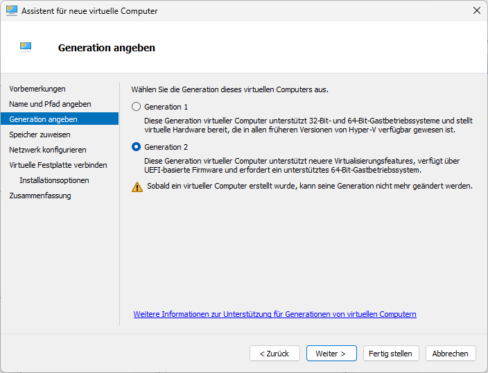
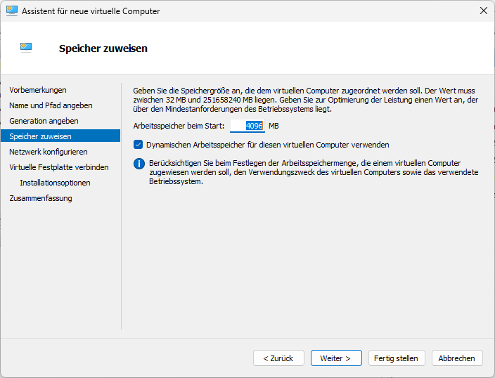
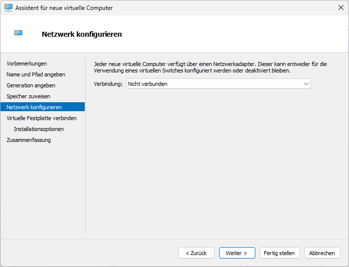
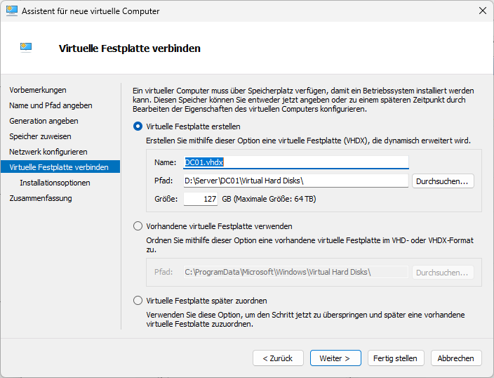
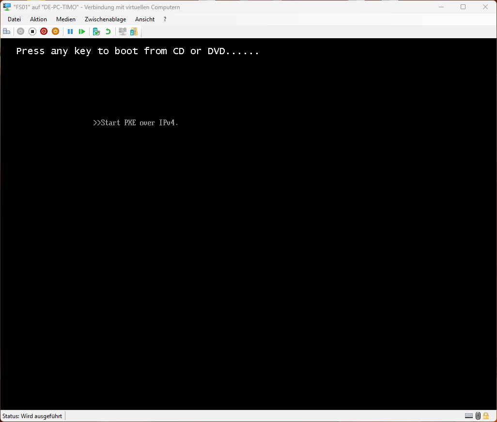
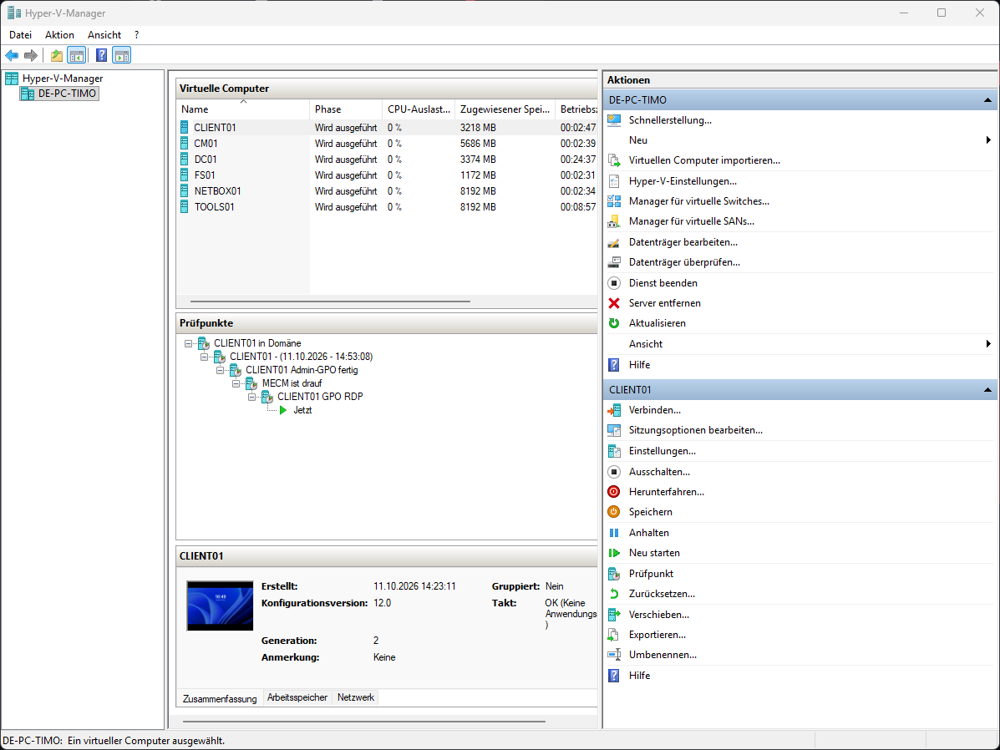

# Kapitel 0 · Voraussetzungen

[Übersicht](../../README.md#anleitung) · weiter: [Kapitel 1 · Netzwerk →](01-netzwerk.md)

> **Ziel:** Hardware prüfen, Software besorgen, Hyper-V einschalten und eine Vorlage für neue VMs kennen.
> **Dauer:** ca. 30 Minuten (plus Downloads) · **Wo:** auf deinem PC (Host)

## Hardware

| | Minimum | Empfohlen |
|---|---|---|
| Arbeitsspeicher | 16 GB (DC, Dateiserver, Client) | 32 GB, mit MECM 64 GB |
| Prozessor | 4 Kerne mit Virtualisierung (Intel VT-x / AMD-V im BIOS aktiv) | 6 Kerne oder mehr |
| Speicher | 200 GB SSD | 500 GB SSD |

## Software

| Was | Woher | Hinweis |
|---|---|---|
| Windows 10/11 **Pro** oder Enterprise als Host | – | Windows Home kann kein Hyper-V |
| Windows Server 2025 Evaluation (ISO) | Microsoft Evaluation Center | 180 Tage kostenlos, verlängerbar mit `slmgr /rearm` |
| Windows 11 Enterprise Evaluation oder Pro (ISO) | Microsoft Evaluation Center bzw. Media Creation Tool | Für den Testclient |
| Ubuntu Server LTS (ISO) | ubuntu.com | Nur für Kapitel 10 |

Lege alle ISOs und VMs in einen eigenen Ordner, z. B. `D:\Server\`.

## Schritt 1 · Hyper-V aktivieren

1. Startmenü → **Windows-Features aktivieren oder deaktivieren**
2. Haken bei **Hyper-V** inklusive aller Unterpunkte → **OK**
3. Neu starten

Danach gibt es im Startmenü den **Hyper-V-Manager**.

## Schritt 2 · So legst du in diesem Lab jede VM an

Alle VMs entstehen über denselben Assistenten: Hyper-V-Manager → rechts **Neu → Virtueller Computer**.

| Seite im Assistenten | Einstellung |
|---|---|
| Name und Pfad | Name der VM (z. B. `DC01`), Haken bei *Virtuellen Computer an einem anderen Speicherort speichern* → `D:\Server\` |
| Generation angeben | **Generation 2** |
| Speicher zuweisen | siehe jeweiliges Kapitel. Für Windows-Installationen **4096 MB, dynamisch aus** |
| Netzwerk konfigurieren | Switch **LAB** (gibt es ab Kapitel 1) |
| Virtuelle Festplatte | Neue VHDX im VM-Ordner, Größe siehe Kapitel |
| Installationsoptionen | *Betriebssystem von startbarer Image-Datei installieren* → ISO auswählen |

  
  

  
  

> [!WARNING]
> Mit **dynamischem Arbeitsspeicher** und 2 GB Startwert bricht das Windows-Setup gern mit *„Windows Server installation has failed“* ab. Während der Installation immer 4 GB fest geben. Danach kann man wieder auf dynamisch stellen.

> [!TIP]
> Beim ersten Start einer VM sofort ins Fenster klicken und die Leertaste drücken, sobald *„Press any key to boot from CD or DVD“* erscheint. Sonst startet die VM über das Netzwerk (PXE) und bleibt hängen:
>
> 

## Schritt 3 · Prüfpunkte nutzen

Vor jedem größeren Schritt einen **Prüfpunkt** setzen: Rechtsklick auf die VM → **Prüfpunkt** → sinnvoll benennen (z. B. *„DC01 vor DHCP“*). Geht etwas schief, bist du mit einem Klick zurück.

> [!NOTE]
> Prüfpunkte sind **keine Sicherung**. Sie liegen auf derselben Platte wie die VM. Für Domain Controller und Dateiserver gehört zusätzlich eine echte Sicherung dazu (siehe [Roadmap](../roadmap.md)).

## Namen und Adressen in dieser Anleitung

| Was | Wert |
|---|---|
| Domäne | `lab.test` (NetBIOS `LAB`) |
| Netz | `10.0.0.0/24` |
| Gateway (Host) | `10.0.0.1` |
| DC01 | `10.0.0.10` |
| CM01 (optional) | `10.0.0.20` |
| FS01 | `10.0.0.40` |
| TOOLS01 (optional) | `10.0.0.50` |
| DHCP-Bereich | `10.0.0.100` – `10.0.0.200` |

`.test` ist eine reservierte Endung, die es im Internet nie geben wird. Für ein Lab ist das sicherer als eine echte Domain oder `.local`.
