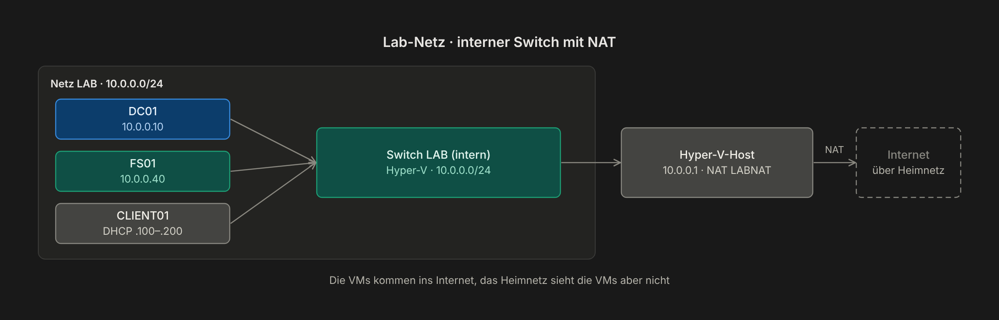

# Kapitel 1 · Netzwerk: eigener Switch mit NAT

[← Kapitel 0](00-voraussetzungen.md) · [Übersicht](../../README.md#inhaltsverzeichnis) · weiter: [Kapitel 2 · Domain Controller →](02-domain-controller.md)

> **Ziel:** Ein eigenes Lab-Netz `10.0.0.0/24`, das über den Host ins Internet kommt, ohne dein Heimnetz zu stören.
> **Dauer:** ca. 10 Minuten · **Wo:** auf dem Host

## Warum ein eigenes Netz?

Der DHCP-Server im Lab (Kapitel 3) würde in deinem Heimnetz echten Geräten Adressen verteilen. Deshalb bekommt das Lab einen **internen** Switch. Der Host spielt den Router und leitet per **NAT** ins Internet weiter.



## Schritt 1 · Switch und NAT anlegen

Das geht nur per PowerShell. Auf dem **Host** PowerShell **als Administrator** öffnen:

```powershell
# 1. Interner Switch
New-VMSwitch -Name "LAB" -SwitchType Internal

# 2. Der Host bekommt im Lab-Netz die Adresse 10.0.0.1 (= Gateway der VMs)
New-NetIPAddress -IPAddress 10.0.0.1 -PrefixLength 24 -InterfaceAlias "vEthernet (LAB)"

# 3. NAT für das ganze Netz
New-NetNat -Name "LABNAT" -InternalIPInterfaceAddressPrefix 10.0.0.0/24
```

## Schritt 2 · VMs mit dem Switch verbinden

Neue VMs wählen den Switch direkt im Assistenten. Bei bestehenden VMs: Rechtsklick → **Einstellungen → Netzwerkkarte → Virtueller Switch: LAB**.


## Prüfen

- Hyper-V-Manager → **Manager für virtuelle Switches**: `LAB` ist als *Intern* eingetragen.
- PowerShell: `Get-NetNat` zeigt `LABNAT` mit `10.0.0.0/24`.
- Später in jeder VM: `ping 10.0.0.1` und `ping 8.8.8.8` funktionieren.

## Optional · Lab-Namen auch vom Host auflösen

Damit Adressen wie `netbox.lab.test` auch im Browser auf dem Host funktionieren, ohne den DNS des Heimnetzes umzustellen, schickt eine NRPT-Regel nur Anfragen für `*.lab.test` an DC01. Das geht erst, wenn DC01 läuft (Kapitel 2):

```powershell
Add-DnsClientNrptRule -Namespace ".lab.test" -NameServers "10.0.0.10"
```

> [!NOTE]
> `nslookup` ignoriert NRPT-Regeln. Zum Testen `Resolve-DnsName netbox.lab.test` oder den Browser nehmen.

## Häufige Fehler

| Symptom | Ursache | Lösung |
|---|---|---|
| VM hat nur `169.254.x.x` | Kein DHCP (DC01 aus) oder falscher Switch | DC01 starten, Switch der VM prüfen |
| Ping auf `10.0.0.1` geht, Internet nicht | NAT fehlt oder falsches Präfix | `Get-NetNat` prüfen, ggf. neu anlegen |
| `New-NetIPAddress` meldet Fehler | Adapter heißt anders | `Get-NetAdapter` zeigt den genauen Namen |
