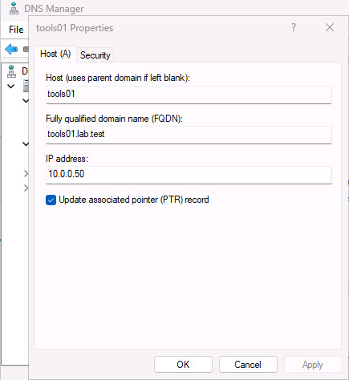
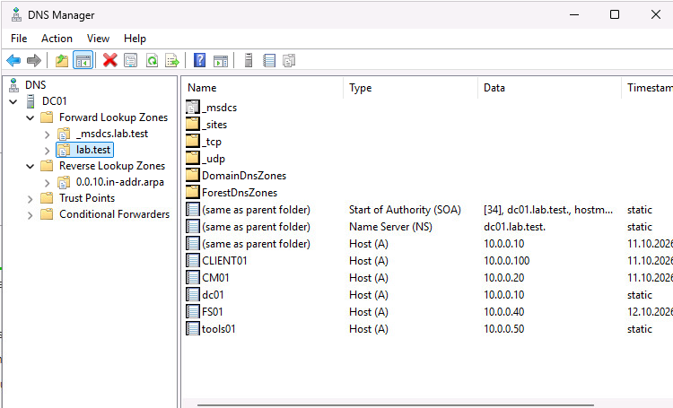

# Kapitel 3 · DNS und DHCP

[← Kapitel 2](02-domain-controller.md) · [Übersicht](../../README.md#inhaltsverzeichnis) · weiter: [Kapitel 4 · AD-Struktur →](04-ad-struktur.md)

  

> **Ziel:** Saubere Namensauflösung in beide Richtungen und automatische IP-Adressen für Clients.
> **Dauer:** ca. 20 Minuten · **Wo:** DC01
> **Menüs:** Englisch, deutscher Name in Klammern

## Schritt 1 · Reverse-Lookupzone anlegen

Damit `nslookup 10.0.0.10` einen Namen liefert und nicht *„Non-existent domain“*:

1. Server Manager → **Tools → DNS**
2. Rechtsklick auf **Reverse Lookup Zones** (Reverse-Lookupzonen) → **New Zone** (Neue Zone)
3. **Primary zone** (Primäre Zone), Haken bei **Store the zone in Active Directory**
4. Replikation: **To all DNS servers running on domain controllers in this domain**
5. **IPv4 Reverse Lookup Zone** → **Network ID**: `10.0.0`
6. **Allow only secure dynamic updates** (Nur sichere dynamische Updates) → **Finish**

## Schritt 2 · Einträge für feste Server

Windows-Server, die der Domäne beitreten (FS01, CM01), tragen sich selbst ein. Von Hand brauchst du Einträge nur für Rechner **ohne** Domänenbeitritt, etwa die Linux-VMs TOOLS01 und NETBOX01 aus Kapitel 10: **Forward Lookup Zones** → `lab.test` → Rechtsklick → **New Host (A or AAAA)** (Neuer Host) → Name und IP → Haken bei **Create associated pointer (PTR) record** (Verknüpften PTR-Eintrag erstellen).

  
  

Fehlt bei einem Windows-Rechner der Eintrag, auf dem Rechner `ipconfig /registerdns` ausführen.

> [!WARNING]
> Ein falscher PTR-Eintrag fällt lange nicht auf. Im Lab zeigte `10.0.0.10` einmal auf `tools01` statt auf `dc01`. Deshalb nach jedem neuen Server einmal `nslookup <IP>` testen.

## Schritt 3 · DHCP installieren

1. Server Manager → **Manage → Add Roles and Features** → **DHCP Server** → **Install**
2. Gelbes Fähnchen → **Complete DHCP configuration** (DHCP-Konfiguration abschließen) → **Commit** mit dem Domänen-Admin. Das **autorisiert** den DHCP-Server im AD, ohne Autorisierung verteilt er nichts.

## Schritt 4 · Bereich anlegen

**Tools → DHCP** → `dc01.lab.test` → Rechtsklick auf **IPv4** → **New Scope** (Neuer Bereich):

| Seite | Einstellung |
|---|---|
| Scope Name | `Lab` |
| IP Address Range | `10.0.0.100` bis `10.0.0.200`, Length 24 |
| Add Exclusions and Delay | nichts eintragen |
| Lease Duration | 8 Tage (Standard) |
| Configure DHCP Options | **Yes, I want to configure these options now** |
| Router (Default Gateway) | `10.0.0.1` → **Add** |
| Domain Name and DNS Servers | Parent domain `lab.test`, IP `10.0.0.10` |
| WINS Servers | überspringen |
| Activate Scope | **Yes, I want to activate this scope now** |

Server bekommen feste Adressen **unterhalb** von `.100`, Clients alles ab `.100`.

## Schritt 5 · AD-Subnetz eintragen

**Tools → Active Directory Sites and Services** (Standorte und Dienste) → **Sites** → Rechtsklick auf **Subnets** → **New Subnet** → Prefix `10.0.0.0/24` → Site *Default-First-Site-Name*.

Ohne Subnetz finden Clients und später MECM ihren AD-Standort nicht.

## Prüfen

| Test (auf DC01) | Erwartet |
|---|---|
| `nslookup 10.0.0.10` | `dc01.lab.test` |
| `nslookup dc01.lab.test` | `10.0.0.10` |
| DHCP-Konsole → IPv4 | grüner Haken, Bereich *Active* |
