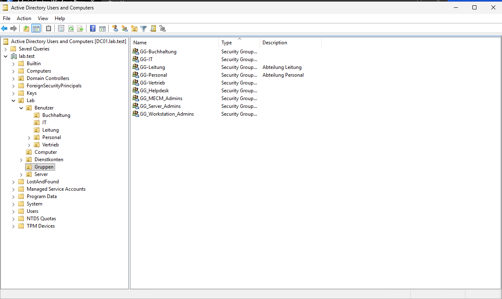
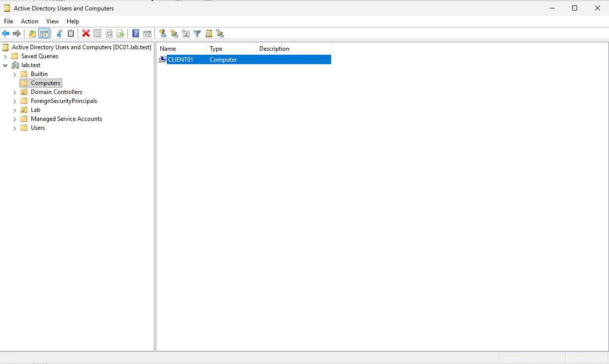

# Kapitel 4 · AD-Struktur: OUs, Gruppen, Konten

[← Kapitel 3](03-dns-dhcp.md) · [Übersicht](../../README.md#anleitung) · weiter: [Kapitel 5 · Benutzer per Skript →](05-benutzer-per-skript.md)

> **Ziel:** Eine OU-Struktur, an die sich GPOs sauber hängen lassen, Abteilungsgruppen und getrennte Konten.
> **Dauer:** ca. 30 Minuten · **Wo:** DC01

## Das Prinzip

Alles Eigene kommt unter **eine** Haupt-OU `Lab`. Die Standardcontainer (*Users*, *Computers*) bleiben leer, denn an Container lassen sich keine GPOs verknüpfen.

```
lab.test
└── Lab
    ├── Benutzer         Benutzerkonten (Unter-OUs pro Abteilung legt Kapitel 5 an)
    ├── Computer         Clients
    ├── Server           Mitgliedsserver (FS01, CM01 …)
    ├── Gruppen          Sicherheitsgruppen
    └── Dienstkonten     Konten für Dienste (MECM, Backup …)
```

## Schritt 1 · OUs anlegen

1. Server-Manager → **Tools → Active Directory-Benutzer und -Computer** (ADUC)
2. Rechtsklick auf `lab.test` → **Neu → Organisationseinheit** → `Lab`
3. Rechtsklick auf `Lab` → genauso `Benutzer`, `Computer`, `Server`, `Gruppen`, `Dienstkonten`

Der Haken *„Container vor zufälligem Löschen schützen“* bleibt an.


## Schritt 2 · Abteilungsgruppen anlegen

Rechtsklick auf `Lab/Gruppen` → **Neu → Gruppe**, Gruppenbereich **Global**, Gruppentyp **Sicherheit**:

| Gruppe | Bekommt später |
|---|---|
| `GG-IT` | Ordner IT, Laufwerk S: |
| `GG-Buchhaltung` | Ordner Buchhaltung, Laufwerk S:, RDP auf Clients |
| `GG-Vertrieb` | Ordner Vertrieb, Laufwerk S:, RDP auf Clients |

`GG-Personal` und `GG-Leitung` legt das Skript in Kapitel 5 selbst an. Auf Dauer kommen Rollen-Gruppen dazu, zum Beispiel für Helpdesk oder Server-Admins:



> [!TIP]
> Rechte bekommen immer **Gruppen**, nie einzelne Benutzer. Und jeder Benutzer ist in genau **einer** Abteilungsgruppe. Sonst bekommt er später das falsche Laufwerk S:.

## Schritt 3 · Getrennte Konten

| Konto | Ort | Zweck |
|---|---|---|
| `adm.vorname` | `Lab/Benutzer` | Dein Admin-Konto, Mitglied von *Domain Admins* |
| `vorname.nachname` | `Lab/Benutzer` | Dein Alltagskonto **ohne** Adminrechte |
| `svc_cm_push` | `Lab/Dienstkonten` | Beispiel für ein Dienstkonto (MECM-Client-Push) |

So übst du gleich die Praxis aus echten Firmen: Mit dem Admin-Konto wird nur verwaltet, nicht gesurft.

## Schritt 4 · Neue Computer automatisch in die richtige OU

Ohne Umstellung landen neue Computer im Container *Computers*:



Einmalig in einer **Admin-Eingabeaufforderung** auf DC01:

```
redircmp "OU=Computer,OU=Lab,DC=lab,DC=test"
```

Ab jetzt landet jeder neue Client direkt in `Lab/Computer`. Server verschiebst du nach dem Domänenbeitritt von Hand nach `Lab/Server`: Rechtsklick → **Verschieben**.

## Schritt 5 · AD-Papierkorb aktivieren

**Tools → Active Directory-Verwaltungscenter** → links `lab (lokal)` → rechts **Papierkorb aktivieren** → bestätigen.

Gelöschte Benutzer, Gruppen und OUs lassen sich damit samt Mitgliedschaften wiederherstellen.

> [!NOTE]
> Der Papierkorb lässt sich nicht wieder abschalten. Fürs Lab genau richtig.

## Prüfen

- ADUC zeigt `Lab` mit fünf Unter-OUs
- Die drei GG-Gruppen liegen in `Lab/Gruppen`
- Verwaltungscenter: *Papierkorb aktivieren* ist ausgegraut, er ist also aktiv
