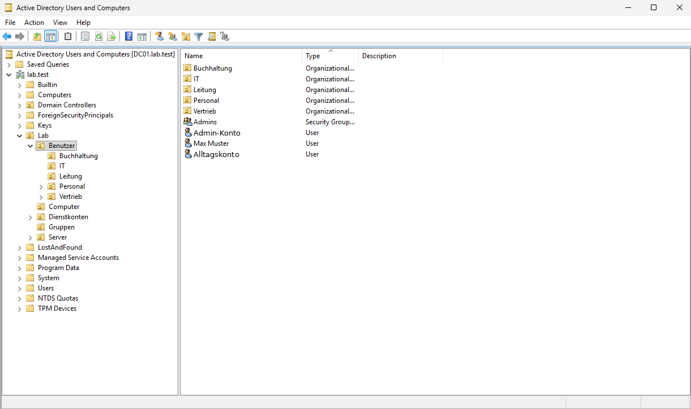

# 4 · AD-Struktur: OUs, Gruppen, Konten

[← 3 · DNS und DHCP](03-dns-dhcp.md) · [Übersicht](../../README.md#anleitung) · weiter: [5 · Benutzer per Skript →](05-benutzer-per-skript.md)

Alles Eigene kommt unter **eine** Haupt-OU `Lab`. GPOs lassen sich so sauber verknüpfen, und die Standardcontainer bleiben unangetastet.

## Ziel

```
lab.test
└── Lab
    ├── Benutzer
    │   └── IT, Buchhaltung, Vertrieb, Personal, Leitung   (legt das Skript an)
    ├── Computer
    ├── Server
    ├── Gruppen
    └── Dienstkonten
```



## OUs anlegen

**Active Directory-Benutzer und -Computer** (ADUC) → Rechtsklick auf `lab.test` → **Neu → Organisationseinheit** → `Lab`. Darin genauso `Benutzer`, `Computer`, `Server`, `Gruppen`, `Dienstkonten`.

## Abteilungsgruppen

In `Lab/Gruppen` je Abteilung eine **globale Sicherheitsgruppe**:

| Gruppe | Wofür |
|---|---|
| `GG-IT` | Ordner IT, Laufwerk S: |
| `GG-Buchhaltung` | Ordner Buchhaltung, Laufwerk S:, RDP auf Clients |
| `GG-Vertrieb` | Ordner Vertrieb, Laufwerk S:, RDP auf Clients |

`GG-Personal` und `GG-Leitung` legt das Skript im nächsten Kapitel selbst an.

> [!TIP]
> Rechte bekommen immer **Gruppen**, nie einzelne Benutzer. Und jeder Benutzer ist in genau **einer** Abteilungsgruppe, sonst bekommt er später das falsche Laufwerk.

## Konten

- **Eigenes Admin-Konto** (z. B. `adm.vorname`) in `Lab/Benutzer`, Mitglied von *Domain Admins*. Für den Alltag ein **normales Konto** ohne Adminrechte.
- **Dienstkonten** in `Lab/Dienstkonten`, z. B. `svc_cm_push` für MECM.

## Neue Computer automatisch in die richtige OU

Standardmäßig landen neue Computer im Container *Computers*, an den man keine GPOs hängen kann. Einmalig in einer Admin-Eingabeaufforderung auf DC01:

```
redircmp "OU=Computer,OU=Lab,DC=lab,DC=test"
```

## AD-Papierkorb aktivieren

**Active Directory-Verwaltungscenter** → links `lab (lokal)` → rechts **Papierkorb aktivieren**. Damit lassen sich gelöschte Benutzer und OUs samt Gruppenmitgliedschaften zurückholen.

> [!NOTE]
> Lässt sich nicht wieder abschalten. Fürs Lab genau richtig.
