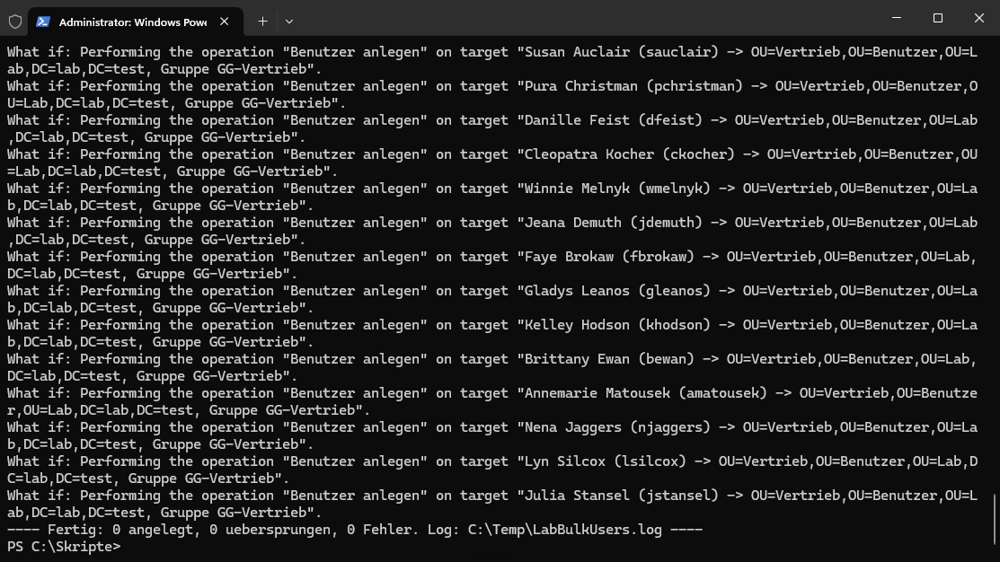

# Kapitel 5 · Testbenutzer per Skript

[← Kapitel 4](04-ad-struktur.md) · [Übersicht](../../README.md#inhaltsverzeichnis) · weiter: [Kapitel 6 · Client →](06-client.md)

> **Ziel:** Über 100 realistische Testbenutzer in Abteilungs-OUs, jeweils in der richtigen Gruppe.
> **Dauer:** ca. 15 Minuten · **Wo:** DC01
> **Menüs:** Englisch, deutscher Name in Klammern

Ein paar Benutzer legt man per Hand an. Für realistische Tests von Rechten, GPOs und Laufwerken braucht man aber mehr, und 100 Benutzer klickt niemand. Dafür gibt es [`New-LabBulkUsers.ps1`](../../scripts/New-LabBulkUsers.ps1).

## Was das Skript macht

- Legt Benutzer in `Lab/Benutzer/<Abteilung>` an
- Legt fehlende Abteilungs-OUs und Gruppen `GG-<Abteilung>` selbst an
- Nimmt jeden Benutzer in seine Abteilungsgruppe auf
- Fragt das Startkennwort beim Start ab, es steht **nicht** in der CSV
- Gibt allen die Beschreibung *Bulk-Import Testbenutzer*, damit man sie später wiederfindet
- Überspringt vorhandene Benutzer, kann also mehrfach laufen
- Mit `-WhatIf` zeigt es nur an, was passieren würde

## Schritt 1 · CSV vorbereiten

Trennzeichen Semikolon. Vorlage: [`benutzer.example.csv`](../../scripts/benutzer.example.csv) mit 15 Benutzern, **drei pro Abteilung**. Mehrere pro Abteilung brauchst du für den Test in Kapitel 9. Die Datei in **`benutzer.csv`** umbenennen und nach Bedarf erweitern, im Lab waren es 114 Benutzer.

```
Vorname;Nachname;Benutzername;Abteilung
Anna;Beispiel;abeispiel;Buchhaltung
Ben;Muster;bmuster;Vertrieb
```

Der Benutzername darf höchstens 20 Zeichen lang sein.

> [!TIP]
> In Excel als **CSV UTF-8 (durch Trennzeichen getrennt)** speichern. Mit dem normalen CSV-Format werden Umlaute wie in *Müller* kaputt.

## Schritt 2 · Dateien auf DC01 bringen und entsperren

1. Auf dem Host das Repo herunterladen (GitHub → **Code → Download ZIP**) und entpacken. Skript und CSV nach DC01 kopieren, z. B. nach `C:\Skripte`. Am einfachsten über die **erweiterte Sitzung**: im Hyper-V-Verbindungsfenster **Ansicht → Erweiterte Sitzung**, dann auf dem Host kopieren und in der VM im Explorer einfügen.
2. Heruntergeladene Dateien sind von Windows markiert. Rechtsklick auf die `.ps1` → **Properties** (Eigenschaften) → Registerkarte **General** (Allgemein) → ganz unten Haken bei **Unblock** (Zulassen) → OK. Dasselbe für die CSV.

> [!NOTE]
> Ohne Entsperren kommt *„… is not digitally signed. You cannot run this script on the current system.“* Der Haken steht auf **General**, nicht auf *Security*. Das verwechselt man leicht.

## Schritt 3 · Probelauf

PowerShell **als Administrator** öffnen:

```powershell
cd C:\Skripte
.\New-LabBulkUsers.ps1 -WhatIf
```

Das Skript listet jeden Benutzer mit Ziel-OU und Gruppe auf, ändert aber nichts:



## Schritt 4 · Echter Lauf

```powershell
.\New-LabBulkUsers.ps1
```

Startkennwort eingeben. Am Ende steht z. B. *„15 angelegt, 0 übersprungen, 0 Fehler“*.

> [!IMPORTANT]
> Das Startkennwort muss zur Kennwortrichtlinie der Domäne passen. Standard sind 7 Zeichen mit Komplexität. In diesem Lab sind es 12 Zeichen: Group Policy Management → **Default Domain Policy** → Edit → **Computer Configuration → Policies → Windows Settings → Security Settings → Account Policies → Password Policy** → *Minimum password length* `12`. Passt das Kennwort nicht, scheitert jeder einzelne Benutzer.

Optional: `-PasswortBeiAnmeldungAendern`, dann müssen die Benutzer das Kennwort bei der ersten Anmeldung ändern.

## Prüfen

- ADUC → `Lab/Benutzer` → **F5**: Abteilungs-OUs mit Benutzern
- Gruppe öffnen → Registerkarte **Members** (Mitglieder)
- Log: `C:\Temp\LabBulkUsers.log`

## Wieder aufräumen

ADUC → Rechtsklick auf `lab.test` → **Find** (Suchen) → Registerkarte **Advanced** → **Field → User → Description** *is (exactly)* `Bulk-Import Testbenutzer`. Die Abteilungs-OUs sind gegen versehentliches Löschen geschützt: **View → Advanced Features** (Ansicht → Erweiterte Features), dann OU → **Properties** → Registerkarte **Object** → Haken bei *Protect object from accidental deletion* entfernen.
