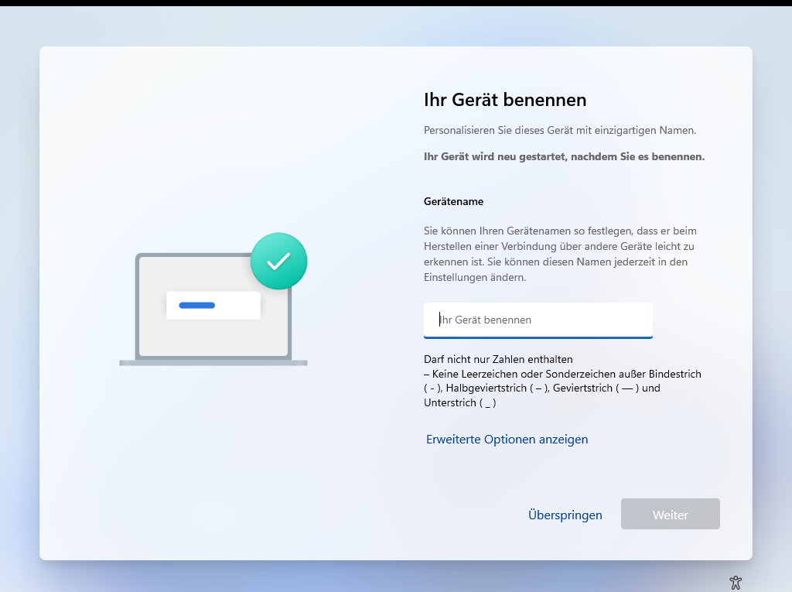
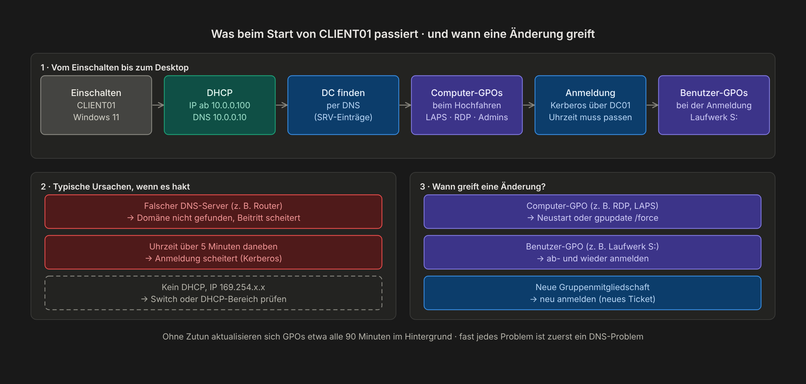

# Kapitel 6 · Windows-11-Client CLIENT01

[← Kapitel 5](05-benutzer-per-skript.md) · [Übersicht](../../README.md#inhaltsverzeichnis) · weiter: [Kapitel 7 · Dateiserver →](07-dateiserver.md)

 

> **Ziel:** Ein Windows-11-Rechner in der Domäne, an dem du dich mit den Testbenutzern anmeldest.
> **Dauer:** ca. 40 Minuten · **Wo:** Host, danach CLIENT01

## Schritt 1 · VM anlegen (Host)

| Einstellung | Wert |
|---|---|
| Name | `CLIENT01` |
| Generation | 2 |
| Prozessoren | **2** (nach dem Assistenten in den Einstellungen) |
| Arbeitsspeicher | 4096 MB, dynamisch aus |
| Netzwerk | `LAB` |
| Festplatte | 64 GB |
| Installation | Windows-11-ISO |

Vor dem ersten Start: Rechtsklick → **Einstellungen → Sicherheit** → Haken bei **Trusted Platform Module aktivieren**. Ohne TPM und mit nur einem Prozessor verweigert Windows 11 die Installation.

## Schritt 2 · Windows installieren (CLIENT01)

1. Von der ISO starten, **Windows 11 Pro** oder **Enterprise** wählen. Windows Home kann keiner Domäne beitreten.
2. Beim Einrichten Gerätename `CLIENT01`

   

3. Ein **lokales** Konto anlegen (*Für Arbeit oder Schule einrichten* → *Anmeldeoptionen* → *Stattdessen einer Domäne beitreten*). Die Option heißt so, legt aber nur ein lokales Konto an. Der echte Domänenbeitritt kommt in Schritt 4.

## Schritt 3 · Netzwerk prüfen (CLIENT01)

Eingabeaufforderung → `ipconfig /all`:

| Wert | Erwartet |
|---|---|
| IPv4-Adresse | aus `10.0.0.100 – 200` |
| Standardgateway | `10.0.0.1` |
| DNS-Server | `10.0.0.10` |

Nur `169.254.x.x`? Dann läuft DHCP auf DC01 nicht oder ist nicht autorisiert (Kapitel 3).

## Schritt 4 · Domäne beitreten (CLIENT01)

1. Startmenü → `sysdm.cpl` → Registerkarte **Computername** → **Ändern…**
2. Mitglied von **Domäne**: `lab.test`
3. Anmeldedaten eines Domänen-Admins eingeben → *Willkommen in der Domäne* → Neustart

Danach am Sperrbildschirm **Anderer Benutzer** → Anmeldung mit einem Domänenkonto. Unter dem Kennwortfeld steht *Anmelden bei: LAB*, du musst also nicht `LAB\` davorschreiben.

## Was beim Start passiert

Ab jetzt läuft bei jedem Start dieselbe Kette ab. Wer sie kennt, findet Fehler schneller:

## Prüfen

- ADUC auf DC01 → `Lab/Computer` → `CLIENT01` ist da (dank `redircmp` aus [Kapitel 4](04-ad-struktur.md#schritt-4--neue-computer-automatisch-in-die-richtige-ou))
- Anmeldung mit einem Testbenutzer aus Kapitel 5 klappt
- Prüfpunkt setzen: *„CLIENT01 in Domäne“*
