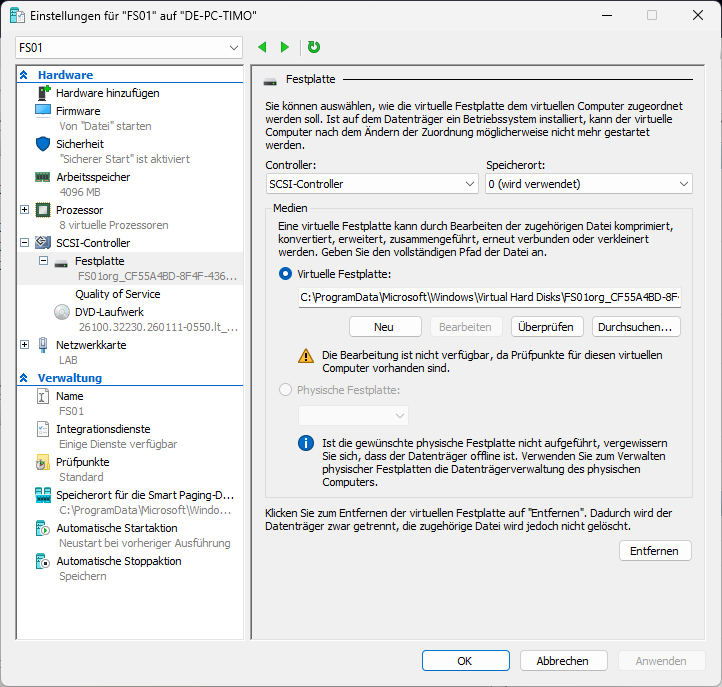
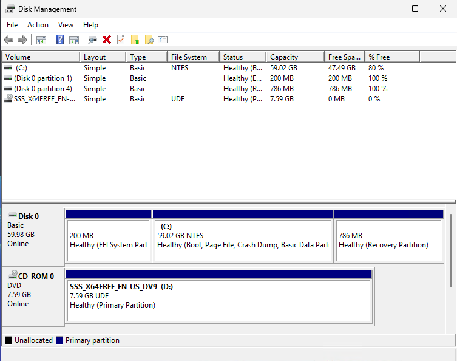
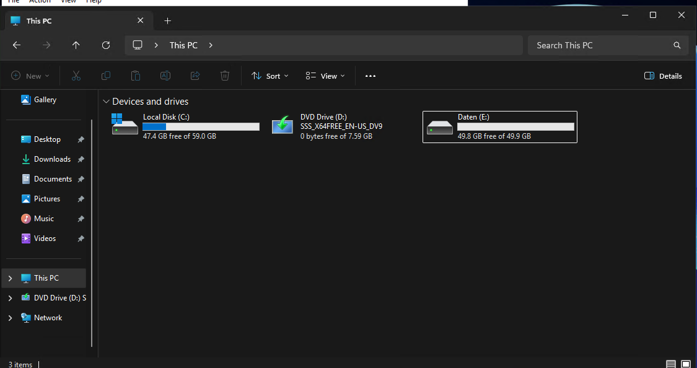
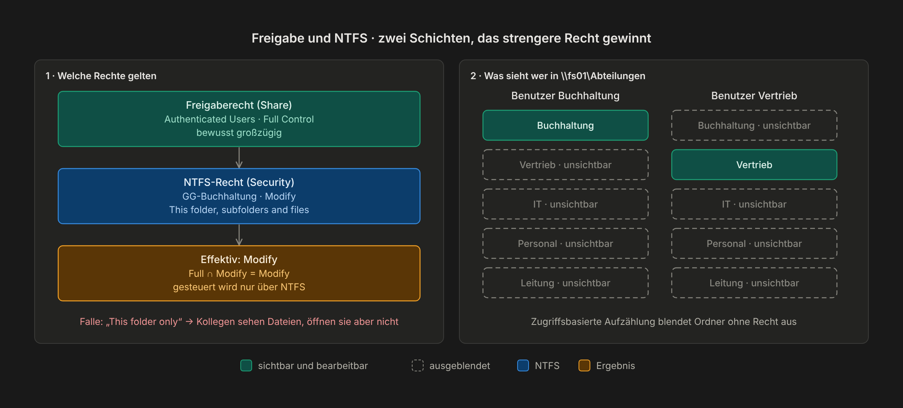
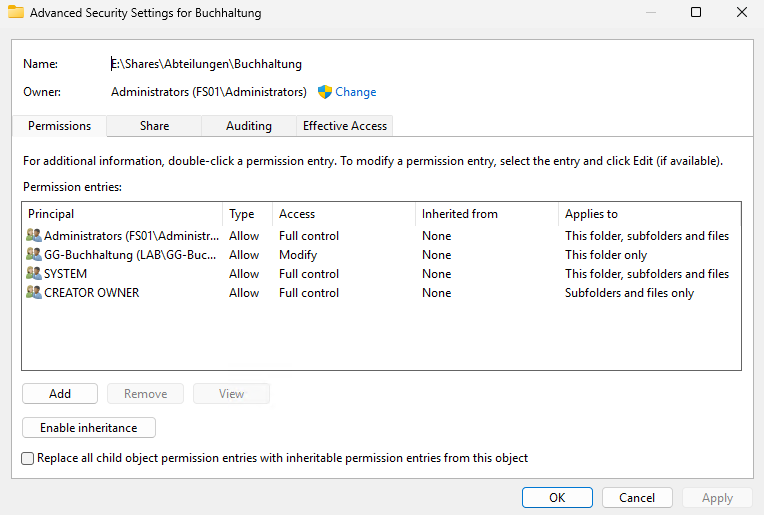

# Kapitel 7 · Dateiserver FS01

[← Kapitel 6](06-client.md) · [Übersicht](../../README.md#inhaltsverzeichnis) · weiter: [Kapitel 8 · Gruppenrichtlinien →](08-gruppenrichtlinien.md)

[](../../README.md#thema-file) [](../../README.md#thema-sec)

> **Ziel:** Eine Freigabe `\\fs01\Abteilungen` mit einem Ordner pro Abteilung. Jeder sieht und bearbeitet nur seinen eigenen.
> **Dauer:** ca. 60 Minuten · **Wo:** Host, danach FS01
> **Menüs:** FS01 auf Englisch, deutscher Name in Klammern

## Schritt 1 · VM mit zweiter Platte (Host)

1. VM `FS01` anlegen und Windows Server installieren wie DC01 in [Kapitel 2](02-domain-controller.md), Schritt 1–2. Systemplatte 60 GB, 2 Prozessoren. Die Hyper-V-Zeitsynchronisierung bleibt hier **an**, und unter *Automatische Startaktion* ebenfalls *Immer automatisch starten* wählen, mit 60 Sekunden Verzögerung.
2. Rechtsklick → **Einstellungen → SCSI-Controller → Festplatte → Hinzufügen → Neu** → VHDX, dynamisch erweiterbar, Name `FS01-Daten.vhdx`, **50 GB**



> [!WARNING]
> Bei der Windows-Installation die **60-GB**-Platte als Ziel wählen, die 50-GB-Platte nicht anfassen.

## Schritt 2 · Grundeinrichtung (FS01)

1. **Server Manager → Local Server**: Time zone Berlin, Computer name `FS01`
2. Feste IP: `10.0.0.40`, Mask `255.255.255.0`, Gateway `10.0.0.1`, DNS `10.0.0.10`
3. Test: `ping dc01.lab.test`
4. `sysdm.cpl` → Registerkarte **Computer Name → Change** → **Domain** `lab.test` → Neustart
5. Ab jetzt an FS01 mit `LAB\adm.vorname` anmelden. Nur so findet *Check Names* in Schritt 6 die Gruppen aus dem AD.
6. Auf DC01 in ADUC das Computerkonto von **`Lab/Computer`** nach **`Lab/Server`** verschieben (wegen `redircmp` aus Kapitel 4 landet es zuerst in `Lab/Computer`)
7. Test auf DC01: `nslookup 10.0.0.40` liefert `fs01.lab.test`

## Schritt 3 · Datenplatte einrichten (FS01)

1. Rechtsklick auf Start → **Disk Management** (Datenträgerverwaltung)
2. Die neue Platte ist *Offline*: Rechtsklick → **Online**, dann **Initialize Disk** (Datenträger initialisieren) → GPT
3. Rechtsklick auf den freien Bereich → **New Simple Volume** (Neues einfaches Volume) → Laufwerksbuchstabe **E:**, NTFS, Volume label `Daten`

<p align="center">
  
  
</p>

## Schritt 4 · Ordner anlegen (FS01)

Im Explorer:

```
E:\Shares\Abteilungen\
├── Buchhaltung
├── Vertrieb
├── IT
├── Personal
└── Leitung
```

## Schritt 5 · Freigabe erstellen (FS01)

**Server Manager → File and Storage Services → Shares** (Datei-/Speicherdienste → Freigaben) → **Tasks → New Share** → **SMB Share – Quick**:

| Seite | Einstellung |
|---|---|
| Share Location | **Type a custom path** → `E:\Shares\Abteilungen` |
| Share Name | `Abteilungen` |
| Other Settings | Haken bei **Enable access-based enumeration** (zugriffsbasierte Aufzählung) |
| Permissions | **Customize permissions** → Registerkarte **Share** → *Authenticated Users* mit **Full Control** |

> [!TIP]
> Freigaberecht großzügig, NTFS streng. Gesteuert wird nur über NTFS, dann suchst du bei Problemen nur an einer Stelle.

## Schritt 6 · NTFS-Rechte pro Abteilungsordner (FS01)

**Zuerst der Stammordner** `E:\Shares\Abteilungen`: Von `E:\` erbt *Users* das Recht, Ordner und Dateien anzulegen. Sonst könnte jeder direkt in der Freigabe eigene Ordner ablegen. Rechtsklick → **Properties → Security → Advanced** → **Disable inheritance** → *Convert …* → bei *Users* **Edit** → nur **Read & execute**, Applies to **This folder only**.

Dann jeder Abteilungsordner. Erst das Prinzip, dann die Klicks:




Für **jeden** Abteilungsordner: Rechtsklick → **Properties → Security → Advanced** (Eigenschaften → Sicherheit → Erweitert):

1. **Disable inheritance** (Vererbung deaktivieren) → **Convert inherited permissions into explicit permissions on this object**
2. Alles **Remove**, was nicht in die Tabelle gehört (z. B. *Users*)
3. **Add** → **Select a principal** → `GG-<Abteilung>` → **Check Names** → OK

Ziel pro Ordner:

| Principal | Access | Applies to |
|---|---|---|
| Administrators | Full control | This folder, subfolders and files |
| SYSTEM | Full control | This folder, subfolders and files |
| CREATOR OWNER | Full control | Subfolders and files only |
| GG-&lt;Abteilung&gt; | **Modify** (Ändern) | **This folder, subfolders and files** |

> [!WARNING]
> **Häufigster Fehler:** Bei der Gruppe steht *This folder only* (Nur dieser Ordner). Dann kann jeder nur seine **eigenen** Dateien öffnen (über CREATOR OWNER), die Kollegen bekommen *„Access denied“*. Mit nur einem Testbenutzer pro Abteilung fällt das nicht auf.
>
> 

> [!WARNING]
> Bei fünf Ordnern hintereinander vertauscht man schnell die Gruppen. Danach also mit einem Benutzer **jeder** Abteilung testen ([Kapitel 9](09-testen.md)).

## Prüfen

Auf CLIENT01 als Benutzer der Buchhaltung `\\fs01\Abteilungen` öffnen:

- Durch die zugriffsbasierte Aufzählung ist **nur** der Ordner *Buchhaltung* zu sehen
- Darin lassen sich Dateien anlegen, ändern und löschen
- Eine Datei, die ein Kollege angelegt hat, lässt sich öffnen und speichern
