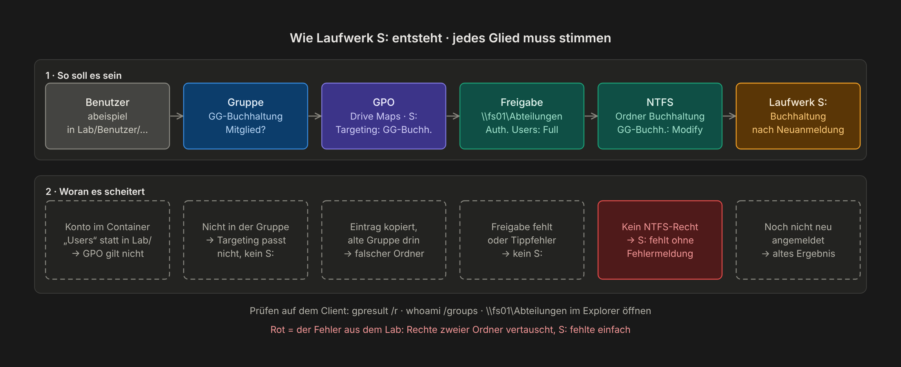
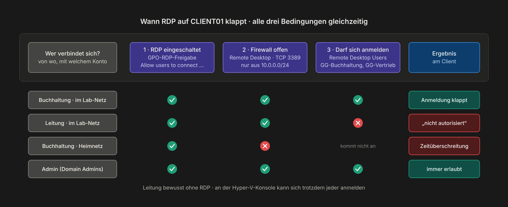
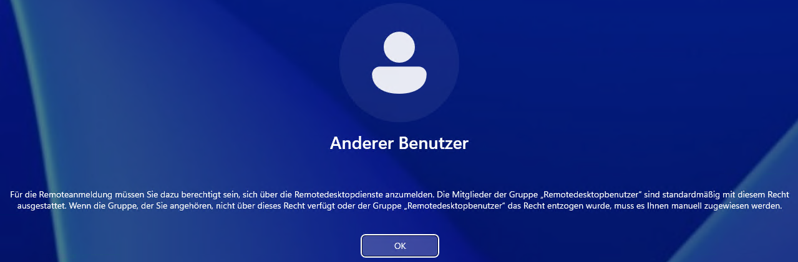

# Kapitel 8 · Gruppenrichtlinien

[← Kapitel 7](07-dateiserver.md) · [Übersicht](../../README.md#inhaltsverzeichnis) · weiter: [Kapitel 9 · Testen →](09-testen.md)

[](../../README.md#thema-gpo) [](../../README.md#thema-file) [](../../README.md#thema-sec)

> **Ziel:** Laufwerk S: je nach Abteilung, RDP nur für bestimmte Abteilungen, lokale Admin-Kennwörter per LAPS und eine saubere Zeitquelle.
> **Dauer:** ca. 60 Minuten · **Wo:** DC01
> **Menüs:** Englisch, deutscher Name in Klammern

## So legst du eine GPO an

Server Manager → **Tools → Group Policy Management** (Gruppenrichtlinienverwaltung) → Rechtsklick auf die Ziel-OU → **Create a GPO in this domain, and Link it here…** → Name → Rechtsklick auf die neue GPO → **Edit** (Bearbeiten).

Namensschema: `GPO-<Computer|Benutzer>-<Zweck>`. So sieht man in der Liste sofort, wofür eine GPO ist und ob sie Benutzer oder Computer betrifft.

| GPO | Verknüpft mit | Kapitel |
|---|---|---|
| `GPO-Benutzer-Laufwerk-S` | Lab/Benutzer | [Schritt 1](#schritt-1--laufwerk-s-pro-abteilung) |
| `GPO-RDP-Freigabe` | Lab/Computer, Lab/Server | [Schritt 2](#schritt-2--rdp-einschalten) |
| `GPO-Computer-RDP` | Lab/Computer | [Schritt 3](#schritt-3--rdp-nur-für-bestimmte-abteilungen) |
| `GPO-Computer-LAPS` | Lab/Computer, Lab/Server | [Schritt 4](#schritt-4--windows-laps) |
| `GPO-DC-Zeitserver` | Domain Controllers | [Schritt 5](#schritt-5--zeitquelle-für-die-domäne) |
| `GPO-Computer-LokaleAdmins` | Lab/Computer | [Schritt 3](#schritt-3--rdp-nur-für-bestimmte-abteilungen), erst für MECM in Kapitel 11 nötig |

Vor dem ersten Umbau alle GPOs sichern: **Group Policy Objects** → Rechtsklick → **Back Up All…** (Alle sichern) → Ordner mit Datum.

## Schritt 1 · Laufwerk S: pro Abteilung

GPO `GPO-Benutzer-Laufwerk-S` an **Lab/Benutzer** → Edit →
**User Configuration → Preferences → Windows Settings → Drive Maps** (Benutzerkonfiguration → Einstellungen → Windows-Einstellungen → Laufwerkzuordnungen) → Rechtsklick → **New → Mapped Drive**:

| Registerkarte | Einstellung |
|---|---|
| General | **Action: Replace** (Ersetzen) · **Location** `\\fs01\Abteilungen\Buchhaltung` · **Label as** *Buchhaltung* · **Drive Letter** S: |
| Common | Haken bei **Item-level targeting** (Zielgruppenadressierung) → **Targeting…** → **New Item → Security Group** → `LAB\GG-Buchhaltung` |

Für jede Abteilung einen Eintrag. Am schnellsten: Eintrag kopieren, einfügen, dann **Location und Targeting** anpassen.


> [!TIP]
> **Replace** statt *Update*: Sonst bleibt nach einem Abteilungswechsel die alte Zuordnung hängen.

> [!WARNING]
> Nach dem Kopieren steht im Targeting noch die **alte** Gruppe. Jeden Eintrag einmal öffnen und prüfen.

> [!NOTE]
> Hat der Benutzer auf das Ziel keine NTFS-Rechte, scheitert die Zuordnung **ohne Fehlermeldung**. S: fehlt dann einfach.



## Schritt 2 · RDP einschalten

Die Gruppe *Remote Desktop Users* zu füllen reicht nicht. RDP muss auch eingeschaltet sein, und auf Servern ist es standardmäßig aus.

GPO `GPO-RDP-Freigabe` an **Lab/Computer** und **Lab/Server**:

1. **Computer Configuration → Policies → Administrative Templates → Windows Components → Remote Desktop Services → Remote Desktop Session Host → Connections** → *Allow users to connect remotely by using Remote Desktop Services* → **Enabled**
2. **Computer Configuration → Policies → Windows Settings → Security Settings → Windows Defender Firewall with Advanced Security → Inbound Rules** → **New Rule** → **Predefined: Remote Desktop** → **Allow the connection**
3. Die vordefinierte Gruppe legt **mehrere** Regeln an (TCP, UDP, Shadow). **Jede** öffnen → Registerkarte **Scope** → *Remote IP address* → **These IP addresses** → **Add** → *This IP address or subnet* `10.0.0.0/24`

## Schritt 3 · RDP nur für bestimmte Abteilungen

GPO `GPO-Computer-RDP` an **Lab/Computer** →
**Computer Configuration → Preferences → Control Panel Settings → Local Users and Groups** (Lokale Benutzer und Gruppen) → Rechtsklick → **New → Local Group**:

- Action: **Update**
- Group name: **`Remote Desktop Users (built-in)`** aus dem **Dropdown** wählen
- Members → **Add**: `LAB\GG-Buchhaltung`, `LAB\GG-Vertrieb`

> [!WARNING]
> Den Gruppennamen **nicht** von Hand eintippen. Wer sich vertippt (im Lab einmal nur `ad`), legt auf jedem Client eine neue lokale Gruppe mit diesem Namen an, statt die richtige zu befüllen. Mit dem Eintrag *(built-in)* funktioniert die GPO auch auf deutschen Clients, wo die Gruppe *Remotedesktopbenutzer* heißt.

RDP klappt nur, wenn Schritt 2 und 3 zusammenpassen:



Wer nicht in diesen Gruppen ist, bekommt beim RDP-Versuch:



Das ist gewollt. An der Hyper-V-Konsole kann sich trotzdem jeder anmelden.

Nach demselben Muster wird ein Dienstkonto zum lokalen Admin: neue GPO `GPO-Computer-LokaleAdmins` an **Lab/Computer**, Group name **`Administrators (built-in)`**, Member `LAB\svc_cm_push`. Die brauchst du erst für MECM in Kapitel 11, du kannst sie aber gleich mit anlegen.

## Schritt 4 · Windows LAPS

Jeder Rechner bekommt ein eigenes, zufälliges Kennwort für den lokalen Administrator, gespeichert im AD.

**Einmalig** auf DC01, PowerShell als Administrator:

```powershell
Update-LapsADSchema
Set-LapsADComputerSelfPermission -Identity "OU=Computer,OU=Lab,DC=lab,DC=test"
Set-LapsADComputerSelfPermission -Identity "OU=Server,OU=Lab,DC=lab,DC=test"
```

GPO `GPO-Computer-LAPS` an **Lab/Computer** und **Lab/Server**:

1. **Computer Configuration → Policies → Administrative Templates → System → LAPS** → *Configure password backup directory* → **Enabled**, *Active Directory*
2. Optional *Password Settings* (Länge, Komplexität, Alter)
3. **Computer Configuration → Policies → Windows Settings → Security Settings → Local Policies → Security Options** → *Accounts: Administrator account status* → **Enabled**

> [!NOTE]
> Punkt 3 ist nötig, weil das eingebaute Administratorkonto unter Windows 11 deaktiviert ist. LAPS setzt nur das Kennwort, sonst kommt *„Ihr Konto wurde deaktiviert“*.

Kennwort nachschauen: ADUC → Computerkonto → **Properties** → Registerkarte **LAPS**. Anmelden mit `.\Administrator`.

## Schritt 5 · Zeitquelle für die Domäne

GPO `GPO-DC-Zeitserver` an der OU **Domain Controllers** →
**Computer Configuration → Policies → Administrative Templates → System → Windows Time Service → Time Providers**:

- *Configure Windows NTP Client* → **Enabled**, NtpServer `de.pool.ntp.org,0x8`, Type `NTP`
- *Enable Windows NTP Client* → **Enabled**

Alle anderen Rechner der Domäne holen sich die Zeit vom DC. Bei FS01 und CLIENT01 darf die Hyper-V-Zeitsynchronisierung an bleiben, nur bei DC01 ist sie aus (Kapitel 2). Auf DC01 `gpupdate /force` und `w32tm /resync`, dann prüfen mit `w32tm /query /status`. Als *Source* muss `de.pool.ntp.org` stehen, nicht *VM IC Time Synchronization Provider*.

## Prüfen

Auf CLIENT01 `gpupdate /force`, ab- und wieder anmelden, dann `gpresult /r`. Unter *Angewendete Gruppenrichtlinienobjekte* müssen die passenden GPOs stehen. Den ausführlichen Testplan findest du in Kapitel 9.
