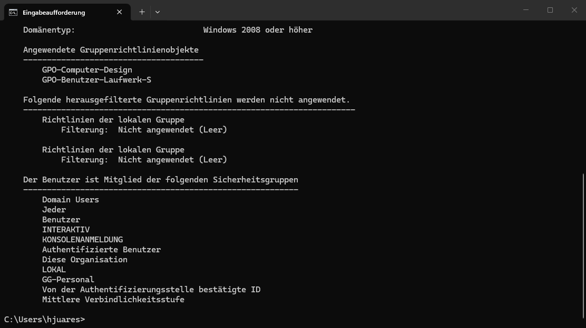

# Kapitel 9 · Testen

[← Kapitel 8](08-gruppenrichtlinien.md) · [Übersicht](../../README.md#inhaltsverzeichnis) · weiter: [Kapitel 10 · Linux-Dienste →](10-linux-dienste.md)

  

> **Ziel:** Nachweisen, dass Rechte, Laufwerke und GPOs für **jede** Abteilung stimmen.
> **Dauer:** ca. 30 Minuten · **Wo:** CLIENT01 (Hyper-V-Konsole), für die RDP-Tests der Host

Die meisten Fehler in diesem Lab sind erst beim Testen mit mehreren Konten aufgefallen. Ein Test mit nur einem Benutzer pro Abteilung reicht nicht.

## Werkzeuge

| Befehl | Wofür |
|---|---|
| `gpupdate /force` | GPOs sofort neu holen |
| `gpresult /r` | Welche GPOs angewendet wurden, in welchen Gruppen der Benutzer ist |
| `whoami /groups` | Gruppen des angemeldeten Benutzers |
| `net use` | Verbundene Laufwerke |

> [!IMPORTANT]
> Neue Gruppenmitgliedschaften gelten erst nach **Ab- und Anmelden**. Ein Neustart des Explorers reicht nicht.

## Testplan

Für **jede** Abteilung mit einem Benutzer anmelden, für Test 4 mit einem zweiten aus derselben Abteilung (die Vorlage aus Kapitel 5 hat drei pro Abteilung):

| # | Test | Erwartet |
|---|---|---|
| 1 | Explorer → *Dieser PC* | **S:** mit dem Namen der eigenen Abteilung |
| 2 | `\\fs01\Abteilungen` öffnen | **Nur** der eigene Abteilungsordner ist sichtbar |
| 3 | In S: eine Datei anlegen | klappt |
| 4 | Mit einem zweiten Benutzer derselben Abteilung diese Datei öffnen und speichern | klappt |
| 5 | RDP auf CLIENT01 als Buchhaltung oder Vertrieb | klappt |
| 6 | RDP auf CLIENT01 als andere Abteilung | wird verweigert |
| 7 | `.\Administrator` mit dem LAPS-Kennwort | klappt |

**So testest du RDP (Test 5 und 6):** Auf dem **Host** `mstsc` starten → als Computer die IP von CLIENT01 (`ipconfig` auf CLIENT01, z. B. `10.0.0.100`) oder `client01.lab.test`, wenn die NRPT-Regel aus Kapitel 1 gesetzt ist. Eine RDP-Anmeldung meldet die Sitzung an der Hyper-V-Konsole ab.

## Fehlersuche, wenn S: fehlt

Geh die Kette von links nach rechts durch. Das erste Glied, das nicht stimmt, ist die Ursache:

**1. Kommt die GPO an, und ist der Benutzer in der Gruppe?**

Eingabeaufforderung → `gpresult /r`:

- Unter *Angewendete Gruppenrichtlinienobjekte* fehlt `GPO-Benutzer-Laufwerk-S`? Dann prüfen, ob die GPO an `Lab/Benutzer` hängt und der Benutzer darunter liegt.
- Unter *Sicherheitsgruppen* fehlt die GG-Gruppe? Dann die Mitgliedschaft in ADUC prüfen, danach ab- und anmelden.

**2. Hat er Rechte auf den Ordner?**

`\\fs01\Abteilungen` öffnen. Durch die zugriffsbasierte Aufzählung sieht er nur Ordner, auf die er NTFS-Rechte hat. Sieht er einen **fremden** Ordner oder gar keinen, sind die NTFS-Rechte falsch oder vertauscht ([Kapitel 7](07-dateiserver.md#schritt-6--ntfs-rechte-pro-abteilungsordner-fs01)).

**3. Läuft FS01?**

**4. Ist der Benutzer in zwei Abteilungsgruppen?** Dann gewinnt die letzte Zuordnung.

Mehr Fälle: [Fehlerbehebung](../fehlerbehebung.md)
