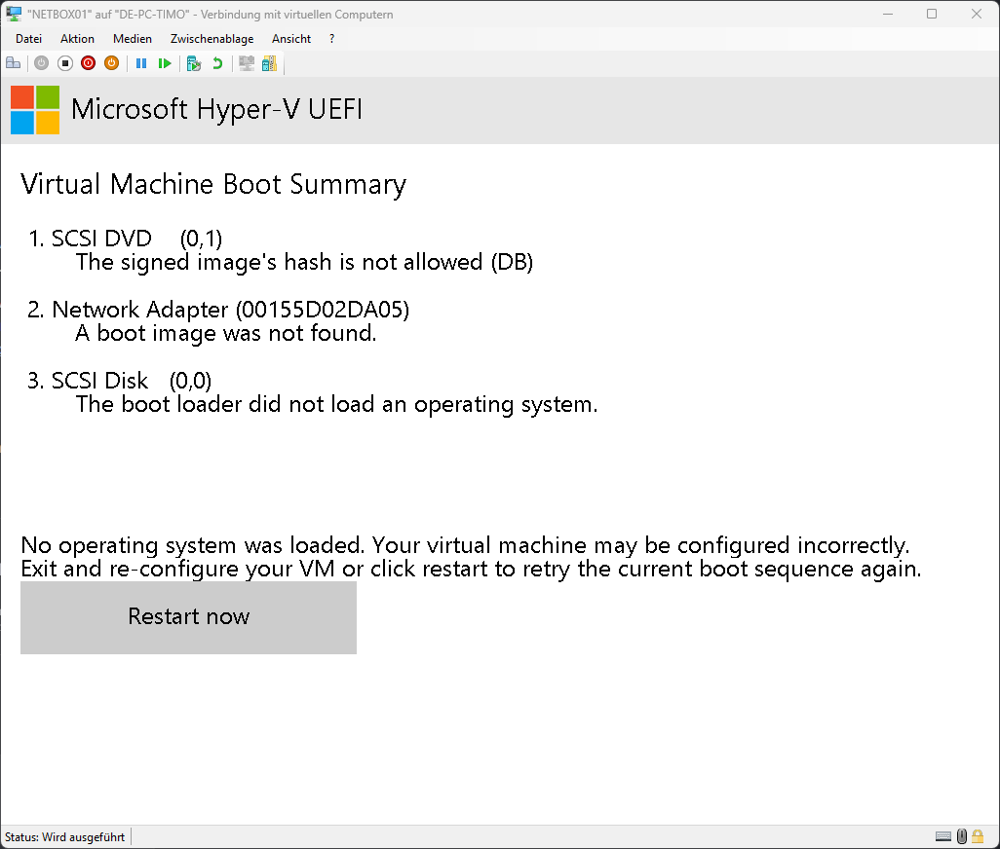
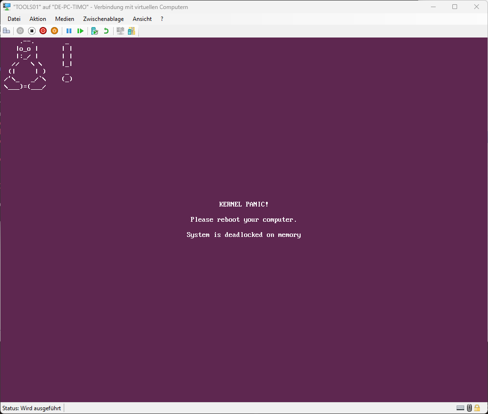
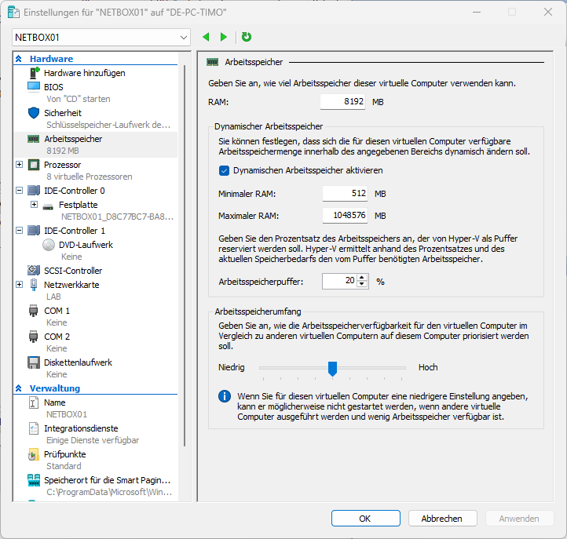
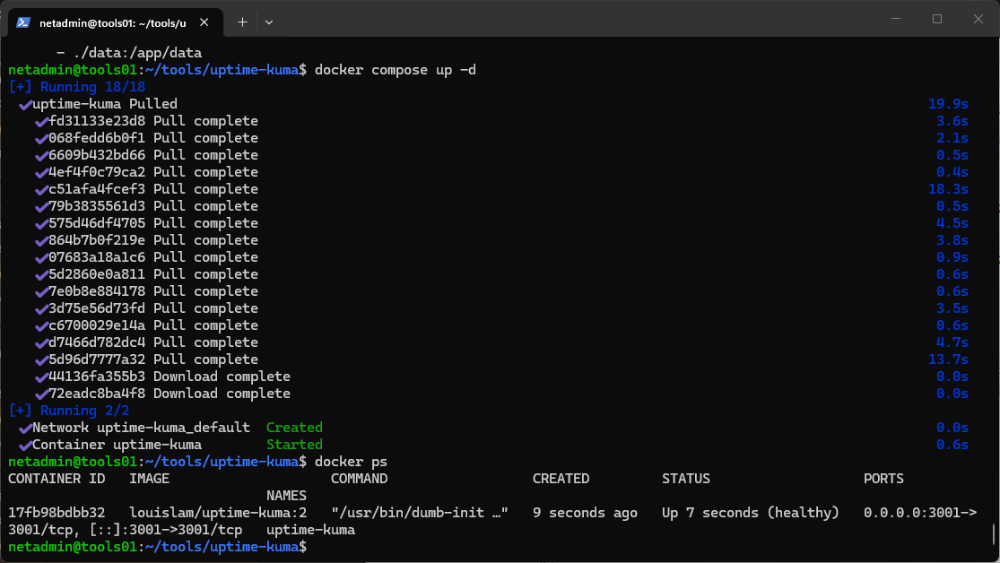
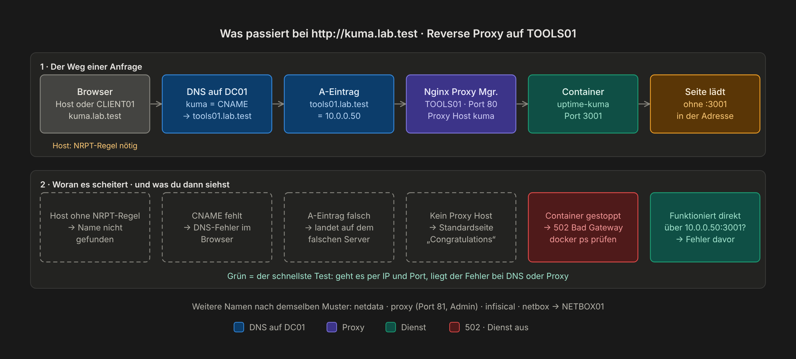
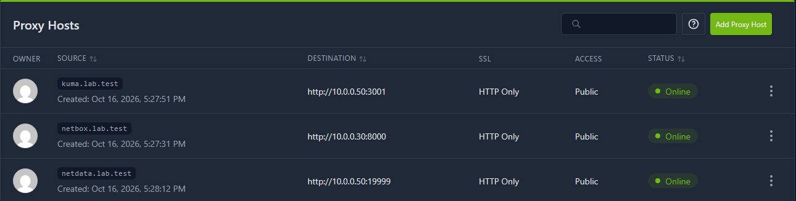
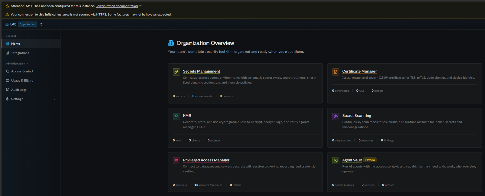
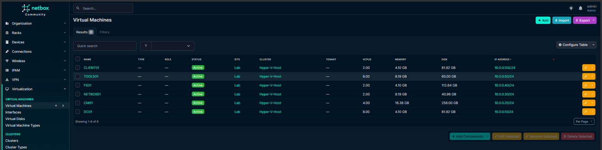

# Kapitel 10 · Linux-Dienste (optional)

[← Kapitel 9](09-testen.md) · [Übersicht](../../README.md#inhaltsverzeichnis) · weiter: [Kapitel 11 · MECM →](11-mecm.md)

> **Ziel:** Eine Ubuntu-VM mit Docker für Überwachung, Reverse Proxy, Jump Host und Kennwortverwaltung.
> **Dauer:** ca. 90 Minuten · **Wo:** Host, danach TOOLS01 (per SSH)

## Schritt 1 · VM anlegen (Host)

| Einstellung | Wert |
|---|---|
| Name | `TOOLS01` |
| Generation | 2 |
| Arbeitsspeicher | **6 GB fest**, dynamisch aus |
| Netzwerk | `LAB` |
| Festplatte | 60 GB |

Vor dem ersten Start: **Einstellungen → Sicherheit** → Vorlage **Microsoft UEFI-Zertifizierungsstelle**. Mit der Standardvorlage *Microsoft Windows* startet der Ubuntu-Installer nicht:



> [!WARNING]
> **Kein dynamischer Arbeitsspeicher für Linux-VMs.** Beim Start von Containern bekommt Linux nicht schnell genug RAM nach, das endet mit *Out of memory* oder einer Kernel Panic:
>
> <p>
>   
>   
> </p>

## Schritt 2 · Ubuntu installieren (TOOLS01)

DC01 muss laufen, sonst gibt es beim Installer *„Temporary failure resolving“*.

| Installer-Seite | Einstellung |
|---|---|
| Netzwerk | Manuell: `10.0.0.50/24`, Gateway `10.0.0.1`, DNS `10.0.0.10`, Suchdomäne `lab.test` |
| Speicher | Ganze Platte, LVM |
| Profil | Servername `tools01`, eigener Benutzer |
| SSH | **OpenSSH-Server installieren** |

Nach der Installation die ganze Platte nutzen. Der Installer nimmt nur einen Teil:

```bash
sudo lvextend -r -l +100%FREE /dev/ubuntu-vg/ubuntu-lv
```

Ab jetzt arbeitest du vom Host aus per SSH (`ssh benutzer@10.0.0.50`). Das ist bequemer als die Hyper-V-Konsole, und Kopieren/Einfügen funktioniert.

## Schritt 3 · Docker installieren

Nach der offiziellen Anleitung auf docs.docker.com (*Install Docker Engine on Ubuntu → apt repository*). Danach:

```bash
sudo usermod -aG docker $USER   # abmelden und neu anmelden
docker run --rm hello-world
```

Alle Dienste bekommen einen eigenen Ordner unter `~/tools/<dienst>` mit einer eigenen `docker-compose.yml`.

## Schritt 4 · Uptime Kuma (Überwachung)

```bash
mkdir -p ~/tools/uptime-kuma && cd ~/tools/uptime-kuma
cat > docker-compose.yml <<'EOF'
services:
  uptime-kuma:
    image: louislam/uptime-kuma:1
    restart: unless-stopped
    ports:
      - "3001:3001"
    volumes:
      - ./data:/app/data
EOF
docker compose up -d
```



Im Browser `http://10.0.0.50:3001` → Admin-Konto anlegen → **Neuen Monitor hinzufügen**:

| Ziel | Monitor-Typ |
|---|---|
| DC01 | Ping auf `10.0.0.10` und DNS (`dc01.lab.test` über `10.0.0.10`) |
| FS01 | TCP-Port `10.0.0.40:445` |
| Weboberflächen | HTTP(s) |


> [!TIP]
> `restart: unless-stopped` gehört in jede `docker-compose.yml`. Ohne startet nach einem Neustart der VM nichts von selbst.

## Schritt 5 · Weitere Dienste

Nach demselben Muster laufen auf TOOLS01:

| Dienst | Zweck | Port |
|---|---|---|
| **Nginx Proxy Manager** | Namen wie `kuma.lab.test` statt IP:Port. Im DNS auf DC01 je einen CNAME auf `tools01.lab.test` anlegen | 80, 81 (Admin) |
| **Netdata** | Leistungsdaten der Linux-VMs | 19999 |
| **Warpgate** | Jump Host für RDP und SSH mit Sitzungsaufzeichnung | 8888 |
| **Infisical** | Kennwörter und Secrets des Labs | 8080 |

So kommt eine Anfrage über den Namen beim richtigen Container an:



<p align="center">
  
  
</p>

Auf einer eigenen VM `NETBOX01` (`10.0.0.30`, 4 GB fest) läuft **NetBox** per `netbox-docker` als Quelle der Wahrheit für IP-Adressen und VMs:



## Weiter mit MECM

Auf `CM01` (`10.0.0.20`) läuft Microsoft Configuration Manager. Die komplette Einrichtung mit SQL Server, ADK und Client-Push steht in [Kapitel 11](11-mecm.md).

Wie es danach weitergeht: [Roadmap](../roadmap.md)
