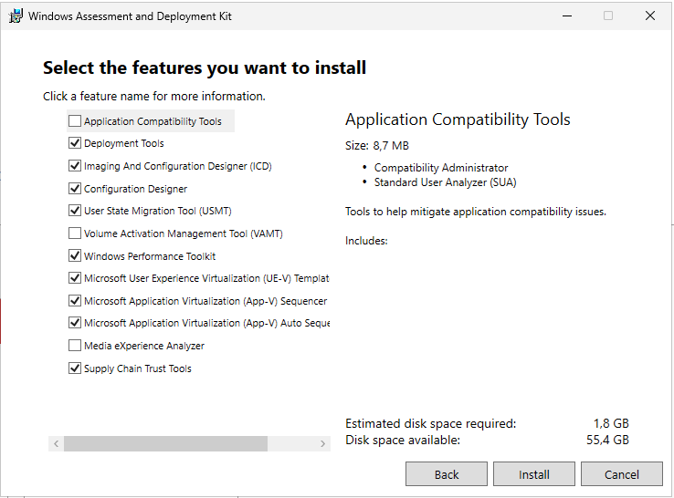
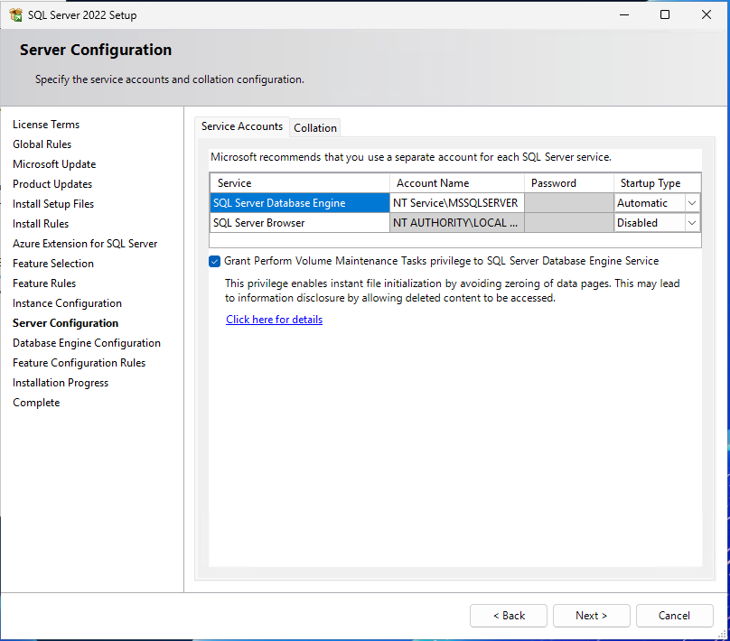
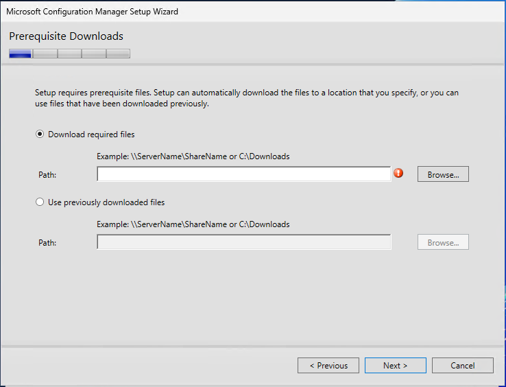
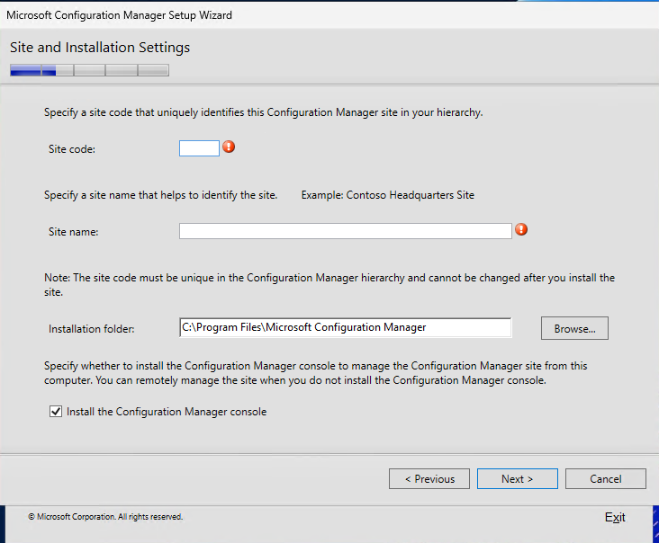
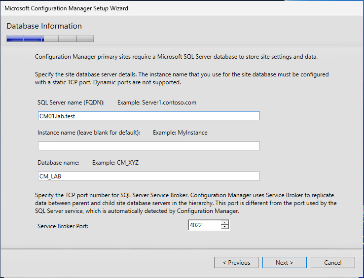
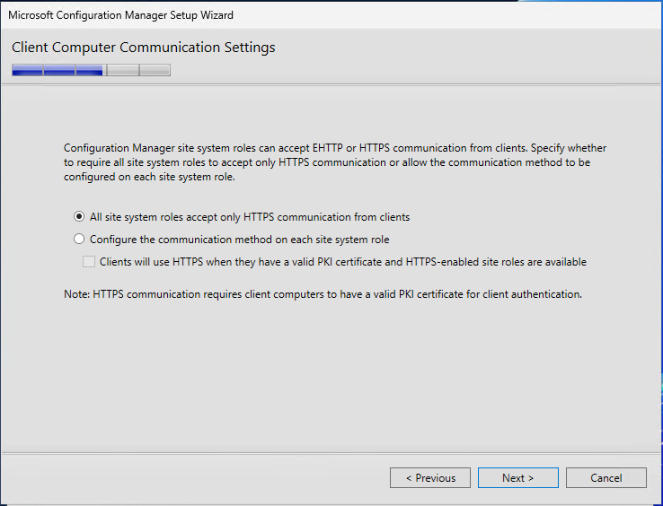
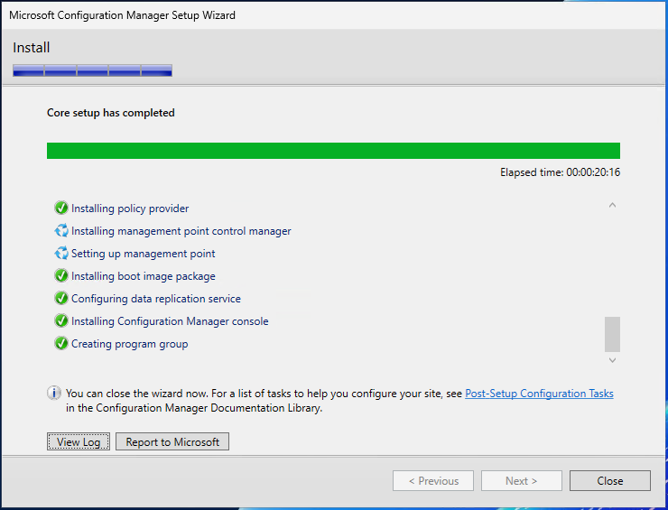
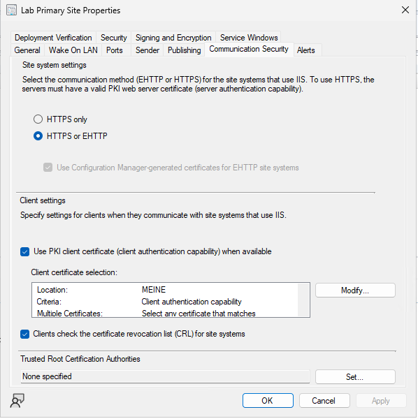
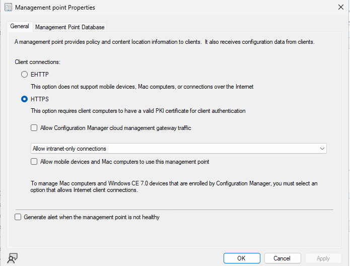

# Kapitel 11 · MECM (Configuration Manager)

[← Kapitel 10](10-linux-dienste.md) · [Übersicht](../../README.md#inhaltsverzeichnis)

> **Ziel:** Ein primärer Standort `LAB` auf CM01, der CLIENT01 findet und den Configuration-Manager-Client per Push installiert.
> **Dauer:** ca. 3–4 Stunden, davon viel Warten · **Wo:** Host, DC01, CM01
> **Menüs:** Englisch, deutscher Name in Klammern
> **Voraussetzung:** Kapitel 0–8, vor allem das Push-Konto als lokaler Admin ([Kapitel 8, Schritt 3](08-gruppenrichtlinien.md#schritt-3--rdp-nur-für-bestimmte-abteilungen))

Microsoft Configuration Manager (früher SCCM, heute auch MECM) verteilt Software, Updates und Betriebssysteme an Windows-Rechner. In vielen Firmen läuft er noch, deshalb lohnt sich das Kapitel für Bewerbungen. Microsoft entwickelt aber vor allem Intune weiter. Ab Version 2609 gibt es nur noch ein Release pro Jahr.

## Ablauf

## Schritt 1 · VM CM01 (Host, dann CM01)

| Einstellung | Wert |
|---|---|
| Generation | 2 |
| Prozessoren | 4 |
| Arbeitsspeicher | **8 GB fest**, Haken bei *Dynamischen Arbeitsspeicher* **aus** |
| Festplatte | 150 GB, dynamisch erweiterbar |
| Netzwerk | Switch `LAB` |

> [!IMPORTANT]
> SQL Server nimmt sich Speicher und gibt ihn ungern zurück. Mit dynamischem RAM wird die VM langsam und die Prüfung im MECM-Setup meckert. Deshalb fester Arbeitsspeicher.

Danach wie in Kapitel 2: Windows Server 2025 installieren, Name `CM01`, IP `10.0.0.20`, DNS `10.0.0.10`, der Domäne `lab.test` beitreten, Computerkonto nach `Lab/Server` verschieben.

Du arbeitest auf CM01 ab jetzt mit deinem **Admin-Konto** `LAB\adm.vorname`.

## Schritt 2 · Active Directory vorbereiten (DC01)

MECM veröffentlicht seine Standortinfos im AD. Dafür braucht es einen Container mit Rechten für CM01 und eine Schema-Erweiterung.

**Container *System Management* anlegen:**

1. Server Manager → **Tools → ADSI Edit** → Rechtsklick **ADSI Edit → Connect to…** → **Default naming context** → OK
2. `DC=lab,DC=test` aufklappen → Rechtsklick auf **CN=System → New → Object** → **container** → Value `System Management` → Finish

**Rechte vergeben:**

1. **Tools → Active Directory Users and Computers** → **View → Advanced Features** (Ansicht → Erweiterte Features) einschalten
2. `System` → Rechtsklick auf **System Management → Properties → Security → Advanced**
3. **Add** → **Select a principal** → **Object Types…** → Haken bei **Computers** → `CM01` → **Check Names**
4. **Full control**, Applies to: **This object and all descendant objects**

> [!NOTE]
> Ohne den Haken bei *Computers* findet *Check Names* das Computerkonto nicht.

**Schema erweitern:** Auf DC01 als Mitglied der *Schema Admins* (das erste Domänen-Admin-Konto ist es) aus den MECM-Installationsdateien `SMSSETUP\BIN\X64\extadsch.exe` ausführen. Erfolg steht in `C:\ExtADSch.log`: *„Successfully extended the Active Directory schema.“*

## Schritt 3 · Windows-Features und ADK (CM01)

**Server Manager → Manage → Add Roles and Features**:

| Seite | Auswählen |
|---|---|
| Server Roles | **Web Server (IIS)**, darunter zusätzlich *Windows Authentication*, *ASP.NET 4.8* und unter *Management Tools* **IIS 6 Management Compatibility** (Metabase und WMI) |
| Features | **Background Intelligent Transfer Service (BITS)**, **Remote Differential Compression**, *.NET Framework 4.8 Features → ASP.NET 4.8* |

**Windows ADK** und das **WinPE-Add-on** von Microsoft herunterladen und installieren. Beim ADK reichen *Deployment Tools* und *User State Migration Tool (USMT)*. Mehr Haken schaden nicht, kosten aber Platz:

## Schritt 4 · SQL Server (CM01)

SQL Server 2022 Evaluation herunterladen, Setup starten → **Installation → New SQL Server standalone installation**.

| Seite | Einstellung |
|---|---|
| Feature Selection | nur **Database Engine Services** |
| Instance Configuration | **Default instance** (`MSSQLSERVER`) |
| Server Configuration → Service Accounts | Standard lassen, Haken bei **Grant Perform Volume Maintenance Tasks privilege** |
| Server Configuration → **Collation** | **`SQL_Latin1_General_CP1_CI_AS`** |
| Database Engine Configuration | **Windows authentication mode** → **Add Current User** |

> [!WARNING]
> MECM akzeptiert **nur** die Sortierung `SQL_Latin1_General_CP1_CI_AS`. Auf einem englischen Server ist sie Standard. Auf einem **deutschen** Server schlägt das Setup `Latin1_General_CI_AS` vor. Dann bricht später die MECM-Prüfung ab, und SQL muss neu installiert werden.

Danach separat **SQL Server Management Studio (SSMS)** installieren. Darin: Rechtsklick auf den Server → **Properties → Memory** → *Maximum server memory* auf etwa **5120 MB** begrenzen, damit für MECM und Windows genug übrig bleibt.

## Schritt 5 · MECM installieren (CM01)

Die MECM-Installationsdateien (Evaluation) entpacken, `splash.hta` starten → **Install**.

| Seite | Einstellung |
|---|---|
| Getting Started | **Install a Configuration Manager primary site** |
| Product Key | **Install the evaluation edition** |
| Prerequisite Downloads | **Download required files** → z. B. `C:\CMDownloads` |
| Site and Installation Settings | Site code **`LAB`**, Site name `Lab Primary Site`, Haken bei *Install the Configuration Manager console* |
| Primary Site Installation | **Install the primary site as a stand-alone site** |
| Database Information | SQL Server `CM01.lab.test`, Instance leer, Database `CM_LAB`, Port 4022 |
| Client Computer Communication Settings | **Configure the communication method on each site system role** |
| Site System Roles | Management point und Distribution point auf CM01, beide **HTTP** |
| Service Connection Point | **Online** |

  
  

  
  

> [!WARNING]
> Auf *Client Computer Communication Settings* ist **„All site system roles accept only HTTPS“** vorausgewählt (Bild rechts). Ohne eigene PKI scheitert dann jede Client-Installation mit `CCM_E_NO_CLIENT_PKI_CERT`. Die zweite Option wählen.

Die **Prerequisite Check**-Seite zeigt Warnungen, etwa zum SQL-Arbeitsspeicher. Warnungen darfst du im Lab übergehen, **Fehler** nicht. Die Installation dauert 30–60 Minuten. Fertig sieht so aus:

> [!TIP]
> Vor dem Setup einen **Prüfpunkt** von CM01 anlegen. Wenn die Installation schiefgeht, sparst du dir die Neuinstallation von Windows und SQL.

## Schritt 6 · Enhanced HTTP einschalten (CM01)

Die Konsole: Start → **Configuration Manager Console**.

**Administration → Site Configuration → Sites** → Rechtsklick auf `LAB - Lab Primary Site` → **Properties** → Registerkarte **Communication Security**:

- **HTTPS or EHTTP**
- Haken bei **Use Configuration Manager-generated certificates for EHTTP site systems**

Dann den Management Point prüfen: **Administration → Site Configuration → Servers and Site System Roles** → `\\CM01.lab.test` → unten **Management point** → **Properties** → *Client connections*.

> [!WARNING]
> Steht hier **HTTPS** wie im Bild, auf **EHTTP** umstellen. So kam im Lab der Fehler `CCM_E_NO_CLIENT_PKI_CERT` zustande.

Später ersetzt eine eigene Zertifizierungsstelle die selbstsignierten Zertifikate ([Roadmap](../roadmap.md)).

## Schritt 7 · Rechner finden und Grenzen setzen (CM01)

**Discovery:** **Administration → Hierarchy Configuration → Discovery Methods** → **Active Directory System Discovery** → Properties:

1. Haken bei **Enable Active Directory System Discovery**
2. Stern-Symbol (**New**) → **Browse** → `OU=Lab,DC=lab,DC=test` → Haken bei *Search child containers*
3. OK → Rechtsklick → **Run Full Discovery Now**

**Boundary:** **Administration → Hierarchy Configuration → Boundaries** → **Create Boundary** → Type **IP subnet**, Network `10.0.0.0`, Subnet mask `255.255.255.0`.

**Boundary Group:** **Boundary Groups → Create Boundary Group** → Name `Lab`:

- Registerkarte **General** → **Add** → die neue Boundary
- Registerkarte **References** → Haken bei **Use this boundary group for site assignment**, Site `LAB` → unter *Site system servers* **Add** → `CM01.lab.test`

> [!NOTE]
> Ohne Boundary Group mit Standortzuweisung weiß ein Client nicht, zu welchem Standort er gehört, und bleibt unverwaltet.

Nach ein paar Minuten stehen die Rechner unter **Assets and Compliance → Devices**, noch mit *Client: No*:

## Schritt 8 · Client per Push installieren (CM01)

Das Konto `LAB\svc_cm_push` ist per GPO lokaler Admin auf allen Clients ([Kapitel 8, Schritt 3](08-gruppenrichtlinien.md#schritt-3--rdp-nur-für-bestimmte-abteilungen)).

1. **Administration → Site Configuration → Sites** → Site markieren → oben **Client Installation Settings → Client Push Installation**
2. Registerkarte **Accounts** → Stern-Symbol → **New Account** → `LAB\svc_cm_push` mit Kennwort → **Verify** → OK
3. **Assets and Compliance → Devices** → Rechtsklick auf `CLIENT01` → **Install Client** → Wizard mit **Next** durchklicken

Fortschritt auf CLIENT01 in `C:\Windows\ccmsetup\Logs\ccmsetup.log`. Ganz unten muss *„CcmSetup is exiting with return code 0“* stehen.

> [!NOTE]
> Der Push braucht auf dem Client die Freigabe `ADMIN$`, also die Firewallregel **Datei- und Druckerfreigabe (SMB eingehend)**. In der Domäne ist sie meist schon aktiv. Wenn nicht, per GPO wie in Kapitel 8 freigeben.

## Prüfen

| Wo | Erwartet |
|---|---|
| Konsole → **Devices** | CLIENT01 mit **Client: Yes** und *Client Activity: Active* (kann bis zu einer Stunde dauern) |
| CLIENT01 → Systemsteuerung → **Configuration Manager** | Registerkarte *Allgemein* zeigt den Standort `LAB`, *Aktionen* listet mehrere Einträge |
| Konsole → **Monitoring → Site Status** | alles grün |

## Häufige Fehler

| Problem | Ursache | Lösung |
|---|---|---|
| `CCM_E_NO_CLIENT_PKI_CERT`, Fehlercode `0x87d00454` | HTTPS only, keine PKI | Schritt 6, Client neu pushen |
| Setup bricht bei der Prüfung ab: Collation | SQL mit `Latin1_General_CI_AS` installiert | SQL mit `SQL_Latin1_General_CP1_CI_AS` neu installieren |
| *Verify* beim Push-Konto scheitert | Tippfehler oder Konto gesperrt | In ADUC prüfen, Kennwort neu setzen |
| CLIENT01 erscheint nicht unter Devices | Discovery sucht nicht in `Lab` oder lief noch nicht | Schritt 7, *Run Full Discovery Now* |
| Client installiert, aber *Client Activity* leer | Keine Boundary Group mit Standortzuweisung | Schritt 7 |

Wie es danach weitergeht, etwa Anwendungen verteilen und Updates ausrollen: [Roadmap](../roadmap.md)
