# Kapitel 12 · Software verteilen mit MECM

[← Kapitel 11](11-mecm.md) · [Übersicht](../../README.md#inhaltsverzeichnis)

  

> **Ziel:** 7-Zip per MECM auf CLIENT01 bringen, einmal zum Selbstinstallieren im Softwarecenter und einmal als Pflicht ohne Klick.
> **Dauer:** ca. 45 Minuten · **Wo:** CM01, danach CLIENT01
> **Menüs:** Konsole auf Englisch, Client auf Deutsch
> **Voraussetzung:** [Kapitel 11](11-mecm.md), CLIENT01 hat den Client mit *Client: Yes*

Genau das ist der Alltag mit MECM: Software einmal paketieren und dann an beliebig viele Rechner verteilen, ohne dass jemand von Rechner zu Rechner läuft.

## Ablauf

| Schritt | Was | Ergebnis |
|---|---|---|
| 1 | Quelle als Freigabe ablegen | `\\CM01\Quellen\7-Zip` |
| 2 | Collection anlegen | Zielgruppe *Lab - Testclients* |
| 3 | Anwendung aus der MSI anlegen | MECM kennt Installation und Erkennung |
| 4 | Inhalt verteilen | MSI liegt auf dem Distribution Point |
| 5–6 | **Available** bereitstellen | Benutzer installiert selbst im Softwarecenter |
| 7 | **Required** bereitstellen | Installation ohne Klick |
| 8 | Status prüfen | CLIENT01 unter *Success* |

> [!TIP]
> Vorher einen **Prüfpunkt** von CM01 und CLIENT01 setzen.

## Schritt 1 · Quelle vorbereiten (CM01)

1. Von 7-zip.org die **64-Bit-MSI** herunterladen, also die Datei mit `.msi`, nicht die `.exe`.
2. Ordner `C:\Quellen\7-Zip` anlegen und die MSI hineinlegen.
3. Rechtsklick auf `C:\Quellen` → **Properties → Sharing → Advanced Sharing** (Erweiterte Freigabe) → Haken bei *Share this folder*, Name `Quellen` → **Permissions** → *Everyone* mit **Read**.
4. Test: `\\CM01\Quellen` in die Adresszeile des Explorers tippen, der Ordner `7-Zip` muss erscheinen.

> [!IMPORTANT]
> MECM nimmt als Quelle **nur Netzwerkpfade** (UNC). Die Clients holen sich die Dateien später darüber, ein Pfad wie `C:\…` gilt nur auf CM01 selbst.

## Schritt 2 · Collection für den Testclient

Eine **Collection** ist eine Gruppe von Geräten, an die man etwas verteilt. In Firmen etwa „alle Buchhaltungs-PCs“.

**Assets and Compliance → Device Collections** → Rechtsklick → **Create Device Collection**:

1. Name `Lab - Testclients`, *Limiting collection* **All Systems** → Next
2. **Add Rule → Direct Rule** → Next → *Attribute name* **Name**, *Value* `CLIENT01` → Next
3. Haken bei **CLIENT01** → durchklicken

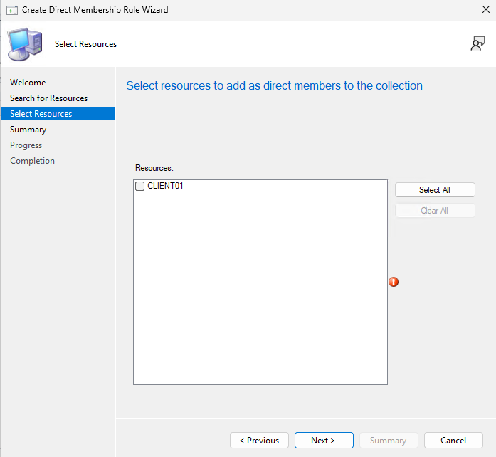

Die Übersicht zeigt direkt danach oft *Member Count 0*. Die Collection wird erst kurz ausgewertet, nach F5 steht dort 1. Doppelklick auf die Collection:

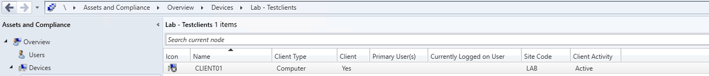

## Schritt 3 · Anwendung anlegen

**Software Library → Application Management → Applications** → Rechtsklick → **Create Application**:

| Seite | Einstellung |
|---|---|
| General | **Automatically detect information…**, Type **Windows Installer (\*.msi file)**, Location `\\CM01\Quellen\7-Zip\7z2604-x64.msi` |
| Import Information | MECM liest die MSI ein → Next |
| General Information | **Publisher** `Igor Pavlov`, **Install behavior: Install for system**. Name und Installationsbefehl `msiexec /i … /q` füllt MECM selbst aus |
| Summary → Completion | Close |

  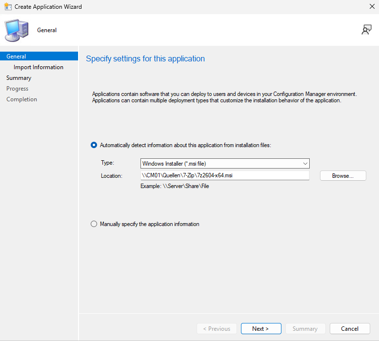
  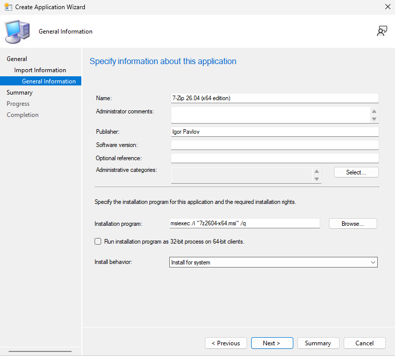

Am Ende listet der Assistent alles auf. Wichtig ist die Zeile **Detection Method**: MECM hat den **Produktcode** der MSI übernommen. Daran erkennt der Client, ob 7-Zip schon installiert ist.

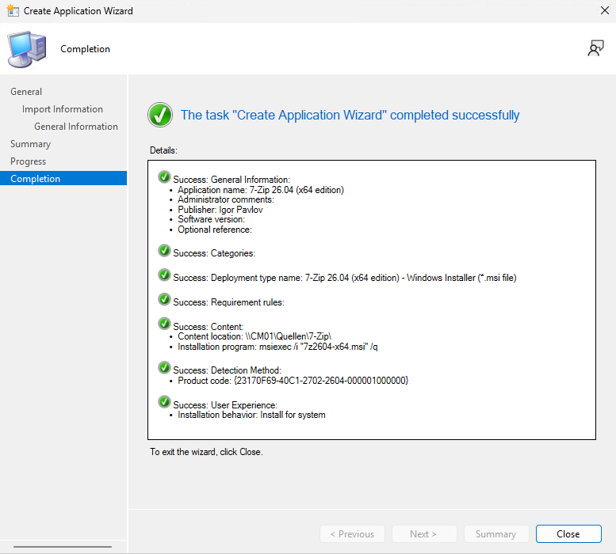

> [!NOTE]
> Bei einer `.exe` gibt es keinen Produktcode. Dann legt man die Erkennung selbst fest, z. B. „Datei `C:\Program Files\…\programm.exe` existiert“. Deshalb ist eine MSI für den Einstieg am einfachsten.

## Schritt 4 · Inhalt verteilen

Rechtsklick auf 7-Zip → **Distribute Content** → Next → **Add → Distribution Point** → `CM01.lab.test` → durchklicken.

Prüfen: **Monitoring → Distribution Status → Content Status**. Nach 1–2 Minuten und F5 ist der Kreis grün, *Success: 1*.

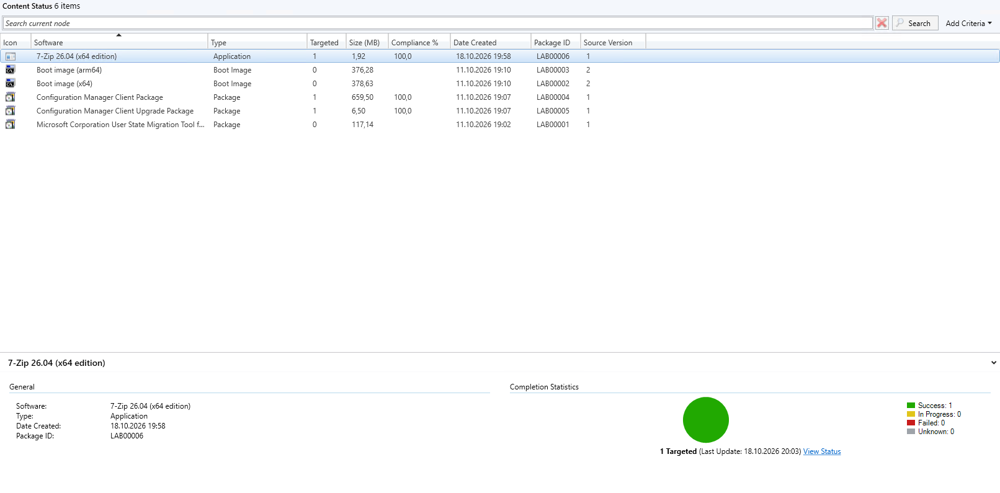

## Schritt 5 · Bereitstellen als „Available“

Rechtsklick auf 7-Zip → **Deploy**:

| Seite | Einstellung |
|---|---|
| General | Collection → **Browse** → `Lab - Testclients` |
| Content | CM01 steht schon drin |
| Deployment Settings | Action **Install**, Purpose **Available** |
| Scheduling, User Experience, Alerts | Standard |

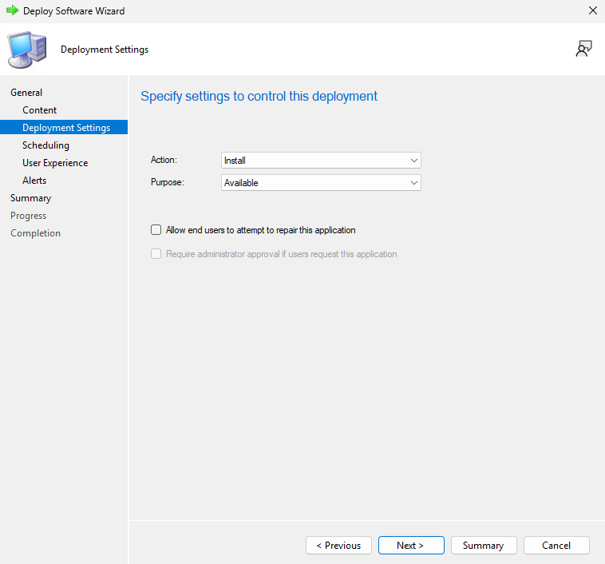

**Available** heißt: Der Benutzer sieht die Anwendung im Softwarecenter und installiert sie, wenn er will.

## Schritt 6 · Installieren auf CLIENT01

Ohne Anstoß holt sich der Client neue Richtlinien nur etwa einmal pro Stunde. Zum Testen also nachhelfen:

1. Systemsteuerung (Ansicht *Kleine Symbole*) → **Configuration Manager** → Registerkarte **Aktionen**
2. **Computerrichtlinienabruf und Auswertungszyklus** → **Jetzt ausführen**
3. Eine Minute warten, dann **Evaluationszyklus für die Anwendungsbereitstellung** → **Jetzt ausführen**

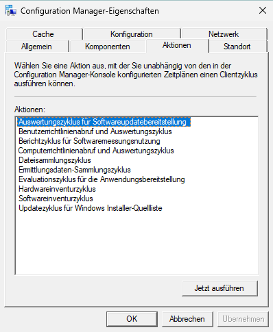

Start → **Softwarecenter** → **Anwendungen** → 7-Zip → **Installieren**. Nach kurzer Zeit steht dort *Status: Installiert*.

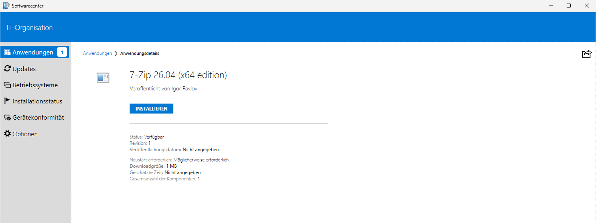

## Schritt 7 · Dasselbe als „Required“

Jetzt ohne Zutun des Benutzers:

1. Im Softwarecenter 7-Zip **deinstallieren**.
2. Konsole: 7-Zip markieren → unten Registerkarte **Deployments** → Zeile *Lab - Testclients* anklicken → oben **Delete**. Danach steht dort *No items found*.
3. Rechtsklick auf 7-Zip → **Deploy** → Collection wie oben, diesmal **Purpose: Required**.
4. Seite **Scheduling** → *Installation deadline* **As soon as possible after the available time**.

  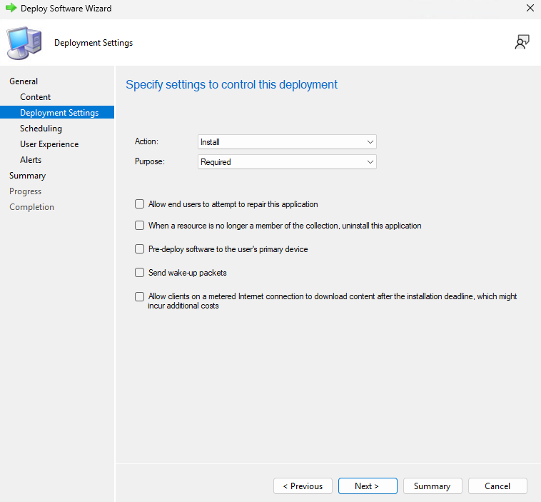
  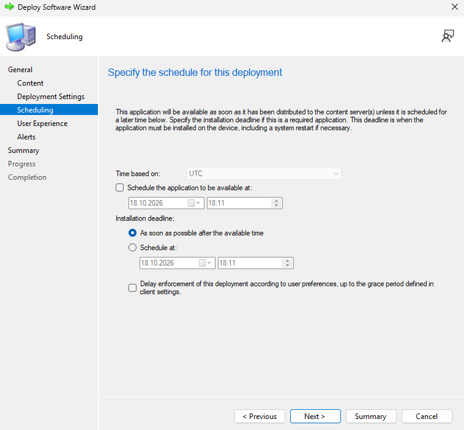

5. Auf CLIENT01 wieder beide Aktionen aus Schritt 6 ausführen.

Nach 1–3 Minuten installiert sich 7-Zip **von selbst**, rechts unten erscheint *„Installation abgeschlossen“*. *Deinstallieren* ist ausgegraut, denn eine Pflicht-Anwendung darf der Benutzer nicht entfernen.

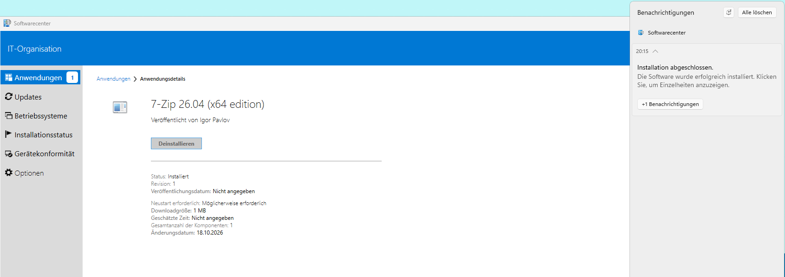

> [!NOTE]
> Mit **Required** kommt die Anwendung auch wieder, wenn sie jemand über die Systemsteuerung entfernt. Der Client prüft regelmäßig die Erkennungsregel und installiert sie dann nach.

## Schritt 8 · Erfolg prüfen

**Monitoring → Deployments** → Doppelklick auf *7-Zip … Status to Lab - Testclients* → **Run Summarization** → kurz warten → **Refresh**.

Unter **Success** steht CLIENT01 mit dem Benutzer *(SYSTEM)*. Das zeigt, dass die Installation im Systemkontext lief, wie mit *Install for system* eingestellt.

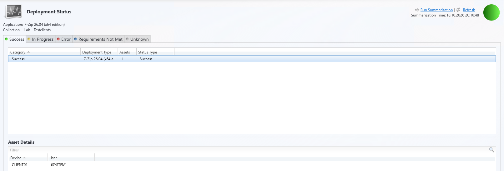

## Prüfen

| Wo | Erwartet |
|---|---|
| Konsole → Content Status | 7-Zip grün, *Success: 1* |
| CLIENT01 → Startmenü | 7-Zip File Manager ist da |
| Konsole → Deployments → Status | CLIENT01 unter **Success** |

## Häufige Fehler

| Problem | Ursache | Lösung |
|---|---|---|
| *„Specify a valid UNC file path.“* | Lokaler Pfad `C:\Quellen\…` eingetragen | Ordner freigeben, `\\CM01\Quellen\…` eintragen |
| Anwendung erscheint nicht im Softwarecenter | Client hat die Richtlinie noch nicht geholt | Beide Aktionen aus Schritt 6 ausführen, Softwarecenter neu öffnen |
| Installation hängt bei *Herunterladen* | Inhalt nicht verteilt oder Client außerhalb der Boundary Group | Content Status prüfen, Boundary aus Kapitel 11 |
| Installation scheitert | Falscher Befehl oder Erkennung passt nicht | `C:\Windows\CCM\Logs\AppEnforce.log` auf CLIENT01 lesen |
| *Compliance 0* in der Übersicht | Werte werden nur alle paar Stunden zusammengefasst | **Run Summarization** im Deployment Status |

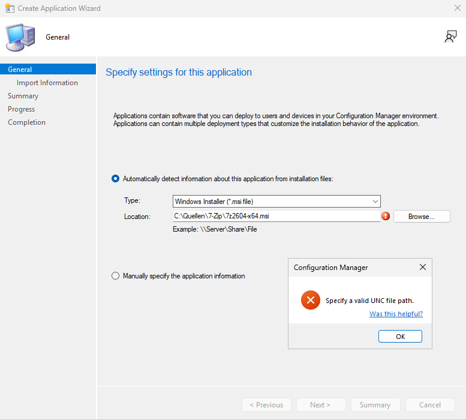

Wie es weitergeht, etwa Windows-Updates per MECM oder ein Betriebssystem per Tasksequenz ausrollen: [Roadmap](../roadmap.md)
