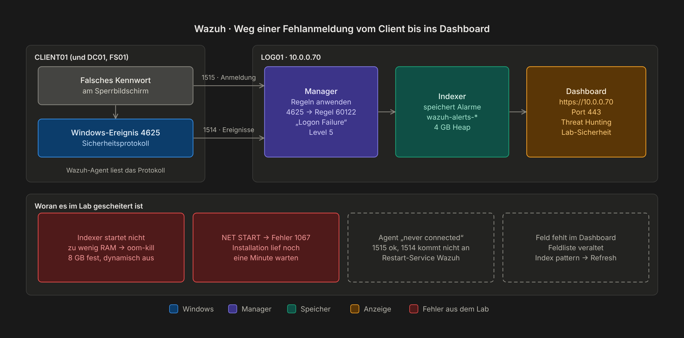
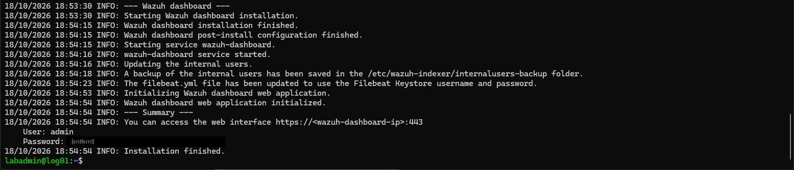
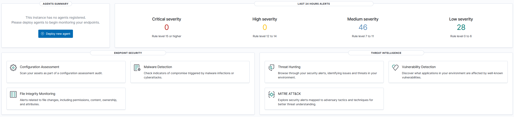
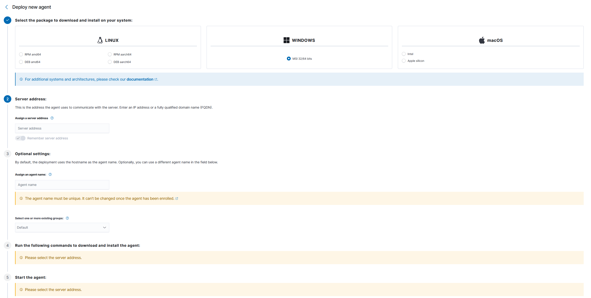
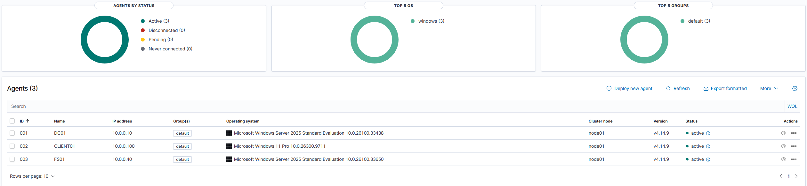
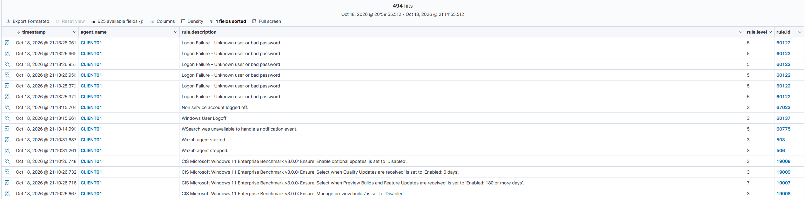
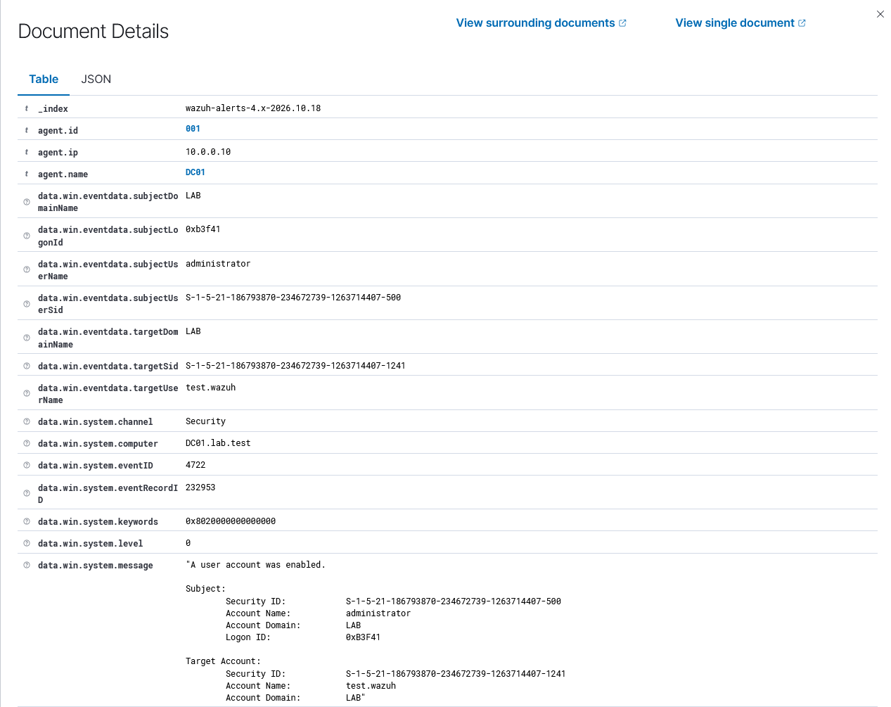
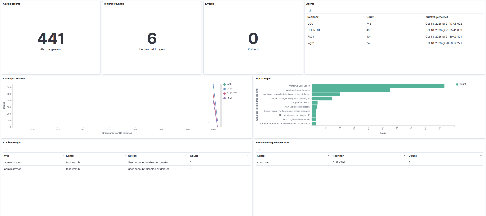
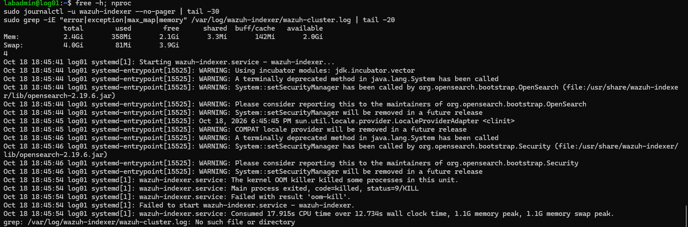
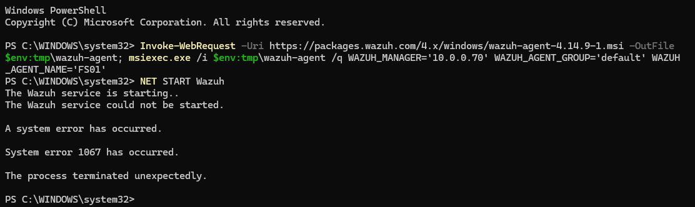

# Kapitel 13 · Wazuh: Sicherheitsüberwachung (SIEM)

[← Kapitel 12](12-softwareverteilung.md) · [Übersicht](../../README.md#inhaltsverzeichnis) · weiter: [Kapitel 14 · Homelable →](14-homelable.md)

[](../../README.md#thema-sec) [](../../README.md#thema-linux) [](../../README.md#thema-test)

> **Ziel:** Ein Wazuh-Server auf LOG01, der die Ereignisprotokolle von DC01, FS01 und CLIENT01 sammelt und Fehlanmeldungen oder neue Benutzer als Alarm meldet.
> **Dauer:** ca. 1,5 Stunden, davon 20 Minuten Warten · **Wo:** Host, LOG01, DC01, FS01, CLIENT01
> **Version:** Wazuh 4.14.9

Wazuh ist ein kostenloses **SIEM** (Security Information and Event Management). Es sammelt die Ereignisprotokolle aller Rechner an einer Stelle, wertet sie mit fertigen Regeln aus und schlägt Alarm, wenn etwas auffällt. Ohne SIEM müsste man auf jedem Server einzeln in die Ereignisanzeige schauen.

| Teil | Aufgabe |
|---|---|
| **Wazuh-Server** (LOG01) | Nimmt Ereignisse an (Manager), speichert sie (Indexer), zeigt sie an (Dashboard) |
| **Wazuh-Agent** (jeder Windows-Rechner) | Liest die Windows-Ereignisprotokolle und schickt sie an LOG01 |



| Port | Wofür |
|---|---|
| 443 | Dashboard im Browser |
| 1515 | Agent meldet sich einmalig an |
| 1514 | Agent schickt laufend Ereignisse |

## Schritt 1 · VM LOG01 anlegen (Host)

| Einstellung | Wert |
|---|---|
| Name | `LOG01`, Generation 2 |
| Prozessoren | **4** |
| Arbeitsspeicher | **8192 MB, dynamischer Arbeitsspeicher aus** |
| Festplatte | 60–80 GB (Wazuh belegt direkt nach der Installation schon 17 GB) |
| Netzwerk | `LAB` |
| Sicherheit | Secure-Boot-Vorlage **Microsoft UEFI-Zertifizierungsstelle** (wie bei TOOLS01, [Kapitel 10](10-linux-dienste.md)) |

> [!IMPORTANT]
> Ohne festen Arbeitsspeicher scheitert die Installation, siehe [Häufige Fehler](#häufige-fehler). Bei 64 GB auf dem Host CM01 vorher herunterfahren, wenn es eng wird.

## Schritt 2 · Ubuntu installieren (LOG01)

Wie TOOLS01 in Kapitel 10, mit diesen Werten:

- Netzwerk → *Edit IPv4* → **Manual**: Subnet `10.0.0.0/24`, Address `10.0.0.70`, Gateway `10.0.0.1`, Name servers `10.0.0.10`, Search domains `lab.test`
- Server name `log01`, derselbe Benutzer wie auf TOOLS01
- *Ubuntu Pro*: **Skip for now**
- Haken bei **Install OpenSSH server**

## Schritt 3 · DNS-Eintrag (DC01)

**Tools → DNS → Forward Lookup Zones → lab.test** → Rechtsklick → **New Host (A or AAAA)** → Name `log01`, IP `10.0.0.70`, Haken bei **Create associated pointer (PTR) record**. Linux tritt nicht der Domäne bei, deshalb von Hand.

## Schritt 4 · Wazuh installieren (vom Host per SSH)

PowerShell auf dem Host → `ssh labadmin@10.0.0.70` → Frage mit `yes` bestätigen. Per SSH lassen sich Befehle einfügen, in der Hyper-V-Konsole nicht.

```bash
sudo apt update && sudo apt upgrade -y
curl -sO https://packages.wazuh.com/4.14/wazuh-install.sh
sudo bash ./wazuh-install.sh -a
```

`-a` heißt *all in one*: Indexer, Manager, Filebeat und Dashboard auf einer VM. Das dauert 5–20 Minuten. Die Warnung, dass Ubuntu 26.04 nicht auf der Liste steht, ist hier ohne Folgen.

Am Ende stehen Benutzer und Kennwort:



> [!WARNING]
> - Kennwort **sofort im Kennwortmanager** speichern. Wiederfinden mit `sudo tar -O -xf wazuh-install-files.tar wazuh-install-files/wazuh-passwords.txt`
> - `wazuh-install.sh -a` **nie ein zweites Mal** auf einer laufenden Installation starten. Das Skript löscht dabei zuerst die Datei mit allen Kennwörtern. Vorher sichern: `sudo cp wazuh-install-files.tar /root/`

## Schritt 5 · Speicher für den Indexer (LOG01)

Das Skript gibt dem Indexer fest 1 GB, egal wie viel die VM hat. Mit der Hälfte des Arbeitsspeichers läuft er stabiler:

```bash
sudo sed -i 's/^-Xms.*/-Xms4g/; s/^-Xmx.*/-Xmx4g/' /etc/wazuh-indexer/jvm.options
sudo systemctl restart wazuh-indexer
```

## Schritt 6 · Dashboard öffnen (Host)

Browser → `https://10.0.0.70` → Zertifikatswarnung mit **Erweitert → Weiter** bestätigen (selbst signiert) → Anmeldung `admin`.



Die ersten Alarme kommen von LOG01 selbst, der Server überwacht sich automatisch mit.

## Schritt 7 · Agents verteilen

**Deploy new agent** (links im Dashboard oder **☰ → Agents management → Summary**):

| Feld | Eintrag |
|---|---|
| 1 · Package | **Windows**, MSI 32/64 bits |
| 2 · Server address | `10.0.0.70`, *Remember server address* an |
| 3 · Agent name | `DC01`, `FS01` oder `CLIENT01`, für jeden Rechner neu. Der Name lässt sich später nicht ändern |
| Group | Default |



Unter 4 erscheint ein fertiger Befehl. Für FS01 sieht er so aus:

```powershell
Invoke-WebRequest -Uri https://packages.wazuh.com/4.x/windows/wazuh-agent-4.14.9-1.msi -OutFile $env:tmp\wazuh-agent; msiexec.exe /i $env:tmp\wazuh-agent /q WAZUH_MANAGER='10.0.0.70' WAZUH_AGENT_GROUP='default' WAZUH_AGENT_NAME='FS01'
```

Auf dem jeweiligen Rechner in einer **PowerShell als Administrator** einfügen, **eine Minute warten**, dann:

```
NET START Wazuh
```

> [!NOTE]
> Der Agent darf nie neuer sein als der Server. Deshalb steht die Version fest im Befehl.

Nach kurzer Zeit sind alle drei **active**:



## Schritt 8 · Testen

**Fehlanmeldungen:** Auf CLIENT01 abmelden und fünfmal mit falschem Kennwort anmelden.

**☰ → Threat Hunting** → Agent CLIENT01 → *Last 15 minutes* → Registerkarte **Events**:



Jeder Versuch ist ein Eintrag *„Logon Failure – Unknown user or bad password“* (Regel 60122). Daneben sieht man das Ab- und Anmelden und die Prüfungen nach **CIS-Benchmark**: Wazuh vergleicht die Einstellungen des Clients automatisch mit Sicherheitsempfehlungen (*Configuration Assessment*).

**Neuer Benutzer:** Auf DC01 in ADUC einen Benutzer `test.wazuh` anlegen. In Threat Hunting auf **DC01** umstellen. Es erscheinen *„User account enabled or created“* und *„User account changed“*. Ein Klick auf die Lupe zeigt, **wer** das Konto angelegt hat (*subjectUserName*) und **welches** (*targetUserName*):



Genau das fragt die Revision in Firmen: Wer hat wann welches Konto angelegt? Danach `test.wazuh` wieder löschen, auch das taucht auf.

> [!TIP]
> Im Beispiel steht als Ersteller *administrator*. Mit dem eigenen Admin-Konto aus [Kapitel 4](04-ad-struktur.md#schritt-3--getrennte-konten) sieht man im Protokoll, **welche Person** es war. Ein Grund mehr für persönliche Admin-Konten.

## Schritt 9 · Eigenes Dashboard „Lab-Sicherheit“

Die eingebauten Ansichten sind umfangreich. Für den Alltag reicht eine Seite mit den wichtigsten Fragen: Melden alle Rechner? Gibt es Fehlanmeldungen? Wer hat am AD etwas geändert?



> [!IMPORTANT]
> Zuerst die Feldliste auffrischen, sonst fehlen die Windows-Felder in den Auswahllisten: **☰ → Dashboard management → Dashboards Management → Index patterns → wazuh-alerts-\*** → oben rechts **Refresh field list**.

**☰ → Dashboards → Create new dashboard**. Jede Kachel entsteht gleich: **Create new** → Typ → Quelle **`wazuh-alerts-*`** → DQL-Filter oben in die Suchzeile → rechts Metrics und Buckets einstellen → **Update** → **Save** → *Save and return*.

| Kachel | Typ | DQL-Filter | Buckets |
|---|---|---|---|
| Alarme gesamt | Metric | `not rule.groups:sca` | – |
| Fehlanmeldungen | Metric | `rule.groups:authentication_failed` | – |
| Kritisch | Metric | `rule.level >= 10` | – |
| Agents | Data Table | – | Split rows: Terms `agent.name`. Zusätzliche Metric: **Max** `timestamp` = *Zuletzt gemeldet* |
| Alarme pro Rechner | Line | `not rule.groups:sca` | X-axis: Date Histogram `timestamp` · Split series: Terms `agent.name` |
| Top 10 Regeln | Horizontal Bar | `not rule.groups:sca` | X-axis: Terms `rule.description`, Size 10 |
| AD-Änderungen | Data Table | `data.win.system.eventID:(4720 or 4726 or 4728 or 4732 or 4740)` | Split rows: `subjectUserName` (Wer) → `targetUserName` (Konto) → `rule.description` (Aktion) |
| Fehlanmeldungen nach Konto | Data Table | `data.win.system.eventID:4625` | Split rows: `targetUserName` (Konto) → `agent.name` (Rechner) |

`not rule.groups:sca` blendet die CIS-Prüfungen aus. Die machen sonst den Großteil der Treffer aus und verdecken die echten Ereignisse. Die Spaltennamen setzt man pro Split rows unter *Custom label*.

**Anordnung** in drei Reihen: oben die drei Zahlen und die Agents („Ist alles in Ordnung?“), in der Mitte Verlauf und Top-Regeln („Was passiert?“), unten die beiden Tabellen („Wer war das?“). Verschieben an der Titelzeile, Größe an der Ecke unten rechts. Zeitraum **Last 24 hours**, beim Speichern Haken bei *Store time with dashboard*.

| Event-ID | Bedeutung |
|---|---|
| 4625 | Fehlgeschlagene Anmeldung |
| 4720 · 4726 | Konto angelegt · gelöscht |
| 4728 · 4732 | Mitglied zu globaler · lokaler Gruppe hinzugefügt |
| 4740 | Konto gesperrt |

## Prüfen

| Wo | Erwartet |
|---|---|
| `https://10.0.0.70` | Dashboard lädt |
| Agents management | DC01, FS01, CLIENT01 **active** |
| Threat Hunting, CLIENT01 | Fehlanmeldungen mit Regel 60122 |
| Threat Hunting, DC01 | *User account enabled or created* |

## Häufige Fehler

| Problem | Ursache | Lösung |
|---|---|---|
| *„wazuh-indexer could not be started“*, das Skript entfernt alles wieder | Zu wenig Arbeitsspeicher, im Journal steht `oom-kill` | VM aus, **8192 MB fest**, dynamisch aus, Skript erneut starten |
| `NET START Wazuh` → *System error 1067* | Installation lief im Hintergrund noch | Eine Minute warten, nochmal starten |
| Agent steht auf *never connected* | Dienst läuft nicht oder Port 1514 gesperrt | `Restart-Service Wazuh`, `Test-NetConnection 10.0.0.70 -Port 1514` |
| Warnung *„current system does not match“* | Ubuntu 26.04 ist offiziell noch nicht gelistet | Läuft trotzdem. Wer sichergehen will, nimmt Ubuntu 24.04 |

So sah der Speicherfehler im Lab aus. `free -h` zeigt nur 2,4 GB, das Journal meldet `oom-kill`:



Und der Fehler 1067 direkt nach der Installation:



## Weiter

- Kennwort `admin` ändern: `sudo /usr/share/wazuh-indexer/plugins/opensearch-security/tools/wazuh-passwords-tool.sh -u admin -p '<neues Kennwort>'`
- Agent auf TOOLS01 und NETBOX01 (Linux, Paket *DEB amd64*)
- Angriffe simulieren und prüfen, ob Wazuh sie meldet, z. B. Kerberoasting gegen ein Dienstkonto ([Roadmap](../roadmap.md))
