# Kapitel 15 · Proxmox auf eigener Hardware: Mini-PC, Speicher, Monitoring, Fernzugriff

[← Kapitel 14](14-homelable.md) · [Übersicht](../../README.md#inhaltsverzeichnis) · [Hardware und Rack](../hardware.md)

[](../../README.md#thema-proxmox) [](../../README.md#thema-netz) [](../../README.md#thema-linux) [](../../README.md#thema-sec)

> **Ziel:** Ein sparsamer Mini-PC läuft rund um die Uhr als Proxmox-Host `pve01`. Er hat drei sauber getrennte Speicher, wird mit Beszel überwacht und ist über Tailscale auch von unterwegs erreichbar, ohne dass ein Port im Router offen ist. Danach können die VMs aus Hyper-V umziehen.
> **Dauer:** ca. 3 Stunden · **Wo:** Mini-PC (BIOS, Installer), Arbeits-PC (Browser), Handy
> **Version:** Proxmox VE 9.2, Beszel 0.21, Tailscale 1.104

Bisher lief das Lab in Hyper-V auf dem großen PC. Der muss dafür aber immer an sein. Jetzt übernimmt ein HP EliteDesk 805 G6 Mini (Ryzen 5 PRO 4650GE, 32 GB RAM), der im Leerlauf kaum Strom braucht. Wie er im 10-Zoll-Rack sitzt und verkabelt ist, steht auf der Seite [Hardware](../hardware.md).

**Warum Proxmox und nicht Windows mit Hyper-V?** Ein Windows-Host braucht selbst RAM und CPU, die bei 32 GB den VMs fehlen. Proxmox ist ein schlanker Hypervisor auf Debian-Basis, Windows Server läuft darunter als KVM-VM genauso wie unter Hyper-V. Dazu kommen LXC-Container für Linux-Dienste und die fertigen [Community-Scripts](https://community-scripts.org/). Hyper-V übe ich weiter auf dem großen PC.


| Was | Wert |
|---|---|
| pve01 | Proxmox VE, `192.168.2.20/24`, Weboberfläche `https://192.168.2.20:8006` |
| beszel | LXC-Container 100, `192.168.2.21/24`, Weboberfläche `http://192.168.2.21:8090` |
| Netz | Heimnetz `192.168.2.0/24`, Gateway und DNS `192.168.2.1` (Speedport) |
| Fernzugriff | Tailscale auf pve01 als Subnet Router für `192.168.2.0/24` |

> [!NOTE]
> Die IP-Adressen sind feste Adressen aus meinem Heimnetz **außerhalb** des DHCP-Bereichs des Routers. Bei dir sehen sie wahrscheinlich anders aus. Vorher im Router nachsehen, welche Adressen frei sind.

## Schritt 1 · Mini-PC aufrüsten (Mini-PC)

> **Werkzeug:** Torx T15 (zur Not ein kleiner Schlitzschraubendreher)

1. **Gehäuse öffnen:** Hinten die Schraube neben dem Schloss-Symbol herausdrehen, den Deckel nach vorne schieben und abheben. Er sitzt oft stramm, beim ersten Mal ruhig etwas Kraft.
   > [!WARNING]
   > Das runde Teil oben rechts an der Rückseite ist **keine Schraube**, sondern eine Plastikabdeckung für einen optionalen WLAN-Antennenanschluss. Nicht mit dem Schraubendreher hineindrücken, sie bricht leicht ab.
2. **RAM:** Er sitzt unter dem Lüfter. Den Lüfter am Scharnier hochklappen, darunter die Abdeckung anheben. Zwei SO-DIMM-Slots (DDR4), maximal 64 GB. Riegel schräg einsetzen und herunterdrücken, bis die Klammern einrasten.
3. **SSDs:** Der 2,5-Zoll-Käfig ist mit zwei Schrauben befestigt. Darunter liegen ein kleiner zweiter Lüfter und zwei M.2-Slots (2280). Für M.2-2230-SSDs braucht man einen Adapter auf 2280.

<p align="center">
  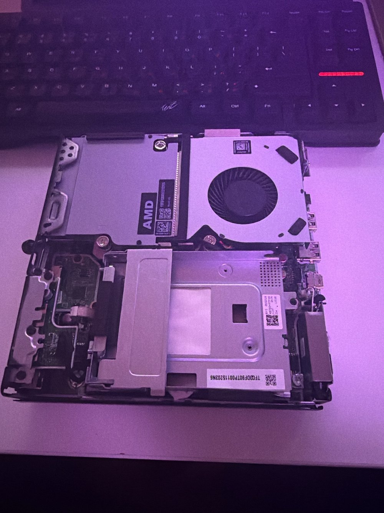
</p>

4. **Prüfen:** Einschalten, sofort mehrmals **F10** (BIOS). Unter **Main → Show Advanced System Information** müssen der volle Arbeitsspeicher und alle Laufwerke stehen.

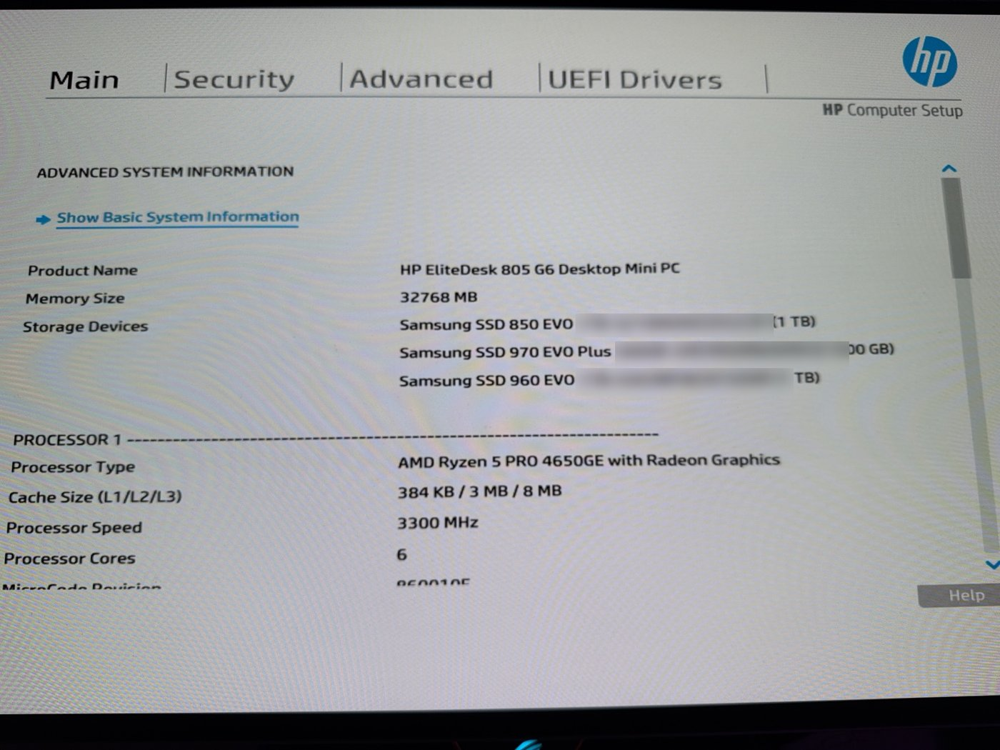

So ist pve01 bestückt:

| Laufwerk | Anschluss | Aufgabe |
|---|---|---|
| Samsung 970 EVO Plus 500 GB | M.2 NVMe | Proxmox selbst, ISOs |
| Samsung 960 EVO 1 TB | M.2 NVMe | VMs und Container (`vmdata`) |
| Samsung 850 EVO 1 TB | SATA, 2,5 Zoll | Backups, Import aus Hyper-V (`backup`) |

5. **Virtualisierung:** Im BIOS unter **Advanced → System Options** prüfen, dass die Virtualisierung (AMD-V/SVM) aktiv ist. Ohne sie startet später keine VM. Mit **F10** speichern.

## Schritt 2 · Bootstick erstellen (Arbeits-PC)

1. Auf [proxmox.com](https://www.proxmox.com/de/downloads) die ISO **Proxmox Virtual Environment** herunterladen (nicht Backup Server oder Mail Gateway).
2. [Rufus](https://rufus.ie) starten (portable Version reicht), USB-Stick ab 8 GB einstecken. **Der Stick wird komplett gelöscht.**
3. Oben den Stick wählen, bei **Startart → Auswahl** die ISO, dann **Start**.
4. Rufus fragt nach dem Schreibmodus: **Im DD-Abbild-Modus schreiben**. Im ISO-Modus startet der Proxmox-Stick oft nicht.

<p align="center">
  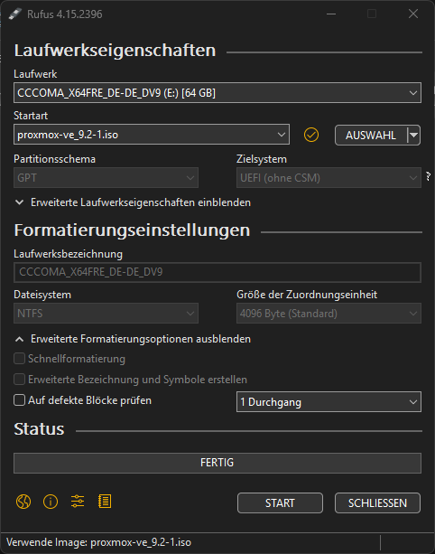
</p>

> [!NOTE]
> Danach meldet Windows eventuell, das Laufwerk müsse formatiert werden. **Abbrechen.** Windows kann das Linux-Dateisystem nur nicht lesen.

## Schritt 3 · Proxmox installieren (Mini-PC)

1. Stick, LAN-Kabel, Monitor und Tastatur anschließen. Beim Start mehrmals **F9** (Boot-Menü) → USB-Stick → **Install Proxmox VE (Graphical)**. Internet braucht die Installation nicht.
2. Die Installer-Seiten:

| Seite | Eintrag |
|---|---|
| Target Harddisk | Die Systemplatte (hier die 970 EVO Plus). **Nach Name und Größe auswählen**, nicht nach Reihenfolge. Unter *Options* Dateisystem **ext4**, ZFS lohnt sich bei einer einzelnen Platte nicht |
| Land / Zeitzone / Tastatur | Germany · Europe/Berlin · German |
| Root-Passwort, E-Mail | Passwort in den Kennwortmanager. Die E-Mail bekommt später Warnungen |
| Netzwerkkarte | Die einzige Realtek-Karte |
| Hostname (FQDN) | `pve01.lab.test` |
| IP (CIDR) | `192.168.2.20/24` |
| Gateway / DNS | `192.168.2.1` / `192.168.2.1` |

3. **Install.** Wenn *Installation successful* erscheint: **erst den Stick abziehen**, dann **Reboot**. Sonst startet wieder der Installer.
4. Am Arbeits-PC im Browser `https://192.168.2.20:8006` öffnen → Zertifikatswarnung bestätigen → Benutzer `root`, Realm **Linux PAM**. Den Hinweis *Keine gültige Subskription* mit OK wegklicken.

Ab jetzt wird pve01 nur noch über den Browser verwaltet. Monitor, Tastatur und Maus kommen wieder ab.

> [!TIP]
> In der Shell der Weboberfläche funktioniert **Strg+V** nicht. Einfügen geht per **Rechtsklick → Einfügen** oder **Strg+Shift+V**. Bequemer ist SSH aus dem Windows-Terminal: `ssh root@192.168.2.20`, dort klappt Strg+V normal.

## Schritt 4 · Paketquellen umstellen und aktualisieren (Browser)

Ohne Abo ist ab Werk die kostenpflichtige **Enterprise**-Paketquelle aktiv. Updates schlagen deshalb fehl, unten in den Tasks steht dann ein roter Eintrag *Update package database*.

1. **pve01 → Updates → Repositories**
2. Die Zeile `…enterprise.proxmox.com/debian/ceph-squid` anklicken (auf den Text, nicht aufs Häkchen) → oben **Disable**. Dasselbe für `…enterprise.proxmox.com/debian/pve`. Die beiden Debian-Zeilen bleiben, wie sie sind.
3. **Add → No-Subscription → Add**. Die Warnung, dass das nicht für Produktion gedacht ist, ist fürs Lab egal.

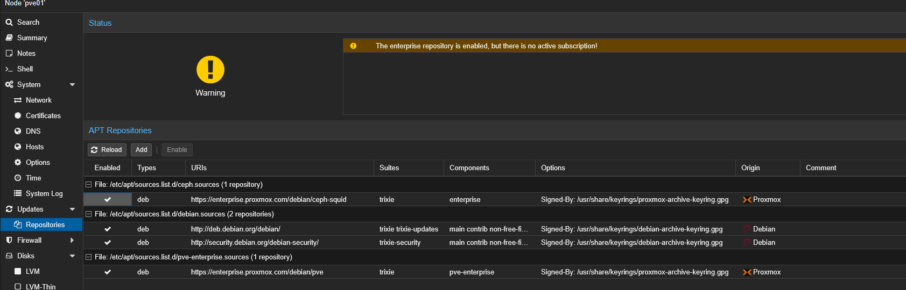

4. **pve01 → Updates → Refresh**, warten bis *TASK OK*.
5. **Upgrade.** Es öffnet sich ein Konsolenfenster (Popups für die Adresse erlauben), mit `Y` bestätigen. Alternativ in **pve01 → Shell**: `apt update && apt full-upgrade`.
6. Zwischendurch zeigt `apt-listchanges` Änderungsnotizen an. Unten steht `:` oder *(press q to quit)*: einmal ins Fenster klicken, **q** drücken, dann geht es weiter.

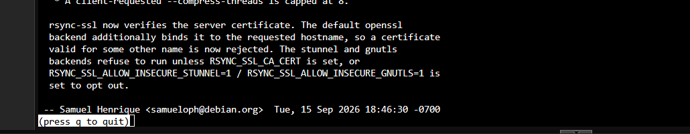

7. Warten, bis wieder `root@pve01:~#` erscheint. **Erst dann** oben rechts **Reboot**.

> [!WARNING]
> Startet pve01 nach dem Update nur bis zur Konsole `grub>`, siehe [Häufige Fehler](#häufige-fehler). Bei mir war GRUB auf der EFI-Partition danach nicht mehr sauber eingerichtet. Mit `grub-install` und `update-grub` war es dauerhaft behoben.

## Schritt 5 · Speicher einrichten (Browser)

Der Installer hat nur die Systemplatte eingerichtet. Die beiden anderen SSDs werden jetzt eingebunden, jede mit einer eigenen Aufgabe.

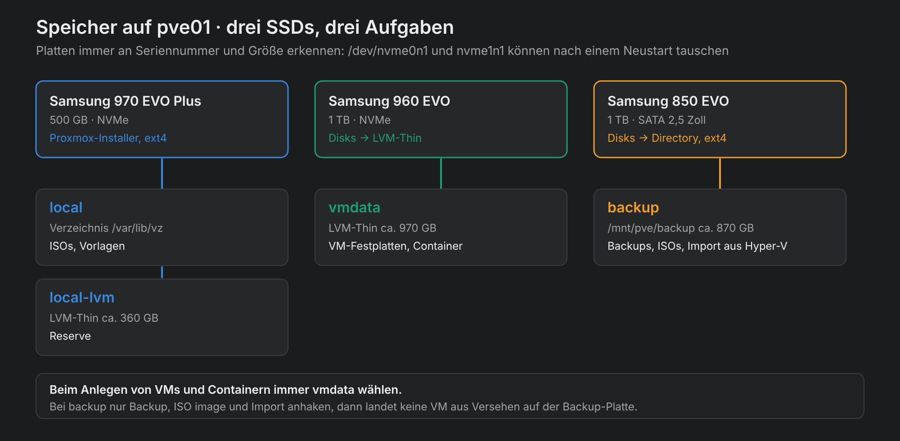

**1. Platten leeren.** **pve01 → Disks**: die beiden zusätzlichen SSDs nacheinander anklicken → **Wipe Disk** → bestätigen. **Das löscht alles darauf.** Solange noch alte Partitionen drauf sind, zum Beispiel von einem früheren Windows, bietet Proxmox die Platten nirgends an.

<p align="center">
  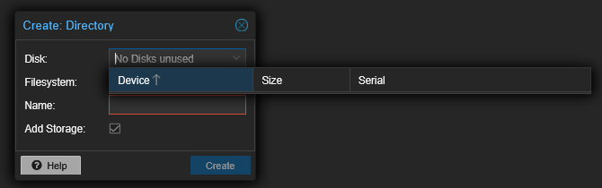
  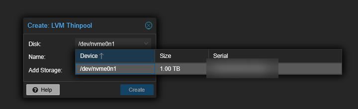
</p>

> [!IMPORTANT]
> Die Namen `/dev/nvme0n1` und `/dev/nvme1n1` können nach einem Neustart **die Plätze tauschen**. Bei mir hieß die 960 EVO vor dem Neustart `nvme1n1`, danach `nvme0n1`. Platten deshalb immer an **Seriennummer und Größe** erkennen, nie am Namen. Die Systemplatte bietet Proxmox in diesen Dialogen ohnehin nicht an.

**2. VM-Speicher.** **Disks → LVM-Thin → Create: Thinpool** → die 1-TB-NVMe, Name `vmdata`, **Add Storage** an → **Create**. LVM-Thin belegt Platz erst, wenn eine VM ihn wirklich nutzt, und kann Snapshots.

**3. Backup-Speicher.** **Disks → Directory → Create: Directory** → die SATA-SSD, Dateisystem **ext4**, Name `backup`, **Add Storage** an → **Create**.

**4. Inhalte festlegen.** **Datacenter → Storage → backup** doppelklicken → bei **Content** nur **Backup**, **ISO image** und **Import** auswählen → **OK**. *Import* braucht man später, um die Festplatten der Hyper-V-VMs einzulesen.

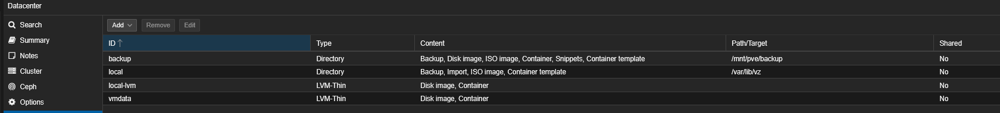

> [!TIP]
> Den Browser darf man schließen, während Proxmox einen Speicher anlegt. Der Vorgang läuft auf dem Server weiter. Ob er fertig ist, steht unten bei **Tasks** (*OK* oder *Error*). Bitte nicht einfach ein zweites Mal anlegen.

## Schritt 6 · Monitoring mit Beszel (Browser)

[Beszel](https://beszel.dev) zeigt CPU, RAM, Festplatten, Netzwerk und **Temperaturen** mit Verlauf, schlank und mit übersichtlicher Oberfläche. Der **Hub** (die Weboberfläche) läuft als LXC-Container, auf dem Proxmox-Host selbst läuft ein kleiner **Agent**, der die echten Werte des Mini-PCs liefert. Uptime Kuma (Kapitel 10) beantwortet dagegen nur die Frage „ist ein Dienst erreichbar?“. Beides ergänzt sich.

**1. Hub anlegen.** Auf [community-scripts.org](https://community-scripts.org/scripts/beszel) den Befehl für **Beszel** kopieren und in **pve01 → Shell** einfügen. Die Frage nach anonymen Statistiken kannst du mit **No** beantworten. Dann **Advanced Install**:

<p align="center">
  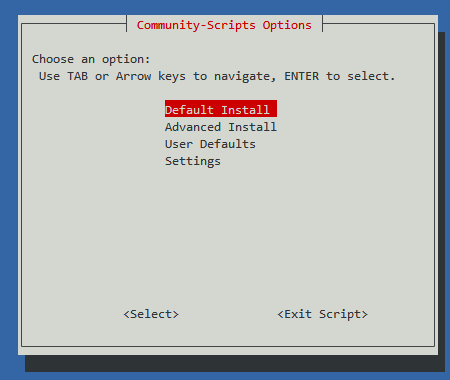
  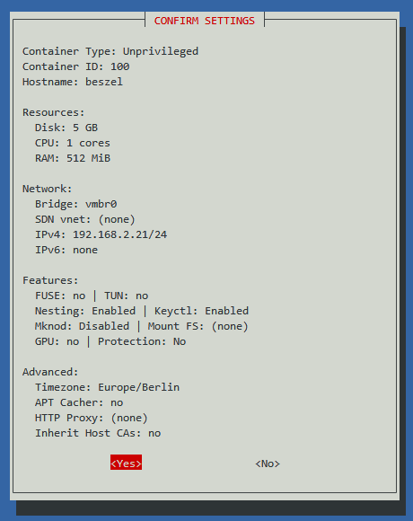
</p>

| Frage | Eintrag |
|---|---|
| Container Type | Unprivileged |
| Hostname | `beszel` |
| Bridge | `vmbr0` |
| IPv4 | static `192.168.2.21/24`, Gateway `192.168.2.1` |
| IPv6 | none |
| SSH, FUSE, Proxy, Protection, Verbose | No |
| Nesting | Yes (App-Standard) |
| Mount Filesystems, Post-Install Hook | leer lassen |
| Storage für das Template | `local` (mit Leertaste auswählen, dann Enter) |
| Storage für den Container | `vmdata` |
| Save as defaults | **No**, sonst bekommt der nächste Container dieselbe feste IP |

Alles andere mit dem Standard bestätigen. Nach ein paar Minuten steht am Ende die Adresse.

**2. Admin anlegen.** `http://192.168.2.21:8090` öffnen, E-Mail und Kennwort festlegen (Kennwortmanager).

**3. Host hinzufügen.** Oben rechts **Add System** → Reiter **Binary**, nicht Docker: Auf dem Proxmox-Host gibt es kein Docker.

| Feld | Eintrag |
|---|---|
| Name | `pve01` |
| Host / IP | `192.168.2.20` |
| Port | `45876` |

**Copy Linux command** (links, nicht das Dropdown) → in **pve01 → Shell** einfügen. Das ist die Shell des **Hosts**, nicht die von Container 100. Die Frage nach automatischen Updates mit `y` beantworten. Wenn *Beszel Agent has been installed successfully* erscheint, im Browser **Add System**.

<p align="center">
  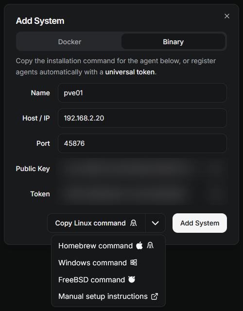
</p>

> [!CAUTION]
> Der Installationsbefehl enthält einen **Token**. Nicht öffentlich posten und nicht in ein Repo legen. Im Screenshot oben ist er unkenntlich gemacht.

**Prüfen:** Nach etwa einer Minute ist `pve01` grün und zeigt Werte.

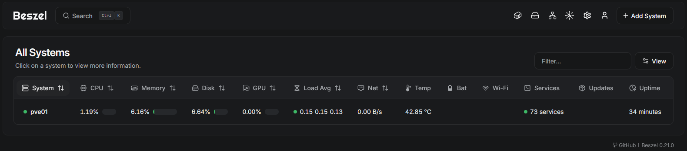

Nach der ersten Nacht lohnt ein Blick in die Verlaufsgrafiken (auf `pve01` klicken):

<p align="center">
  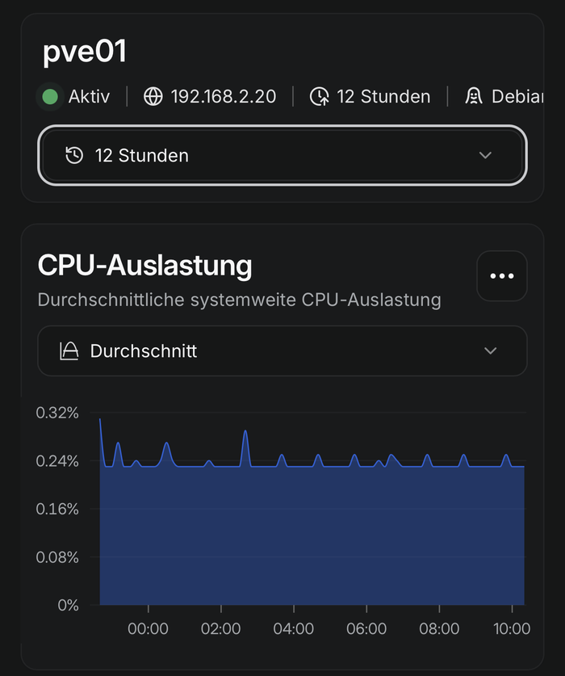
  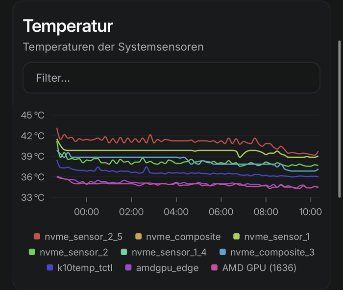
</p>

| Wert im Leerlauf | Bei mir | Bewertung |
|---|---|---|
| CPU | ca. 0,25 % | Nur Hintergrundjobs, kleine Spitzen sind normal |
| Systemlast | unter 0,2 | Bei 12 Threads praktisch Leerlauf. Ein Buckel nachts sind geplante Wartungsjobs |
| CPU-Temperatur (`k10temp_tctl`) | ca. 36 °C | Kritisch erst ab ca. 90 °C |
| NVMe-Temperaturen | 37–42 °C | Kritisch erst ab ca. 70 °C |

## Schritt 7 · Zugriff von unterwegs mit Tailscale (Shell, Browser, Handy)

Statt im Router Ports freizugeben, läuft [Tailscale](https://tailscale.com) direkt auf pve01 als **Subnet Router**. Das Handy baut einen verschlüsselten WireGuard-Tunnel zu pve01 auf und erreicht darüber das ganze Heimnetz: Proxmox, Beszel, den Switch. Aus dem Internet ist nichts offen. Der kostenlose Tarif reicht.

**1. Installieren.** In **pve01 → Shell**, Zeile für Zeile:

```bash
curl -fsSL https://tailscale.com/install.sh | sh
echo 'net.ipv4.ip_forward = 1' > /etc/sysctl.d/99-tailscale.conf && sysctl -p /etc/sysctl.d/99-tailscale.conf
tailscale up --advertise-routes=192.168.2.0/24
```

Die zweite Zeile erlaubt dem Host, Pakete weiterzuleiten. Ohne sie funktioniert der Subnet Router nicht.

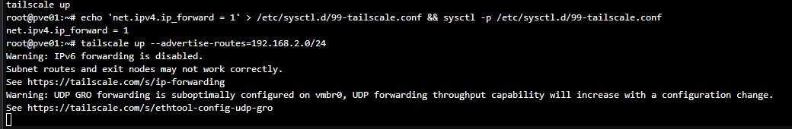

Die Warnungen zu *IPv6 forwarding* (es wird nur IPv4 weitergeleitet) und *UDP GRO* (nur ein Performance-Hinweis) kann man ignorieren. Der letzte Befehl zeigt einen Link `https://login.tailscale.com/a/…`: im Browser öffnen und anmelden.

**2. Route freigeben.** In der Tailscale-Verwaltung unter [Machines](https://login.tailscale.com/admin/machines) bei `pve01` → **⋯** → **Edit route settings…** → `192.168.2.0/24` anhaken → **Save**. Im selben Menü **Disable key expiry**, sonst muss sich der Server alle 180 Tage neu anmelden.

**3. Handy.** Tailscale-App installieren, mit **demselben Konto** anmelden, VPN einschalten.

**Prüfen:** Am Handy **WLAN aus, mobile Daten an**, Tailscale an, dann `http://192.168.2.21:8090` öffnen. Beszel lädt wie zu Hause. Ganz ohne Internet geht es natürlich nicht, der Tunnel läuft übers Netz.

## Schritt 8 · Einbauen und verkabeln

Der Mini-PC kommt auf den Fachboden im Rack, das LAN-Kabel hinten ins Patchpanel. Belegung und Portplan: [Hardware](../hardware.md#verkabelung). Danach im Switch unter **Switching → Port Setting** prüfen, ob der Port mit **1000MF** läuft.

<p align="center">
  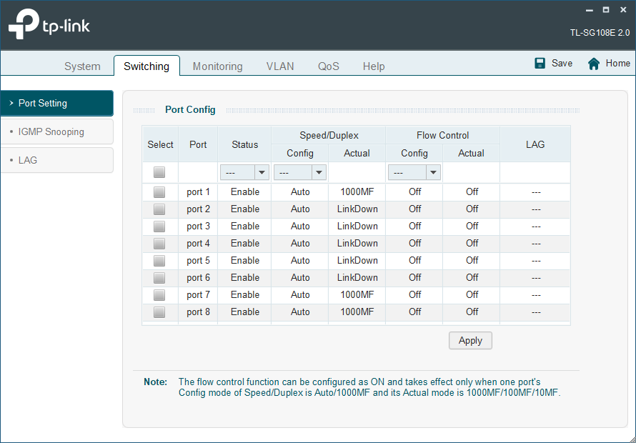
</p>

> [!TIP]
> Zum Ausschalten reicht ein **kurzer** Druck auf den Power-Knopf: Proxmox fährt dann sauber herunter. Nicht den Stecker ziehen, solange die LED leuchtet.

## Prüfen

- [ ] `https://192.168.2.20:8006` erreichbar, Anmeldung als `root`
- [ ] Unter **Updates → Repositories** sind die Enterprise-Quellen aus und *No-Subscription* an, **Refresh** läuft ohne Fehler
- [ ] Ein **Reboot** aus der Weboberfläche klappt, pve01 ist danach von selbst wieder erreichbar
- [ ] **Datacenter → Storage** zeigt `local`, `local-lvm`, `vmdata` und `backup`, alle *Enabled*
- [ ] Beszel zeigt `pve01` grün mit Temperaturen
- [ ] Über mobile Daten mit Tailscale ist Beszel erreichbar
- [ ] DNS-Einträge `pve01` und `beszel` (A + PTR) auf DC01, sobald DC01 auf pve01 läuft

## Häufige Fehler

| Problem | Ursache | Lösung |
|---|---|---|
| Nach dem Neustart nur `grub>` statt Boot-Menü | GRUB findet nach dem Update seine Konfiguration nicht | Einmal von Hand starten (siehe unten), dann in der Shell `grub-install --target=x86_64-efi --efi-directory=/boot/efi --bootloader-id=proxmox` und `update-grub` |
| Mini-PC zeigt nach Neustart kein Bild, Tastatur bleibt dunkel, Power-LED leuchtet weiß | Start hängt vor dem HP-Logo, sehr wahrscheinlich wegen eines angesteckten USB-Geräts | Nur Strom, LAN und Monitor anstecken. Erst dann Gehäuse öffnen. Ohne LAN-Kabel bringt ein Ping-Test natürlich nichts |
| *Update package database* rot, Updates schlagen fehl | Enterprise-Paketquelle ohne Abo | Schritt 4: Enterprise aus, No-Subscription an |
| Upgrade „hängt“ mit `:` am unteren Rand | `apt-listchanges` zeigt Änderungsnotizen | Ins Fenster klicken, **q** |
| *No Disks unused* beim Anlegen eines Speichers | Auf der Platte sind noch alte Partitionen | **Disks → Wipe Disk** |
| Falsche Platte ausgewählt | `/dev/nvme0n1` und `nvme1n1` haben nach einem Neustart getauscht | Immer an Seriennummer und Größe erkennen |
| Beszel-Agent lässt sich nicht installieren | Reiter **Docker** gewählt, auf dem Proxmox-Host gibt es kein Docker | Reiter **Binary**, **Copy Linux command** |
| Zweiter Container bekommt dieselbe IP | *Save as defaults* mit Yes beantwortet | Mit **No** antworten, die Vorgaben liegen sonst unter `/usr/local/community-scripts/defaults/` |
| Strg+V in der Proxmox-Shell geht nicht | Im Browser-Terminal ist Strg+V belegt | Rechtsklick → Einfügen, Strg+Shift+V oder SSH aus dem Windows-Terminal |
| Handy erreicht das Heimnetz über Tailscale nicht | Route nicht freigegeben oder IP-Forwarding fehlt | In der Tailscale-Verwaltung die Route `192.168.2.0/24` anhaken, `sysctl net.ipv4.ip_forward` muss `1` zeigen |

**GRUB von Hand starten:** In der Konsole `grub>` gilt US-Tastatur: `=` liegt auf **´**, `-` auf **ß**, `/` auf **-**, y und z sind vertauscht. Jede Zeile mit Enter, Dateinamen mit **Tab** ergänzen lassen, `<version>` ist die höchste Kernel-Version, die Tab anzeigt:

```
set root=(lvm/pve-root)
linux /boot/vmlinuz-<version>-pve root=/dev/mapper/pve-root ro quiet
initrd /boot/initrd.img-<version>-pve
boot
```

<p align="center">
  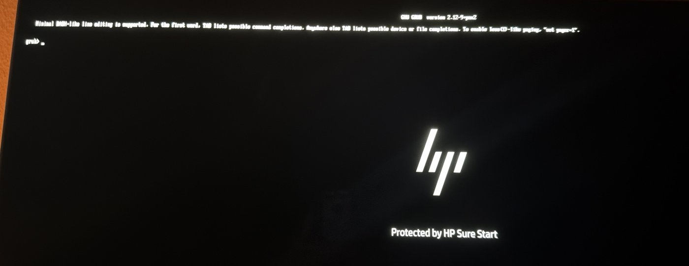
  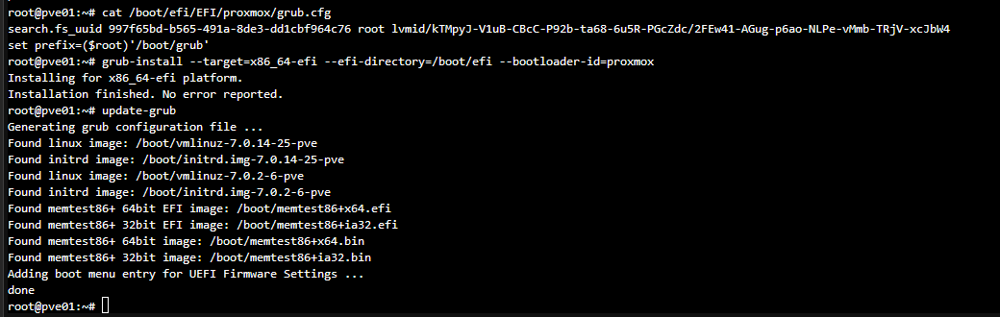
</p>

Wie es weitergeht: Lab-Netz als zweite Bridge auf pve01, dann ziehen die VMs aus Hyper-V um, DC01 zuerst. [Roadmap](../roadmap.md)
