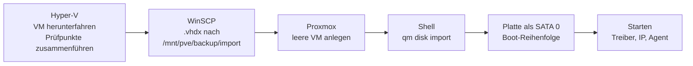

# Kapitel 17 · Umzug der VMs von Hyper-V auf Proxmox

[← Kapitel 16](16-pi-nas.md) · [Übersicht](../../README.md#inhaltsverzeichnis) · [Fehlerbehebung](../fehlerbehebung.md#umzug-hyper-v--proxmox) · [Kapitel 18 →](18-betrieb.md)

[](../../README.md#thema-proxmox) [](../../README.md#thema-hyperv) [](../../README.md#thema-ad) [](../../README.md#thema-linux) [](../../README.md#thema-netz)

> **Ziel:** Die Dienste des Labs (Domain Controller, Dateiserver, Werkzeug-Server, Wazuh) laufen nicht mehr in Hyper-V auf dem großen PC, sondern als KVM-VMs auf `pve01`. Die Platten werden übernommen, nichts wird neu installiert. IP-Adressen, Domäne und Freigaben bleiben gleich.
> **Dauer:** ca. 3–4 Stunden für vier VMs, viel davon Warten · **Wo:** Arbeits-PC (Hyper-V, WinSCP, Browser), pve01 (Weboberfläche und Shell)
> **Voraussetzung:** [Kapitel 15](15-proxmox-host.md) mit Lab-Bridge `vmbr1` (`10.0.0.1/24`, NAT), Speicher `vmdata` und `backup`, ein funktionierendes Backup ([Kapitel 16](16-pi-nas.md))

| VM | Proxmox-ID | System | CPU / RAM auf pve01 | Netzwerkkarte |
|---|---|---|---|---|
| DC01 | 110 | Windows Server 2025 | 2 Kerne / 2 GB | Intel E1000E |
| FS01 | 140 | Windows Server 2025, zweite Platte E: | 2 Kerne / 2 GB | Intel E1000E |
| TOOLS01 | 150 | Ubuntu 26.04 mit Docker | 4 Kerne / 6 GB (danach 3 GB) | VirtIO |
| CM01 | 120 | Windows Server 2025 mit MECM und SQL | 4 Kerne / 8 GB fest | Intel E1000E |
| LOG01 | 170 | Ubuntu 26.04 mit Wazuh | 4 Kerne / 6 GB | VirtIO |
| CLIENT01 | 900 | Windows 11 | 2 Kerne / 4 GB | Intel E1000E |

> [!NOTE]
> In Hyper-V hatten alle VMs 8 virtuelle Kerne. Auf einem Mini-PC mit 6 Kernen/12 Threads ist das zu viel. Für ein Lab reichen 2 Kerne für Windows-Server locker, mehr geben kann man jederzeit.

> [!IMPORTANT]
> **DC01 gibt es nur einmal.** Sobald DC01 auf Proxmox einmal im Netz lief, die Hyper-V-Kopie **nie wieder starten**. Zwei Domain Controller mit derselben Identität und unterschiedlichem Stand führen zu einem USN-Rollback, die Domäne ist danach kaputt. Bei Problemen auf Proxmox reparieren, nicht zurückwechseln.

## Ablauf in Kürze



Windows und Linux unterscheiden sich nur im letzten Schritt. Linux braucht vor dem Umzug noch eine Vorbereitung in Hyper-V (Schritt 3).

## Schritt 1 · Vorab prüfen (pve01, Pi-NAS)

1. **Backup von letzter Nacht:** Proxmox → **Datacenter → Backup** und unten in den Tasks: Der Backup Job steht auf **OK**. Unter **nas (pve01) → Backups** liegen Dateien von heute.
2. **RAID gesund:** OpenMediaVault → **Storage → Multiple Device**: `md0` steht auf **clean**.
3. **Updates:** pve01 → **Updates → Refresh → Upgrade**. Lieber vorher als mitten im Umzug.

## Schritt 2 · Bestandsaufnahme und Herunterfahren (Arbeits-PC, Hyper-V)

1. PowerShell als Administrator, nur lesen:

   ```powershell
   Get-VM DC01,FS01,TOOLS01 | Select-Object Name, Generation, ProcessorCount, @{n='RAM_MB';e={$_.MemoryStartup/1MB}}
   Get-VMHardDiskDrive DC01,FS01,TOOLS01 | Select-Object VMName, Path
   ```

   Die beiden Befehle **einzeln** ausführen, sonst verschluckt PowerShell die zweite Tabelle.
2. **Generation 2** heißt in Proxmox **BIOS: OVMF (UEFI)**, Generation 1 heißt SeaBIOS.
3. Herunterfahren in der Reihenfolge **TOOLS01 → FS01 → DC01**, DC01 zuletzt.
4. **Prüfpunkte zusammenführen:** Bei jeder VM im Bereich *Prüfpunkte* den obersten Eintrag rechtsklicken → **Prüfpunktunterstruktur löschen** und warten, bis die VM wieder nur **Aus** zeigt.
5. **Kontrolle:** Alle Pfade aus Schritt 1 enden auf **.vhdx**, keiner auf `.avhdx`. Eine `.avhdx` ist ein Differenzdatenträger. Kopiert man nur die `.vhdx` darunter, fehlt alles seit dem Prüfpunkt.
6. **Automatische Prüfpunkte abschalten:** Rechtsklick auf die VM → **Einstellungen → Prüfpunkte** → **Automatische Prüfpunkte verwenden** abhaken. Sonst legt Hyper-V beim nächsten Start (z. B. für Schritt 3) wieder still eine `.avhdx` an.

> [!TIP]
> Eine alte Sicherungsplatte (bei mir `DC01_Backup.vhdx` aus der Windows-Server-Sicherung) muss nicht mit. Die Sicherung übernimmt jetzt Proxmox.

## Schritt 3 · Nur Linux: Treiber für Proxmox nachrüsten (Hyper-V-Konsole)

Ubuntu baut seine Startumgebung (initramfs) standardmäßig nur mit den Treibern, die es gerade braucht, also mit den Hyper-V-Treibern. Auf Proxmox findet der Kernel dann seine eigene Platte nicht und bleibt mit `A start job is running for /dev/disk/by-uuid/…` hängen, nach ein paar Minuten im **Emergency Mode**.

Deshalb **vor** dem Kopieren in Hyper-V starten, anmelden und:

1. Datei anlegen:

   ```
   sudo nano /etc/dracut.conf.d/90-proxmox.conf
   ```

   Inhalt (Leerzeichen nach dem ersten und vor dem letzten Anführungszeichen beachten):

   ```
   hostonly="no"
   add_drivers+=" ahci sd_mod virtio_pci virtio_scsi virtio_blk virtio_net "
   ```

   Speichern mit **Strg+O → Enter → Strg+X**.
2. Startumgebung für den laufenden Kernel neu bauen:

   ```
   sudo dracut -f /boot/initrd.img-$(uname -r) $(uname -r)
   ```

   `dracut --regenerate-all` bricht bei mir mit `Can't write to /boot/efi/…/7.0.0-30-generic` ab, weil ein alter Kernel-Pfad fehlt. Der gezielte Befehl reicht, GRUB startet ohnehin den neuesten Kernel.
3. `sudo shutdown now`, danach in Hyper-V prüfen, dass **kein neuer Prüfpunkt** entstanden ist.

> [!WARNING]
> Die Hyper-V-Konsole tippt bei **Zwischenablage → Text eingeben** mit englischem Layout, dabei kommt Zeichensalat heraus. Lieber abtippen. Englisches Layout: `_` = **Shift+ß**, `-` = **ß**, `"` = **Shift+Ä**, Y und Z vertauscht. Und: Benutzername und Kennwort nie ins falsche Feld tippen, auf dem Bildschirm steht das Kennwort sonst im Klartext.

## Schritt 4 · Platten hochladen (Arbeits-PC, WinSCP)

1. WinSCP: Protokoll **SFTP**, Host `192.168.2.20`, Benutzer `root`.
2. Rechts nach `/mnt/pve/backup/`, mit **F7** den Ordner `import` anlegen.
3. Links die `.vhdx`-Dateien hineinziehen. `C:\ProgramData` ist versteckt, den Pfad am besten oben eintippen.
4. Größe und Änderungsdatum links und rechts vergleichen.

Gigabit schafft etwa 100 MB/s, eine 44-GB-Platte dauert also rund 7 Minuten.

## Schritt 5 · Leere VM anlegen (pve01, Weboberfläche)

**Create VM** oben rechts, am Ende **Start after created** aus lassen.

| Reiter | Windows (DC01, FS01) | Linux (TOOLS01, LOG01) |
|---|---|---|
| General | VM ID und Name | VM ID und Name |
| OS | **Do not use any media**, Microsoft Windows 11/2022/2025 | **Do not use any media**, Linux 7.x – 2.6 Kernel |
| System | Machine **q35**, BIOS **OVMF (UEFI)**, EFI Storage `vmdata`, Pre-Enroll keys an, **TPM aus**, **Qemu Agent an** | wie Windows |
| Disks | vorgeschlagene Platte mit dem Mülleimer löschen | löschen |
| CPU | 2 Cores, Type **host** | 4 Cores, Type **host** |
| Memory | 2048 | 6144, Advanced → **Ballooning aus** |
| Network | Bridge **vmbr1**, Model **Intel E1000E** | Bridge **vmbr1**, Model **VirtIO** |

> [!CAUTION]
> Auf der Confirm-Seite einmal alles lesen. Bei mir standen beim zweiten Anlegen noch Werte vom vorherigen Durchlauf drin (Linux, 4 Kerne, **vmbr0**). Mit vmbr0 landet die VM im Heimnetz statt im Lab-Netz.

**Warum E1000E für Windows?** Diese Karte kennt Windows ohne Zusatztreiber, die VM ist also sofort im Netz. VirtIO ist schneller, braucht aber die virtio-win-Treiber. Umstellen kann man später.

## Schritt 6 · Platte importieren und einbinden (pve01)

1. **pve01 → Shell**, pro Platte:

   ```
   qm disk import 110 /mnt/pve/backup/import/DC01.vhdx vmdata
   qm disk import 140 /mnt/pve/backup/import/FS01org.vhdx vmdata
   qm disk import 140 /mnt/pve/backup/import/FS01-Daten.vhdx vmdata
   qm disk import 150 /mnt/pve/backup/import/TOOLS01.vhdx vmdata
   ```

   Am Ende steht `Successfully imported disk as 'unused0:…'`. Die angezeigte Größe ist die **maximale** Größe der dynamischen VHDX (Hyper-V-Standard: 127 GB). Belegt wird auf `vmdata` (LVM-Thin) nur, was wirklich Daten enthält.
2. VM → **Hardware → Unused Disk 0** doppelklicken → Bus **SATA**, Nummer **0**, **Discard** und **SSD emulation** an → **Add**.
3. Bei zwei Platten (FS01) zählt die Reihenfolge der Imports: `disk-1` = System → **SATA 0**, `disk-2` = Daten → **SATA 1**. Sicher geht's unter **vmdata → VM Disks** anhand der Größe.
4. **Options → Boot Order:** bei **sata0** den Haken in der Spalte *Enabled* setzen, nach oben ziehen. `net0` abhaken.
5. Nur Windows: **Hardware → CD/DVD Drive (ide2)** → **Use CD/DVD disc image file**, ISO **virtio-win.iso**.

## Schritt 7a · Windows starten und nacharbeiten

**Reihenfolge: DC01 zuerst**, dann FS01.

1. Starten, **Console**. Der erste Start zeigt lange *Applying computer settings*, weil Windows neue Hardware einrichtet und der DC auf sein Netz wartet. 5–10 Minuten sind normal.
2. Strg+Alt+Entf: in der Proxmox-Konsole links die Leiste aufklappen → **Ctrl-Alt-Del**.
3. Auf dem CD-Laufwerk **virtio-win** `virtio-win-guest-tools.exe` installieren (Treiber und QEMU Guest Agent).
4. Die Netzwerkkarte ist neu, die feste IP hing an der alten. `ncpa.cpl` → neuer Adapter → IPv4:

   | | DC01 | FS01 |
   |---|---|---|
   | IP | `10.0.0.10/24` | `10.0.0.40/24` |
   | Gateway | `10.0.0.1` | `10.0.0.1` |
   | DNS | `127.0.0.1` | `10.0.0.10` |

   Meldet Windows, dass die IP schon einem anderen Adapter gehört: **Ja**, alte Konfiguration entfernen.

   > [!WARNING]
   > Danach mit `ipconfig` prüfen, ob das **Standardgateway** wirklich drinsteht. Bei mir fehlte es bei FS01 und CM01. Ohne Gateway antwortet der Server nur im Lab-Netz, RDP vom Arbeits-PC geht nicht.
5. **Prüfen DC01:** `ping 1.1.1.1` (Internet über NAT von vmbr1), `dcdiag /q`. Direkt nach dem Umzug meldet `SystemLog` noch Fehler vom ersten Start, das ist normal. Im DHCP-Manager unter **IPv4 → Eigenschaften → Erweitert → Bindungen** muss die neue Verbindung mit `10.0.0.10` angehakt sein.
6. **Prüfen FS01:** Laufwerk **E:** da, `fsmgmt.msc` zeigt die Freigabe `Abteilungen`, `nltest /sc_verify:lab.test` endet mit `NERR_Success`.
7. **Proxmox → Summary:** Bei *IPs* steht die Adresse, der Guest Agent läuft also.

## Schritt 7b · Linux starten und nacharbeiten

1. Starten, **Console**. Mit den Treibern aus Schritt 3 bootet die VM normal.
2. Die Netzwerkkarte hat eine neue MAC-Adresse (steht unter **Hardware → Network Device**). Ubuntu-Server-Installationen sprechen ihre Karte in Netplan über die MAC an, deshalb holt sich die VM jetzt per DHCP eine fremde Adresse oder gar keine.

   ```
   sudo nano /etc/netplan/00-installer-config.yaml
   ```

   Nur die Zeile `macaddress:` auf die neue MAC ändern, alles andere bleibt. Durch `set-name: eth0` heißt die Karte danach wieder `eth0` wie unter Hyper-V.

   ```
   sudo netplan apply
   ip a show eth0
   ```
3. Guest Agent:

   ```
   sudo apt update
   sudo apt install -y qemu-guest-agent
   sudo reboot
   ```

   Die Meldung *qemu-guest-agent.service is a disabled or static unit* ist normal, der Agent startet automatisch, sobald Proxmox den Kanal bereitstellt. Ohne `apt update` kommen bei älteren Paketlisten `404 Not Found`.
4. **TOOLS01:** `docker ps`, alle Container *Up*.
5. **LOG01 (Wazuh):** Mit 6 statt 8 GB RAM den Indexer-Heap verkleinern, in `/etc/wazuh-indexer/jvm.options`:

   ```
   -Xms3g
   -Xmx3g
   ```

   Beide Werte müssen gleich sein. Danach `sudo reboot`, nach ein, zwei Minuten im Dashboard prüfen, dass die Agents wieder melden.

> [!TIP]
> Im Browser fängt **Strg+W** (Suche in nano) die Tastenkombination ab und schließt den Tab. In der Proxmox-Konsole darum lieber mit den Pfeiltasten hinnavigieren. Strg+O und Strg+X funktionieren.

## Schritt 8 · Arbeits-PC umstellen

Bisher hing der PC über den internen Hyper-V-Switch direkt im Lab-Netz. Jetzt liegt das Lab hinter pve01.

1. `ncpa.cpl` → **vEthernet (LAB)** → **Deaktivieren**. Solange der Adapter an ist, sucht der PC `10.0.0.x` bei Hyper-V.
2. Route über pve01, Eingabeaufforderung als Administrator:

   ```
   route -p add 10.0.0.0 mask 255.255.255.0 192.168.2.20
   ```
3. Testen: `ping 10.0.0.10`. Für Namen in `lab.test` `ping dc01.lab.test` statt `nslookup` nehmen: `nslookup` fragt immer den Router und ignoriert die NRPT-Regel. Zum gezielten Fragen: `nslookup client01.lab.test 10.0.0.10`.
4. Hat eine VM eine neue IP bekommen (CLIENT01 per DHCP), hilft am PC `ipconfig /flushdns`.

Für RDP und SSH ab jetzt einen Verbindungsmanager (z. B. Remote Desktop Manager) mit den IP-Adressen. Tastatur und Bild sind dort deutlich besser als in der Proxmox-Konsole.

## Schritt 9 · Aufräumen

| Was | Wann |
|---|---|
| Hyper-V-VMs DC01, FS01, TOOLS01, LOG01, CLIENT01 | ausgeschaltet lassen, nach 1–2 Wochen löschen. DC01 nie wieder starten |
| `.vhdx` unter `/mnt/pve/backup/import/` | löschen, sobald alles läuft (belegt sonst den Backup-Speicher) |
| NetBox | Cluster der VMs von Hyper-V auf pve01, vCPUs nachtragen |
| Backup-Jobs | der Testclient ist bei mir ausgeschlossen (**Selection Mode → Exclude selected VMs**) |

## Windows nachträglich auf VirtIO umstellen

SATA und E1000E sind für den ersten Start bequem, aber langsam. Bei CM01 (SQL + MECM) war das deutlich zu spüren. Umstellen geht in einer Viertelstunde, aber **nur bei ausgeschalteter VM** und **nach einem Backup**.

> [!CAUTION]
> Wer Platten bei laufender VM abhängt, bekommt nur eine orange durchgestrichene „pending“-Änderung. Wird dann weitergeklickt (Revert, Remove …), ist die Systemplatte schnell gelöscht. Mir ist genau das bei CM01 passiert, gerettet hat mich die `.vhdx` unter `/mnt/pve/backup/import/`. Erst herunterfahren, dann umbauen.

1. **Treiber vorbereiten:** **Hardware → Add → Hard Disk**, Bus **SCSI**, 1 GB (Controller **VirtIO SCSI single**). Netzwerkkarte auf Model **VirtIO** ändern. VM starten, `virtio-win-guest-tools.exe` ausführen. Im Geräte-Manager muss unter *Disk drives* ein **QEMU HARDDISK SCSI Disk Device** stehen, dann lädt Windows den SCSI-Treiber beim Booten. Herunterfahren.
2. **Systemplatte umhängen:** `sata0` → **Detach** → die Unused Disk (die große!) doppelklicken → Bus **SCSI**, Discard, SSD emulation, IO thread → **Add**.
3. **Hilfsplatte weg:** `scsi0` (1 GB) → Detach → nur die Unused Disk mit **1 GB** → **Remove**.
4. **Options → Boot Order:** die Systemplatte anhaken und nach oben.
5. Starten, IP/Gateway/DNS auf dem neuen **Red Hat VirtIO Ethernet Adapter** eintragen, mit `ipconfig /all` das Gateway kontrollieren.

Gibt es beim Booten **INACCESSIBLE_BOOT_DEVICE**, war der Treiber noch nicht aktiv: Platte zurück auf SATA, Schritt 1 wiederholen.

## RAM-Planung

pve01 hat 32 GB. Dauerhaft laufen DC01, FS01 (je 4 GB mit Ballooning), TOOLS01 (3 GB, die Container brauchen unter 1 GB), NetBox und Beszel, zusammen ca. 11 GB. **Nur bei Bedarf** (Options → *Start at boot: No*): CM01 (8 GB fest, SQL mag kein Ballooning) und LOG01. Die beiden sind auch aus den nächtlichen Backup-Jobs ausgenommen und werden nach größeren Änderungen von Hand gesichert (**Backup now**, als *Protected* markieren). Der Testclient läuft wieder in Hyper-V auf dem Arbeits-PC.

**Startreihenfolge** (Options → *Start/Shutdown order*): DC01 = 1 mit 60 s Verzögerung, dann FS01, dann TOOLS01.

## MECM nach dem Umzug

- **Erster Start dauert:** SQL Server lag bei rund 70 % CPU, die Console hing minutenlang bei *Connecting to Site Database*. MECM holt nach längerer Pause Wartungsaufgaben nach. Nach ca. 30 Minuten war Ruhe. Bei einer Bedarfs-VM deshalb 10–15 Minuten vor dem Üben starten, und immer erst nach DC01.
- **Prüfen:** `Get-Service MSSQLSERVER, SMS_EXECUTIVE, SMS_SITE_COMPONENT_MANAGER` (alle *Running*) und `Get-CimInstance -Namespace root\sms -ClassName SMS_ProviderLocation` (Site Code erscheint).
- **„insufficient permissions to read information from the site database“:** Console mit *Als Administrator ausführen* starten, und das eigene Admin-Konto unter **Administration → Security → Administrative Users** als *Full Administrator* eintragen.

## Häufige Fehler

Alle Fälle mit Ursache und Lösung: [Fehlerbehebung → Umzug Hyper-V → Proxmox](../fehlerbehebung.md#umzug-hyper-v--proxmox)

Wie es weitergeht: Monitoring, Alarme und Startseite für den Dauerbetrieb in [Kapitel 18](18-betrieb.md). [Roadmap](../roadmap.md)
