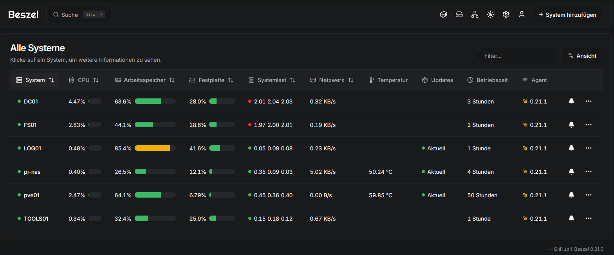
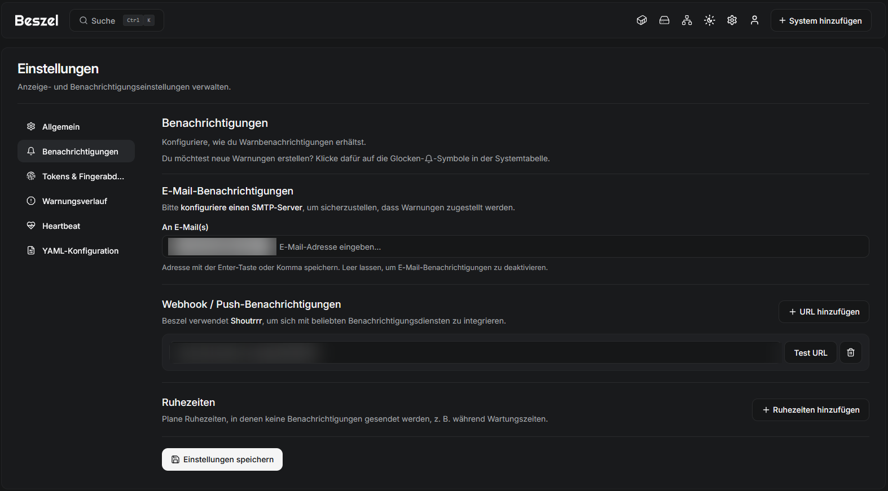
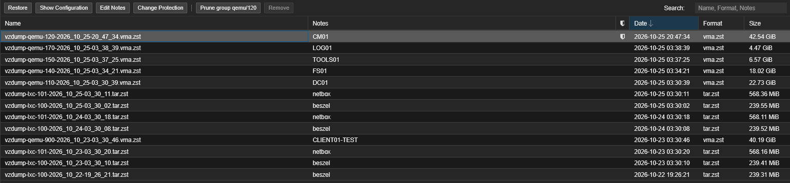
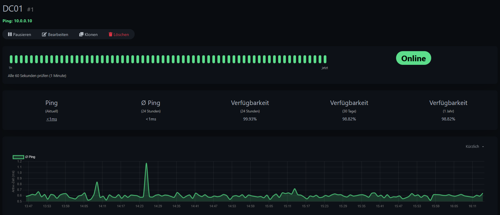
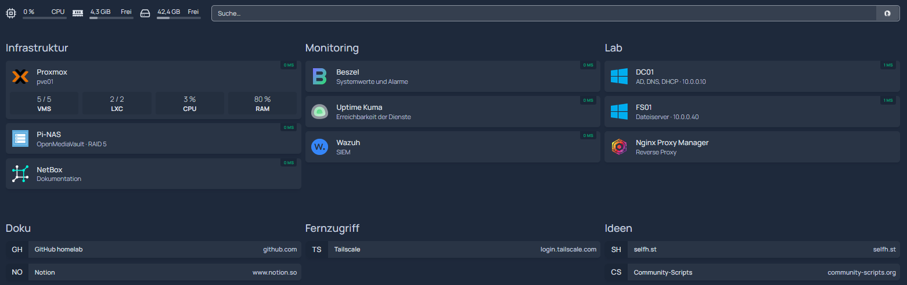
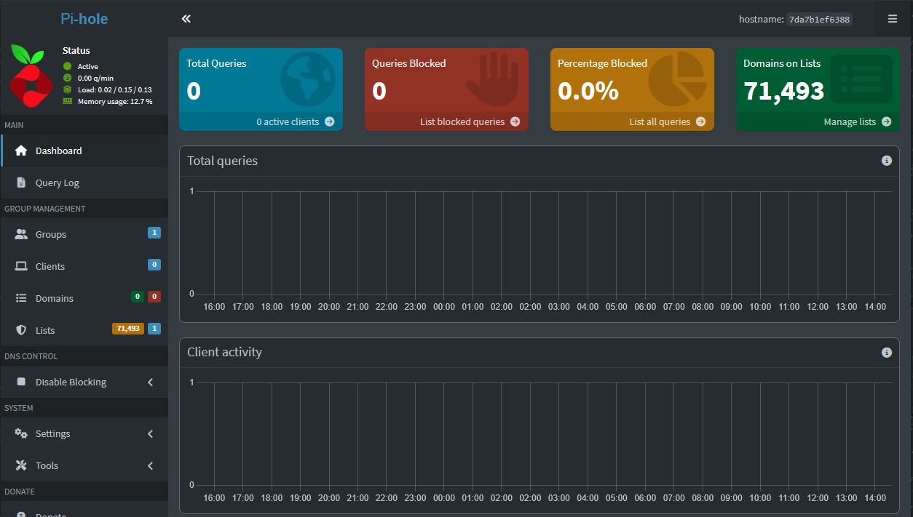

# Kapitel 18 · Betrieb: Monitoring, Alarme, Startseite und Zugänge

[← Kapitel 17](17-umzug-hyperv-proxmox.md) · [Übersicht](../../README.md#inhaltsverzeichnis) · [Fehlerbehebung](../fehlerbehebung.md)

[](../../README.md#thema-proxmox) [](../../README.md#thema-linux) [](../../README.md#thema-netz) [](../../README.md#thema-dns)

> **Ziel:** Nach dem Umzug läuft das Lab rund um die Uhr. Jetzt soll es sich selbst melden, wenn etwas nicht stimmt: Server aus, Dienst hängt, Speicher voll, Backup fehlgeschlagen. Dazu eine Startseite mit allen Diensten, sprechende Namen statt IP und Port, ein Werbeblocker und ein zweiter Weg ins Heimnetz, falls pve01 hängt.
> **Dauer:** ca. 3 Stunden, einzeln machbar · **Wo:** Browser, SSH auf TOOLS01 und pi-nas, DC01 (DNS)
> **Voraussetzung:** [Kapitel 15](15-proxmox-host.md)–[17](17-umzug-hyperv-proxmox.md), ein ntfy-Thema aufs Handy ([Kapitel 16](16-pi-nas.md))


## Wer passt worauf auf

| Frage | Werkzeug | Wo | Meldet per |
|---|---|---|---|
| Läuft der Server, ist RAM, Platte oder CPU am Limit? | Beszel | LXC 100 auf pve01 | ntfy |
| Antwortet der Dienst (Freigabe, DNS, Webseite)? | Uptime Kuma | TOOLS01 | ntfy |
| Ist pve01 selbst weg? | zweites Uptime Kuma | pi-nas | ntfy |
| Hat das Backup geklappt? | Proxmox Notifications | pve01 | ntfy |
| Passiert etwas Verdächtiges? | Wazuh ([Kapitel 13](13-wazuh.md)) | LOG01, bei Bedarf | – |

Die drei Wächter ergänzen sich. Beszel sieht nicht, wenn auf FS01 die Freigabe hängt, Uptime Kuma sieht nicht, wenn der RAM vollläuft, und beide schweigen, wenn der Host ausfällt, auf dem sie laufen. Deshalb ein Wächter auf einem zweiten Gerät.

> [!IMPORTANT]
> **Jede Benachrichtigung mit *Test* prüfen.** Bei mir kam von Beszel tagelang kein einziger Alarm an, ohne dass es auffiel (siehe Schritt 1).

## Schritt 1 · Beszel: alle Server und Alarme (Browser, SSH)

Wie Agents für die Lab-VMs dazukommen (zweite Karte am Hub, Docker-, Binary- und Windows-Agent), steht in [Kapitel 15](15-proxmox-host.md#vms-im-lab-netz-überwachen-nach-dem-umzug-kapitel-17).

1. **Push einrichten:** Beszel → **Einstellungen → Benachrichtigungen → Webhook / Push → URL hinzufügen** → `ntfy://ntfy.sh/<thema>` → **Test URL** → **Einstellungen speichern**.
2. **Alarme für alle auf einmal:** Glocke bei einem beliebigen System → Reiter **Alle Systeme**: Status an, Arbeitsspeicher > 90 % für 10 Minuten, Festplatte > 85 %, CPU > 90 % für 15 Minuten, Temperatur > 85 °C. Systemlast ohne Alarm, die schlägt bei Windows ständig an.
3. **Bedarfs-VMs pausieren:** Ist eine VM bewusst aus (CM01, LOG01), bei ihr **⋯ → Pause**, sonst kommt ein „down“-Alarm.





**Netzwerk-Monitore** (Beszel ab 0.21, Symbol mit den drei Kästchen oben): Ein Agent prüft ein Ziel per ICMP, TCP, HTTP oder DNS und zeigt Antwortzeit und Paketverlust. Bei mir nur Strecken, die Uptime Kuma nicht abdeckt:

| System | Ziel | Protokoll | Wofür |
|---|---|---|---|
| pve01 | `1.1.1.1` | ICMP | Qualität der Internetleitung |
| pi-nas | `192.168.2.20` | ICMP | Strecke der nächtlichen Backups |
| TOOLS01 | `10.0.0.10` | ICMP | Lab-Netz auf vmbr1 |
| TOOLS01 | `192.168.2.20:8006` | TCP | Proxmox-Weboberfläche |

HTTP auf `https://192.168.2.20:8006` bleibt rot (100 % Verlust), obwohl das Zertifikat angezeigt wird: Das selbstsignierte Proxmox-Zertifikat wird nicht akzeptiert. TCP auf Port 8006 reicht.

**RAID als eigene Platte:** Beszel zeigt bei *Festplatte* nur das Systemlaufwerk (beim Pi die microSD). Das RAID kommt per `EXTRA_FILESYSTEMS` dazu ([Beszel-Doku](https://beszel.dev/guide/additional-disks)). Auf pi-nas den Kernel-Namen mit `lsblk -o NAME,KNAME,SIZE,TYPE,MOUNTPOINT` prüfen (`md0`), dann `sudo systemctl edit beszel-agent`:

```
[Service]
Environment="EXTRA_FILESYSTEMS=md0__RAID"
```

`sudo systemctl restart beszel-agent`. Danach zeigt pi-nas *RAID Nutzung* und *RAID E/A*, und unter **S.M.A.R.T.** erscheint `/dev/md0` mit Status *PASSED*. `systemctl edit` legt eine eigene Override-Datei an, die ein Agent-Update nicht überschreibt. Auf pve01 genauso mit `/mnt/pve/backup__Backup` für den lokalen Backup-Speicher.

**Wer überwacht Beszel?** Fällt der Beszel-Container aus, kommen keine Alarme mehr, und es fällt nicht auf. Lösung: Heartbeat an das Uptime Kuma auf dem Pi ([Beszel-Doku](https://beszel.dev/guide/heartbeat)).

1. Uptime Kuma auf pi-nas → **Neuen Monitor hinzufügen** → Typ **Push**, Name `Beszel Heartbeat`, Intervall 120 s → Push-URL kopieren → Speichern.
2. pve01-Shell: `pct enter 100`, dann `systemctl edit beszel-hub`:

   ```
   [Service]
   Environment="HEARTBEAT_URL=http://192.168.2.234:3001/api/push/<token>?status=up&msg=OK&ping="
   Environment="HEARTBEAT_METHOD=GET"
   ```

3. `systemctl restart beszel-hub`, `exit`. Der Monitor wird nach spätestens einer Minute grün.

Befehle einzeln einfügen: Bei mehreren Zeilen auf einmal läuft nach `pct enter` die nächste Zeile schon auf dem Host.

> [!WARNING]
> **Test URL meldet `Client.Timeout exceeded`?** Bei mir lag es nicht an ntfy, sondern am DNS des Containers. Tailscale auf pve01 stellt den Host-DNS auf `100.100.100.100` um, und Container mit *use host settings* übernehmen diese Adresse, die sie nicht erreichen. Lösung: **100 (beszel) → DNS → DNS server** fest auf den Router (`192.168.2.1`), dann **Reboot**. Prüfen mit `pct exec 100 -- cat /etc/resolv.conf`. Gleiches gilt für jeden anderen Container.

**Werte richtig lesen:** Die Übersicht zeigt immer den heißesten Sensor. Bei mir ist das `nvme_sensor_2`, der Controller der VM-SSD, beim Kopieren großer Platten kurz bis 100 °C. Entscheidend ist, ob die SSD je über ihrer Warngrenze war:

```
smartctl -a /dev/nvme1 | grep -iE "temp|warning|critical"
```

Steht bei *Warning Comp. Temperature Time* `0`, ist alles gut. Die *Systemlast* der Windows-Agents ist dauerhaft „rot“, aussagekräftig ist dort die CPU in Prozent.

## Schritt 2 · Backup-Ergebnis aufs Handy (pve01, Browser)

Proxmox schreibt nach jedem Backup-Job einen Bericht mit OK/Fehler, Dauer und Größe pro Gast. So kommt er aufs Handy:

1. **Datacenter → Notifications → Notification Targets → Add → Webhook:** Name `ntfy`, Method **POST**, URL `https://ntfy.sh/<thema>`, Header `Title` = `{{ title }}`, Body `{{ message }}` → **Test** → OK.
2. **Notification Matchers → Add:** Name `backups-ntfy`, **Match Rules → Add**: Field **Notification type** (`type`), Value **vzdump** · **Targets to notify:** `ntfy` → **Add**.
3. **Datacenter → Backup** → beide Jobs → **Edit → Notifications:** *Use global notification settings*.

Den vollständigen Bericht zeigt **Tasks → Backup Job** (Doppelklick). Der Button **Show: Guests Without Backup Job** zeigt, was von keinem Job erfasst wird.

**Bedarfs-VMs** (CM01 mit 78 GB, LOG01) sind bei mir aus beiden Jobs ausgenommen (**Selection Mode → Exclude selected VMs**), weil sie meist aus sind und sich nicht ändern. Nach größeren Änderungen: VM herunterfahren → **Backup → Backup now** auf `nas`, Mode *Stop*, danach das Backup unter **Edit Notes / Change Protection** auf *Protected*, damit die Aufbewahrung es nie löscht.



**Restore-Test** (dauert ca. 15 Minuten, ohne das Original zu stören):

1. **nas (pve01) → Backups** → Backup markieren → **Restore** → Storage `vmdata`, VM-ID **999**, **Unique** an (neue MAC), *Start after restore* aus.
2. **999 → Hardware → Network Device → Disconnect** an, sonst streitet sich die Kopie mit dem Original um die IP. **Options → Start at boot** auf *No*, das wird aus dem Original übernommen.
3. Starten, über die Konsole anmelden, prüfen (`docker ps -a`, Dateien da?).
4. **Shutdown → More → Remove** mit *Purge from job configurations* und *Destroy unreferenced disks*.

Erst nach einem erfolgreichen Restore-Test die alten Hyper-V-VMs und `.vhdx`-Dateien löschen.

## Schritt 3 · Zweites Uptime Kuma auf dem Pi (OpenMediaVault)

Docker auf dem Pi läuft über das Compose-Plugin von OpenMediaVault:

1. SSH auf pi-nas (Admin-Konto mit Gruppen `_ssh` und `sudo`, in OMV unter **Users** anlegen):

   ```
   wget -O - https://github.com/OpenMediaVault-Plugin-Developers/packages/raw/master/install | sudo bash
   ```

   Das Skript fragt mitten in der Ausgabe nach dem `sudo`-Kennwort. Die vielen `configured multiple times`-Warnungen sind harmlos.
2. OMV mit **Strg+Shift+R** neu laden → **System → omv-extras** → *Docker repo* → **System → Plugins** → `openmediavault-compose` installieren.
3. **Storage → Shared Folders → Create** `appdata` auf dem RAID (`/dev/md0`, nicht auf der microSD).
4. **Services → Compose → Settings:** Shared folder `appdata` → Save → Apply.
5. **Files → Create** `uptime-kuma`:

   ```yaml
   services:
     uptime-kuma:
       image: louislam/uptime-kuma:2
       container_name: uptime-kuma
       restart: unless-stopped
       ports:
         - "3001:3001"
       volumes:
         - ./data:/app/data
   ```

   **Save** → markieren → **Up**. Datenbank: SQLite.
6. **Der Pi kennt das Lab-Netz nicht.** Monitore auf `10.0.0.x` bleiben rot, bis er die Route über pve01 kennt. Eigene Netplan-Datei, die OMV in Ruhe lässt (Kartenname mit `ip a` prüfen, beim Pi 5 mit OMV `eth0`):

   ```yaml
   # /etc/netplan/90-lab-route.yaml
   network:
     version: 2
     ethernets:
       eth0:
         routes:
           - to: 10.0.0.0/24
             via: 192.168.2.20
   ```

   ```
   sudo chmod 600 /etc/netplan/90-lab-route.yaml && sudo netplan apply
   ```

   Vorher mit `ls /etc/netplan` prüfen, dass dort die Dateien von OMV liegen.
7. Monitore nur für das Wichtigste: **pve01** (Ping `192.168.2.20`), **DC01** (Ping `10.0.0.10`), **Uptime Kuma auf TOOLS01** (HTTP `http://10.0.0.50:3001`). Typ *Ping* will nur eine IP, für URLs *HTTP(s)* wählen.
8. **Settings → Notifications → Setup Notification:** ntfy, Server `https://ntfy.sh`, Topic, Priority 3, DOWN-Events 5, **Default enabled** und **Apply on all existing monitors** an → **Test**. Dasselbe im Uptime Kuma auf TOOLS01.



**RAID-Wächter:** Beszel sieht CPU, RAM und Temperatur des Pi, aber nicht, ob das RAID *degraded* ist. Fällt eine SSD aus, läuft RAID 5 still weiter, bis die zweite auch stirbt. Ein kleines Skript meldet jede Zustandsänderung von `md0` per ntfy (nur bei Änderung, kein Dauer-Spam):

`sudo nano /usr/local/bin/raid-check.sh`:

```bash
#!/bin/bash
T="https://ntfy.sh/<thema>"
F=/var/tmp/raid-state
NOW=$(mdadm --detail /dev/md0 | awk -F' : ' '/ State :/{print $2}')
[ -z "$NOW" ] && NOW="md0 fehlt"
[ "$NOW" = "$(cat $F 2>/dev/null)" ] && exit 0
echo "$NOW" > $F
P=default
echo "$NOW" | grep -qiE "degraded|fail|inactive|fehlt" && P=high
curl -s -H "Title: RAID pi-nas: $NOW" -H "Priority: $P" -d "md0: $NOW" "$T" >/dev/null
```

Vor dem Speichern ganz nach unten scrollen: Beim Einfügen in nano wurde bei mir eine längere Version abgeschnitten (`unexpected EOF while looking for matching '"'`). Dann `sudo chmod 700 /usr/local/bin/raid-check.sh`.

**Test:** `sudo rm -f /var/tmp/raid-state` und das Skript starten. Ohne gespeicherten Zustand meldet es sofort „RAID pi-nas: clean“ aufs Handy, danach nur noch bei Änderungen.

**Automatisch:** OMV **System → Scheduled Tasks → Create**, alle 15 Minuten, User `root`, Command `/usr/local/bin/raid-check.sh` → **Save → Apply**. Nicht per `crontab -e`, OMV verwaltet die Cron-Dateien selbst.

## Schritt 4 · Startseite mit Homepage (TOOLS01)

[Homepage](https://gethomepage.dev) zeigt alle Dienste als Kacheln mit Erreichbarkeit und Live-Werten.

```
mkdir -p ~/tools/homepage/config && cd ~/tools/homepage && nano docker-compose.yml
```

```yaml
services:
  homepage:
    image: ghcr.io/gethomepage/homepage:latest
    container_name: homepage
    restart: unless-stopped
    env_file: .env
    ports:
      - 3000:3000
    volumes:
      - ./config:/app/config
      - /var/run/docker.sock:/var/run/docker.sock:ro
    environment:
      HOMEPAGE_ALLOWED_HOSTS: 10.0.0.50:3000,tools01.lab.test:3000,home.lab.test
```

`HOMEPAGE_ALLOWED_HOSTS` ist Pflicht. Jede Adresse, unter der die Seite aufgerufen wird, muss drinstehen, sonst kommt `Host validation failed`.

Beim ersten `docker compose up -d` legt Homepage Beispieldateien in `config/` an. Kacheln stehen in `services.yaml`, je Dienst `href`, `description`, `icon` (z. B. `proxmox.png`) und `ping` für den Status-Punkt.

**Proxmox-Widget mit Nur-Lese-Zugang:**

1. **Datacenter → Permissions → Users → Add:** `homepage`, Realm *Proxmox VE authentication server*.
2. **Permissions → Add → User Permission:** Path `/`, User `homepage@pve`, Role **PVEAuditor**.
3. **API Tokens → Add:** User `homepage@pve`, Token ID `homepage`, **Privilege Separation aus**. Das Secret wird nur einmal angezeigt.
4. Secret nicht in die YAML schreiben, sondern in `~/tools/homepage/.env` (`chmod 600`):

   ```
   HOMEPAGE_VAR_PVE_SECRET=<secret>
   ```

5. In `services.yaml` beim Proxmox-Eintrag:

   ```yaml
           widget:
             type: proxmox
             url: https://192.168.2.20:8006
             username: homepage@pve!homepage
             password: "{{HOMEPAGE_VAR_PVE_SECRET}}"
             node: pve01
   ```

YAML verzeiht keine falsche Einrückung. Meldet Homepage `Failed to load services.yaml` mit Zeilennummer, die Datei lieber komplett neu einfügen als Leerzeichen zu zählen. **Tipp fürs Handy:** Seite in Safari öffnen → *Teilen → Zum Home-Bildschirm*.



## Schritt 5 · Namen statt IP und Port (Nginx Proxy Manager, DC01)

| Name | Ziel | Hinweis |
|---|---|---|
| `home.lab.test` | http `10.0.0.50:3000` | Homepage |
| `pve.lab.test` | **https** `192.168.2.20:8006` | *Websockets Support* an, sonst keine Konsole |
| `beszel.lab.test` | http `192.168.2.21:8090` | *Websockets Support* an |
| `kuma.lab.test` | http `10.0.0.50:3001` | *Websockets Support* an |
| `netbox.lab.test` | **https** `192.168.2.22:443` | |
| `wazuh.lab.test` | **https** `10.0.0.70:443` | |
| `pihole.lab.test` | http `192.168.2.234:8080` | |

Pro Name in NPM einen **Proxy Host** und auf DC01 im **DNS Manager → lab.test → New Alias (CNAME)** mit Ziel `tools01.lab.test`, am besten über **Browse…** auswählen statt tippen.

**Testen** am Arbeits-PC mit `ping beszel.lab.test` oder `nslookup beszel.lab.test 10.0.0.10`. `nslookup` ohne Server fragt den Router und ignoriert die NRPT-Regel. Liefert `nslookup` nur `Name:` ohne Adresse, zeigt der CNAME ins Leere (Tippfehler im Ziel). Danach `ipconfig /flushdns`.

Die Namen gehen vom Arbeits-PC und aus dem Lab. Unterwegs übers Handy nicht, dort weiter die IPs, oder in Tailscale unter **DNS → Nameservers** `10.0.0.10` mit *Restrict to domain* `lab.test` eintragen.

## Schritt 6 · Werbeblocker Pi-hole (pi-nas)

Pi-hole ist ein DNS-Server, kein Proxy. Durch den Pi gehen nur die Namensanfragen (Millisekunden, danach im Cache), Videos und Downloads laufen direkt über den Router.

**Feste IP zuerst:** Speedport → **Heimnetz → Verbundene Geräte → Listenansicht** → pi-nas → *Immer dieselbe IPv4-Adresse*. Ein DNS-Server mit wechselnder Adresse ist nicht zu gebrauchen.

**Services → Compose → Files → Create** `pihole`:

```yaml
services:
  pihole:
    image: pihole/pihole:latest
    container_name: pihole
    restart: unless-stopped
    ports:
      - "192.168.2.234:53:53/tcp"
      - "192.168.2.234:53:53/udp"
      - "8080:80/tcp"
    environment:
      TZ: Europe/Berlin
      FTLCONF_webserver_api_password: <kennwort>
      FTLCONF_dns_listeningMode: ALL
    volumes:
      - ./etc-pihole:/etc/pihole
```

Port 53 nur an die LAN-Adresse binden: Auf dem Pi mit OpenMediaVault lauscht `systemd-resolved` schon auf `127.0.0.53:53`, mit `"53:53"` startet der Container mit *address already in use*. Port 8080, weil 80 und 443 die OMV-Oberfläche belegt. Weboberfläche: `http://192.168.2.234:8080/admin`.



**Überwachen:** Ist der Pi grün, heißt das noch nicht, dass Pi-hole antwortet. Im Uptime Kuma auf TOOLS01 einen Monitor Typ **DNS** anlegen: Hostname `google.com`, Resolver `192.168.2.234`, Port 53, Record `A`. Fällt Pi-hole aus, kommen PC und Handy nicht mehr ins Internet, deshalb lohnt sich der Alarm.

**Erst einzelne Geräte, dann das ganze Haus.** Am PC DNS manuell auf `192.168.2.234` (und IPv6 aus, sonst fragt Windows am Pi-hole vorbei), am iPhone unter *WLAN → (i) → DNS konfigurieren → Manuell* (Privat-Relay und rotierende WLAN-Adresse aus). Fürs ganze Haus müsste beim Speedport Smart der DHCP-Server aus und Pi-hole ihn übernehmen, weil der Speedport keinen eigenen DNS-Server verteilen kann. Dann hängt das Internet aller im Haus am Pi, also nur nach Absprache und einer stabilen Testphase.

YouTube-Werbung blockt Pi-hole nicht, sie kommt von denselben Servern wie die Videos.

## Schritt 7 · Zweiter Zugang von unterwegs (Tailscale auf pi-nas)

Läuft Tailscale nur auf pve01 und der hängt, ist das Heimnetz von unterwegs nicht mehr erreichbar.

```
curl -fsSL https://tailscale.com/install.sh | sh
echo 'net.ipv4.ip_forward = 1' | sudo tee -a /etc/sysctl.d/99-tailscale.conf
sudo sysctl -p /etc/sysctl.d/99-tailscale.conf
sudo tailscale up --advertise-routes=192.168.2.0/24 --accept-dns=false
```

Ohne IP-Forwarding wird die Route im Admin zwar freigegeben, es fließt aber kein Verkehr darüber ([Tailscale-Doku](https://tailscale.com/kb/1019/subnets)). Bei mir fiel das erst beim Gegenlesen auf. Testen: am Handy WLAN aus, in der Tailscale-App bei pve01 kurz die Route abschalten bzw. pve01 herunterfahren und `192.168.2.234` aufrufen.

`--accept-dns=false` ist wichtig: Sonst stellt Tailscale den DNS des Pi auf `100.100.100.100` um, mit denselben Folgen wie bei beszel in Schritt 1, nur dass hier Pi-hole und alle Container betroffen wären. Im Tailscale-Admin bei pi-nas **Edit route settings** → `192.168.2.0/24` freigeben und **Disable key expiry**. Mit zwei Subnet Routern für dasselbe Netz übernimmt Tailscale automatisch den erreichbaren.

## Schritt 8 · Regelmäßig (Checkliste)

| Wann | Was |
|---|---|
| täglich, automatisch | Backup-Nachrichten 01:30 und 03:30 auf dem Handy lesen |
| wöchentlich | Beszel kurz ansehen: Updates-Spalte, RAM-Trend, Temperatur |
| monatlich | pve01 **Updates → Refresh → Upgrade** · OMV **Update Management** · TOOLS01 `sudo apt update && sudo apt upgrade` und `docker compose pull && docker compose up -d` je Dienst · Windows Update auf DC01 und FS01 |
| monatlich | `smartctl` auf beiden NVMe (Warning Time = 0?) · OMV **Multiple Device**: `md0` *clean* |
| nach Änderungen an CM01/LOG01 | manuelles Backup, *Protected* |
| vierteljährlich | Restore-Test: ein Backup als neue VM-ID zurückspielen, starten, löschen |

Bei Wazuh die Pakete mit `sudo apt-mark hold wazuh-indexer wazuh-manager wazuh-dashboard filebeat` aus normalen Updates heraushalten. Indexer, Manager und Dashboard werden zusammen nach Anleitung aktualisiert.

## Startreihenfolge


Eingestellt in Proxmox pro Gast unter **Options**: *Start at boot* (Yes/No) und *Start/Shutdown order*, bei DC01 zusätzlich *Startup delay* 60.

## Häufige Fehler

| Problem | Ursache | Lösung |
|---|---|---|
| Beszel-Test: `Client.Timeout exceeded` | Container erbt Tailscale-DNS vom Host | DNS des Containers fest auf den Router, Reboot |
| `Host validation failed` (Homepage) | Aufgerufene Adresse fehlt in `HOMEPAGE_ALLOWED_HOSTS` | Eintragen, `docker compose up -d` |
| Pi-hole: `address already in use` auf Port 53 | `systemd-resolved` auf `127.0.0.53` | Port 53 nur an die LAN-IP binden |
| Monitore auf dem Pi für `10.0.0.x` rot | Pi kennt die Route ins Lab nicht | Netplan-Route über pve01 |
| `Server Not Found` bei einem `.lab.test`-Namen, andere gehen | CNAME fehlt oder Ziel vertippt | CNAME neu anlegen, Ziel per Browse, `ipconfig /flushdns` |
| Proxy-Seite lädt, aktualisiert sich aber nicht live | Websockets im Proxy Host aus | *Websockets Support* an |
| Strg+W in der Proxmox-Konsole schließt den Tab | Browser fängt die Tastenkombination ab | *Auf Seite bleiben*, mit Pfeiltasten arbeiten |
| Beim Einfügen ins Terminal steht `^[[200~` vor dem Befehl | Bracketed Paste | `echo 'set enable-bracketed-paste off' >> ~/.inputrc` |

Weitere Fälle: [Fehlerbehebung](../fehlerbehebung.md)

Wie es weitergeht: [Roadmap](../roadmap.md)

Weiter: [Kapitel 19 · Lab-Netz als VLAN 10](19-vlan-testclient.md)
