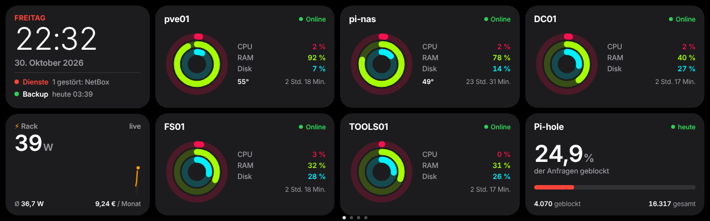
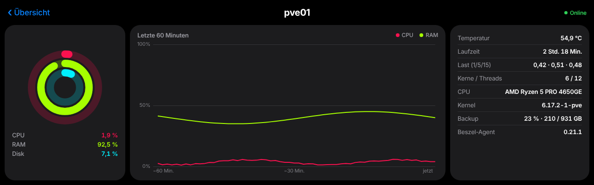
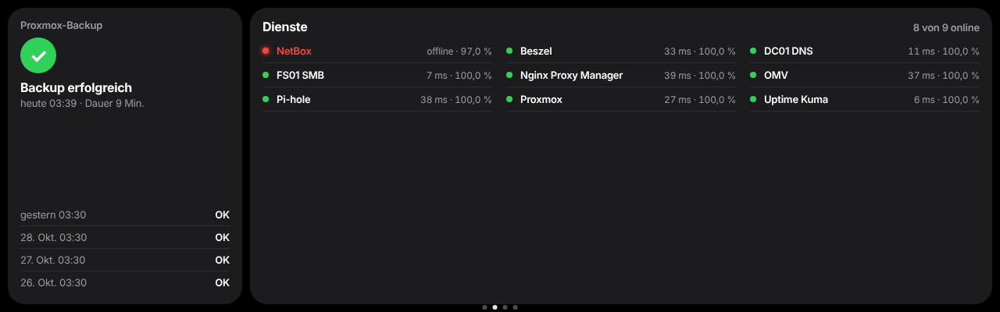

# Kapitel 20 · Rack-Display: Dashboard im Kiosk auf dem Pi

[← Kapitel 19](19-vlan-testclient.md) · [Übersicht](../../README.md#inhaltsverzeichnis) · [Hardware und Rack](../hardware.md) · [Fehlerbehebung](../fehlerbehebung.md#rack-display-kapitel-20)

[](../../README.md#thema-linux) [](../../README.md#thema-proxmox)

> **Ziel:** Ein kleines Touch-Display oben im Rack zeigt rund um die Uhr, wie es dem Lab geht: Uhrzeit, Stromverbrauch des Racks live, alle Server mit CPU, RAM und Platte, Pi-hole, gestörte Dienste aus Uptime Kuma und das letzte Proxmox-Backup. Antippen öffnet Details, Wischen blättert zu weiteren Seiten. Nachts ist das Display komplett aus.
> **Dauer:** ca. 2–3 Stunden · **Wo:** SSH auf pi-nas, Weboberflächen von Shelly, Beszel, Pi-hole, Uptime Kuma und Proxmox
> **Voraussetzung:** Pi-NAS ([Kapitel 16](16-pi-nas.md)), Beszel ([Kapitel 15](15-proxmox-host.md)), Pi-hole und Uptime Kuma auf dem Pi ([Kapitel 18](18-betrieb.md))



**Warum am Pi und nicht am Mini-PC?** Anfangs hing das Display am HP. Das klappt, hat aber zwei Nachteile: Auf einem Proxmox-Host soll möglichst wenig zusätzlich laufen, und die USB-Ports des HP lassen sich nicht abschalten. Das Display bekommt seinen Strom per USB. Beim Raspberry Pi 5 lässt sich dieser Strom per Software trennen, damit ist das Display nachts wirklich aus und nicht nur schwarz.

```text
Shelly Plug ──┐
Beszel ───────┤
Pi-hole ──────┼──► kiosk-server (127.0.0.1:8099) ──► Chromium im Kiosk (cage) ──HDMI──► Display
Uptime Kuma ──┤                                                                     ▲
Proxmox-API ──┘                                      uhubctl per Cron (22–10 Uhr) ───┘ USB-Strom aus
```

| Was | Wert |
|---|---|
| Display | GeeekPi 7,84 Zoll, 1280×400, HDMI, Strom und Touch über USB |
| Anschluss | HDMI über die DeskPi-Adapterplatine (Micro-HDMI → HDMI), USB-A am Pi |
| Strommessung | Shelly Plug M Gen3 zwischen Wandsteckdose und Steckdosenleiste des Racks, feste IP |
| Kiosk | Benutzer `kiosk`, Autologin auf tty1, `cage` (Wayland-Kiosk) mit Chromium |
| Webserver | `kiosk-server.py` als systemd-Dienst, lauscht nur auf `127.0.0.1:8099` |
| Zugangsdaten | `/etc/kiosk-dashboard.json`, nur root und kiosk dürfen lesen |
| Dateien | [`scripts/rack-display/`](../../scripts/rack-display/) |

## Teil 1 · Strom messen mit dem Shelly Plug (Handy, Browser)

1. Shelly einstecken. Er macht ein eigenes WLAN `ShellyPlugMG3-…` auf. Mit dem Handy verbinden und `http://192.168.33.1` öffnen.
2. **Settings → WiFi → WiFi 1:** Heim-WLAN eintragen, **Set static IP** wählen und eine freie Adresse außerhalb des DHCP-Bereichs vergeben (bei mir `192.168.2.237`, Gateway und DNS = Router) → **Save**.
3. Wieder ins Heim-WLAN wechseln und `http://192.168.2.237` öffnen. Auf der Startseite steht der aktuelle Verbrauch in Watt.
4. Stecker zwischen Wand und Steckdosenleiste des Racks setzen. Alles, was an der Leiste hängt, wird mitgezählt.

**Prüfen** (auf pi-nas):

```bash
curl -s http://192.168.2.237/rpc/Switch.GetStatus?id=0
```

In der Antwort stehen `apower` (Watt), `voltage`, `current` und `aenergy` (Zähler in Wh).

> [!TIP]
> Bei *invalid state* oder wenn die Seite nicht lädt: Shelly kurz vom Strom nehmen, dann ist er nach ca. 30 Sekunden im Heim-WLAN.

## Teil 2 · Kiosk einrichten (SSH auf pi-nas)

**1. Pakete und Benutzer:**

```bash
sudo apt install -y cage chromium wlrctl ddcutil uhubctl fonts-inter
sudo useradd -m -s /bin/bash kiosk
sudo usermod -aG video,render,input kiosk
sudo mkdir -p /home/kiosk/screen
```

**2. Dateien kopieren.** Den Ordner [`scripts/rack-display/`](../../scripts/rack-display/) auf den Pi holen (z. B. per `git clone` oder WinSCP), dann:

```bash
sudo install -m 755 kiosk-server.py /usr/local/bin/kiosk-server.py
sudo install -m 755 kiosk-update.sh /usr/local/bin/kiosk-update
sudo cp dashboard.html strom.html strom-dither.html /home/kiosk/screen/
echo "http://127.0.0.1:8099/dashboard.html" | sudo tee /home/kiosk/seite
sudo chown -R kiosk:kiosk /home/kiosk
```

**3. Webserver als Dienst.** `/etc/systemd/system/kiosk-server.service`:

```ini
[Unit]
Description=Kiosk-Webserver (Dashboard und Datenquellen)
After=network-online.target

[Service]
User=kiosk
ExecStart=/usr/bin/python3 /usr/local/bin/kiosk-server.py
Restart=always

[Install]
WantedBy=multi-user.target
```

> [!NOTE]
> **Warum ein eigener Webserver?** Öffnet man die Seite als `file://`, blockt Chromium alle Abfragen an andere Geräte (CORS), die Watt-Anzeige bleibt bei „– W“. Der Server liefert Seite und Daten aus derselben Quelle und hält die Zugangsdaten vom Browser fern.

**4. Autologin auf dem Bildschirm.** `/etc/systemd/system/getty@tty1.service.d/override.conf`:

```ini
[Service]
ExecStart=
ExecStart=-/sbin/agetty --autologin kiosk --noclear %I $TERM
```

Die Datei direkt mit `sudo tee` schreiben. Bei `systemctl edit` landet eingefügter Text leicht unter der Kommentarzeile und wird verworfen.

**5. Kiosk beim Login starten.** `/home/kiosk/.bash_profile`:

```bash
if [ "$(tty)" = "/dev/tty1" ]; then
  export XKB_DEFAULT_LAYOUT=de
  SEITE=$(cat /home/kiosk/seite 2>/dev/null || echo http://127.0.0.1:8099/dashboard.html)
  exec cage -- sh -c "chromium --kiosk --no-first-run --noerrdialogs --disable-infobars \
    --password-store=basic --lang=de --disable-translate --disable-features=Translate \
    $SEITE & sleep 15; wlrctl pointer move 5000 5000; sleep 30; wlrctl pointer move 5000 5000; wait"
fi
```

- `wlrctl pointer move` schiebt den Mauszeiger in die Ecke, die Seiten selbst haben `cursor:none`. Zweimal, weil Chromium auf dem Pi beim ersten Start länger braucht.
- Das „Übersetzen?“-Fenster ignoriert die Flags auf dem Pi teilweise. Sicher weg ist es per Richtlinie:

```bash
sudo mkdir -p /etc/chromium/policies/managed
echo '{ "TranslateEnabled": false }' | sudo tee /etc/chromium/policies/managed/kiosk.json
```

## Teil 3 · Zugänge für die Datenquellen (Browser)

Jede Quelle bekommt einen eigenen Zugang, der **nur lesen** darf.

| Quelle | Wo | Was |
|---|---|---|
| Beszel | PocketBase-Oberfläche `http://<beszel>:8090/_/` → **users → New record** | Benutzer z. B. `kiosk@rack.local`, Rolle `readonly`. Dann unter **systems** bei jedem System im Feld **users** zusätzlich diesen Benutzer eintragen, sonst sieht er nichts |
| Pi-hole v6 | **Settings → Web interface / API**, oben rechts auf **Expert** → **Configure app password** | App-Passwort erzeugen und einmal kopieren |
| Uptime Kuma (Pi) | **Status Pages → New Status Page**, Slug `rack` | Monitore hinzufügen → **Save**. Die Statusseite ist ohne Login lesbar |
| Proxmox | **Datacenter → Permissions → API Tokens → Add** | User `root@pam`, Token-ID `kiosk`, *Privilege Separation* an. Danach **Permissions → Add → API Token Permission**: Pfad `/`, Token `root@pam!kiosk`, Rolle `PVEAuditor` |

**Zugangsdaten eintragen.** Die Vorlage [`kiosk-dashboard.example.json`](../../scripts/rack-display/kiosk-dashboard.example.json) kopieren und die Platzhalter ersetzen:

```bash
sudo install -m 640 -o root -g kiosk kiosk-dashboard.example.json /etc/kiosk-dashboard.json
sudo nano /etc/kiosk-dashboard.json
```

> [!IMPORTANT]
> Kennwörter und Token-Secret gehören nur in diese Datei auf dem Pi (und in den Passwortmanager), nie in ein Repo. Proxmox nutzt ein selbstsigniertes Zertifikat, der Server prüft es deshalb nicht. Das ist nur vertretbar, weil der Token ausschließlich lesen darf und alles im Heimnetz bleibt.

**Starten und prüfen:**

```bash
sudo systemctl daemon-reload
sudo systemctl enable --now kiosk-server
sudo systemctl restart getty@tty1
curl -s http://127.0.0.1:8099/api/beszel | head -c 300; echo
curl -s http://127.0.0.1:8099/api/pihole;  echo
curl -s http://127.0.0.1:8099/api/kuma | head -c 300; echo
curl -s http://127.0.0.1:8099/api/backup;  echo
```

Jede Abfrage liefert JSON. Steht dort `{"fehler": …}`, passt der jeweilige Zugang noch nicht.

## Teil 4 · Das Dashboard bedienen

| Geste | Wirkung |
|---|---|
| Kachel antippen | Detailansicht: Server mit Verlauf der letzten 60 Minuten aus Beszel, Pi-hole mit Top-Domains und Top-Clients, Strom mit 30-Minuten-Graph, Spannung und Kosten |
| „‹ Übersicht“ oder nach rechts wischen | zurück |
| Links/rechts wischen | Seiten: Übersicht · Dienste (Uptime Kuma und Backup) · Strom im Dither-Look · Slideshow |
| „Dienste“ / „Backup“ in der Uhr-Kachel | springt direkt zur Seite Dienste |

Ohne Berührung geht es nach 90 Sekunden aus einer Detailansicht und nach 5 Minuten auf die Übersicht zurück.





**Anpassen** (oben in `dashboard.html`): `SYSTEME` legt fest, welche Beszel-Systeme als Kachel erscheinen, `PREIS` den Strompreis pro kWh für die Kostenschätzung.

**Slideshow:** Bilder oder GIFs nach `/home/kiosk/screen/` kopieren (Namen egal), dann `sudo kiosk-update` (optional Sekunden pro Bild als Parameter, Standard 10). Das Skript nummeriert die Dateien und baut `index.html` neu.

## Teil 5 · Nachts komplett aus (SSH auf pi-nas)

Ein schwarzes Bild reicht bei einem LCD nicht, die Hintergrundbeleuchtung leuchtet im dunklen Raum sichtbar. Deshalb bekommt das Display nachts keinen USB-Strom. Beim Pi 5 lassen sich die USB-Ports nur gemeinsam schalten: An beiden Controllern müssen USB-2- und USB-3-Hub aus sein (Hubs 1–4). Am Pi-NAS hängen die Platten am SATA-HAT, nicht an USB, sie sind davon nicht betroffen.

**1. Testen, ob es klappt:**

```bash
for h in 1 2 3 4; do sudo uhubctl -l $h -a off; done   # Display geht aus
for h in 1 2 3 4; do sudo uhubctl -l $h -a on;  done   # nach ein paar Sekunden wieder an
```

**2. Zeitplan.** `/usr/local/bin/display-zeitplan`:

```bash
#!/bin/bash
PATH=/usr/local/sbin:/usr/local/bin:/usr/sbin:/usr/bin:/sbin:/bin   # Cron kennt /usr/sbin sonst nicht
AUS_AB=22   # ab dieser Stunde aus
AN_AB=10    # ab dieser Stunde an
H=$(date +%-H)
if [ "$H" -ge $AUS_AB ] || [ "$H" -lt $AN_AB ]; then
  for h in 1 2 3 4; do uhubctl -l $h -a off >/dev/null 2>&1; done
else
  for h in 1 2 3 4; do uhubctl -l $h -a on  >/dev/null 2>&1; done
  sleep 5; ddcutil setvcp 10 70 >/dev/null 2>&1   # Helligkeit 70 %
fi
```

`/etc/cron.d/display-zeitplan`:

```text
*/10 * * * * root /usr/local/bin/display-zeitplan
@reboot      root sleep 60 && /usr/local/bin/display-zeitplan
```

```bash
sudo chmod +x /usr/local/bin/display-zeitplan
sudo env -i /usr/local/bin/display-zeitplan   # testet mit leerer Umgebung wie Cron
```

**Prüfen, ob Cron das Skript wirklich startet** (nach dem nächsten Zehner, z. B. 10:10):

```bash
ls -l /etc/cron.d/display-zeitplan          # muss root:root und -rw-r--r-- sein
sudo journalctl -u cron --since "-15min" --no-pager | grep display-zeitplan
```

Dort muss eine Zeile `(root) CMD (/usr/local/bin/display-zeitplan)` stehen. Bei mir fehlte die Cron-Datei am ersten Abend, das Display blieb morgens aus. Von Hand lief das Skript, nur der Zeitplan nicht.

Das Skript prüft alle 10 Minuten den Sollzustand. Wer das Display nachts kurz braucht, schaltet es mit der Zeile aus Schritt 1 an, spätestens nach 10 Minuten ist es wieder aus. Zusätzlich schaltet das Dashboard selbst zwischen 22 und 10 Uhr auf Schwarz (`NACHT_AB` / `NACHT_BIS` in `dashboard.html`).

## Prüfen

- [ ] Nach einem Neustart des Pi startet das Dashboard ohne Tastatur und ohne Mauszeiger
- [ ] Watt-Anzeige bewegt sich, alle Server-Kacheln zeigen „Online“
- [ ] Antippen einer Kachel öffnet die Details, Wischen nach rechts führt zurück
- [ ] Seite Dienste zeigt das letzte Backup von heute Nacht
- [ ] Nach 22 Uhr ist das Display dunkel und ohne Hintergrundlicht, ab 10 Uhr wieder an

## Häufige Fehler

| Problem | Ursache | Lösung |
|---|---|---|
| Watt-Anzeige bleibt bei „– W“ | Seite als `file://` geöffnet, CORS | Seite über den kiosk-server laden (`http://127.0.0.1:8099/…`) |
| Bild füllt das Display nicht | `--force-device-scale-factor` gesetzt | Weglassen, unter cage verkleinert es das ganze Fenster |
| Mauszeiger mitten im Bild | Zeiger steht nach dem Start in der Mitte | `cursor:none` auf der Seite und `wlrctl pointer move` (zweimal) |
| „Übersetzen?“-Fenster | Chromium ignoriert die Flags teilweise | Richtlinie `TranslateEnabled: false` |
| Display bleibt morgens aus, Skript von Hand klappt | Cron-Datei fehlt oder hat falsche Rechte | `ls -l /etc/cron.d/display-zeitplan`, im Cron-Log nach `CMD (…display-zeitplan)` suchen |
| Nachtmodus per Cron schaltet nicht, von Hand schon | `uhubctl` liegt in `/usr/sbin`, Cron kennt den Pfad nicht | PATH-Zeile ins Skript, testen mit `sudo env -i …` |
| Display nach `ddcutil setvcp d6 4` tot | Hartes Ausschalten, danach reagiert es nicht mehr auf DDC | Ab- und wieder anstecken. Nicht für Zeitpläne verwenden |
| Nach `wlr-randr --off` hell „No Signal“ | Display geht ohne Signal nicht in den Standby | Strom trennen statt Signal abschalten |
| `uhubctl`: *No compatible devices* | USB-Ports des Rechners lassen sich nicht schalten (z. B. am HP-Mini-PC) | Display an einen Pi 5 hängen |
| Beszel-Kacheln „offline“, Login klappt | Kiosk-Benutzer ist beim System nicht unter **users** eingetragen | In PocketBase bei jedem System ergänzen |

Weitere Fälle: [Fehlerbehebung](../fehlerbehebung.md#rack-display-kapitel-20)

Weiter: [Kapitel 21 · Immich](21-immich.md)

Wie es weitergeht: [Roadmap](../roadmap.md)
