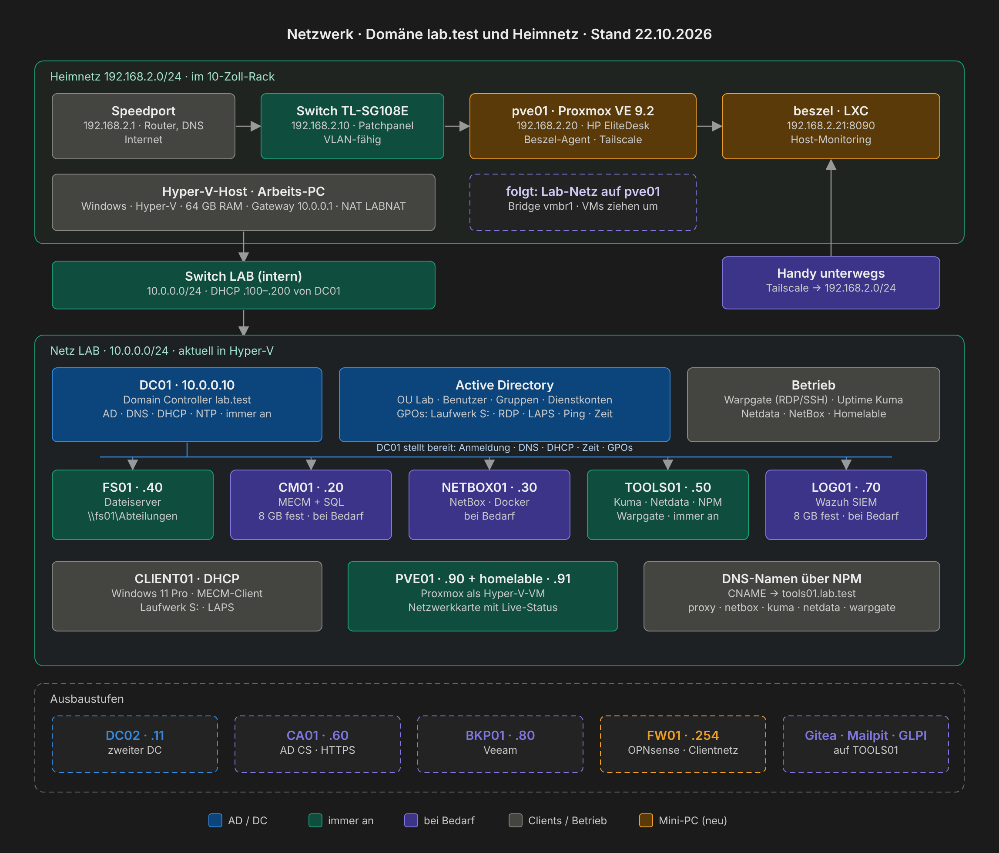

# Aufbau



## Netz

| Was | Wert |
|---|---|
| Netz | `10.0.0.0/24`, interner Hyper-V-Switch `LAB` mit NAT |
| Gateway | `10.0.0.1` (Hyper-V-Host) |
| DNS | `10.0.0.10` (DC01), Weiterleiter ins Internet |
| DHCP | `10.0.0.100` – `10.0.0.200` auf DC01 |
| Domäne | `lab.test`, NetBIOS `LAB` |
| Namensauflösung vom Host | NRPT-Regel: `*.lab.test` über DC01, Rest normal |

### DNS

- Forward-Zone `lab.test` mit A-Einträgen für alle Server
- Reverse-Zone `0.0.10.in-addr.arpa` mit PTR-Einträgen
- CNAMEs `netbox`, `kuma`, `netdata`, `proxy` → `tools01.lab.test` (dahinter Nginx Proxy Manager)

## Server

| VM | IP | OS | Aufgabe | Betrieb |
|---|---|---|---|---|
| DC01 | 10.0.0.10 | Windows Server 2025 | AD DS, DNS, DHCP, PDC-Emulator / Zeitquelle | immer an, startet zuerst |
| CM01 | 10.0.0.20 | Windows Server 2025 | MECM (Site `LAB`), SQL Server | bei Bedarf |
| NETBOX01 | 10.0.0.30 | Ubuntu Server | NetBox per Docker | bei Bedarf |
| FS01 | 10.0.0.40 | Windows Server 2025 | Dateiserver, Datenplatte E: | immer an |
| TOOLS01 | 10.0.0.50 | Ubuntu Server | Docker-Dienste | immer an |
| LOG01 | 10.0.0.70 | Ubuntu Server | Wazuh 4.14 (SIEM), 8 GB fest | bei Bedarf |
| PVE01 | 10.0.0.90 | Proxmox VE 9.2 (Hyper-V-VM, Gen 1) | Host für LXC-Container, 4 GB fest | immer an |
| HOMELABLE | 10.0.0.91 | LXC auf PVE01 (Debian 13) | [Homelable](anleitung/14-homelable.md): Netzwerkkarte mit Live-Status | immer an |
| CLIENT01 | DHCP | Windows 11 Pro | Testclient | bei Bedarf |

**Mini-PC im Heimnetz** ([Kapitel 15](anleitung/15-proxmox-host.md)):

| Gerät | IP | OS | Aufgabe | Betrieb |
|---|---|---|---|---|
| pve01 | 192.168.2.20 | Proxmox VE 9.2 auf HP EliteDesk 805 G6 Mini | Hypervisor, Beszel-Agent, Tailscale Subnet Router | immer an |
| beszel | 192.168.2.21 | LXC auf pve01 | Monitoring-Hub ([Beszel](anleitung/15-proxmox-host.md#schritt-6--monitoring-mit-beszel-browser)) | immer an |
| Switch | 192.168.2.10 | TL-SG108E | Managed Switch im Rack ([Hardware](hardware.md)) | immer an |

Die VMs oben ziehen nach und nach aus Hyper-V auf pve01 um.

**Startreihenfolge:** DC01 → CM01, FS01, NETBOX01, TOOLS01 → CLIENT01. Herunterfahren umgekehrt, DC01 zuletzt. Ohne DC01 gibt es kein DNS, und die anderen VMs laufen in Fehler.

**Arbeitsspeicher:** Windows-VMs dynamisch, Linux-VMs und CM01 (SQL Server) fest. Siehe [Entscheidungen](entscheidungen.md).

## Active Directory


```
lab.test
├── Domain Controllers   → DC01 · GPO-DC-Zeitserver, Ping
└── Lab
    ├── Benutzer         → Laufwerk S:
    │   └── IT, Buchhaltung, Vertrieb, Personal, Leitung
    ├── Computer         → CLIENT01 · RDP, lokale Admins, LAPS, Ping, Design
    ├── Server           → FS01, CM01 · LAPS, Ping
    ├── Gruppen          → GG-IT, GG-Buchhaltung, GG-Vertrieb, GG-Personal, GG-Leitung
    └── Dienstkonten     → svc_cm_push, svc_cm_naa
```

- Neue Computerkonten landen per `redircmp` in `Lab/Computer` statt im Standardcontainer.
- Regel: Jeder Benutzer ist in genau **einer** Abteilungsgruppe, sonst bekommt er das falsche Laufwerk.
- Admin-Konto und Alltagskonto sind getrennt.
- Domänenweit: Kennwort mind. 12 Zeichen, Chronik 24, Sperre nach 10 Fehlversuchen für 15 Minuten. AD-Papierkorb ist aktiv.

## Gruppenrichtlinien

| GPO | Verknüpft mit | Was sie tut |
|---|---|---|
| GPO-Benutzer-Laufwerk-S | Lab/Benutzer | S: je Abteilung, Zielgruppenadressierung auf die GG-Gruppe, Aktion *Ersetzen* |
| GPO-Computer-RDP | Lab/Computer | GG-Buchhaltung und GG-Vertrieb in *Remotedesktopbenutzer* |
| GPO-RDP-Freigabe | Lab/Computer, Lab/Server | RDP einschalten, Firewall-Ausnahme nur für `10.0.0.0/24` |
| GPO-Computer-LokaleAdmins | Lab/Computer | MECM-Push-Konto als lokaler Administrator |
| GPO-Computer-LAPS | Lab/Computer, Lab/Server | Windows LAPS, Kennwortsicherung im AD |
| GPO-Computer-Ping | Lab/Computer, Lab/Server, Domain Controllers | ICMPv4 Echo eingehend erlauben (für Uptime Kuma und den Homelable-Scan) |
| GPO-Computer-Design | Lab/Computer | Hintergrundbild aus NETLOGON, per Files-Preference lokal kopiert |
| GPO-DC-Zeitserver | Domain Controllers | NTP-Quelle `de.pool.ntp.org` |
| Default Domain Policy | Domäne | Kennwort- und Sperrrichtlinie |

## Dateiserver

- Freigabe `\\fs01\Abteilungen` → `E:\Shares\Abteilungen`
- Freigaberecht: *Authenticated Users* Vollzugriff, gesteuert wird nur über NTFS
- Pro Abteilungsordner:

| Principal | Recht | Gilt für |
|---|---|---|
| Administrators | Vollzugriff | Ordner, Unterordner, Dateien |
| SYSTEM | Vollzugriff | Ordner, Unterordner, Dateien |
| CREATOR OWNER | Vollzugriff | nur Unterordner und Dateien |
| GG-&lt;Abteilung&gt; | Ändern | Ordner, Unterordner, Dateien |

- Zugriffsbasierte Aufzählung ist an: Jeder sieht in der Freigabe nur seinen eigenen Abteilungsordner.

## MECM

- Primärer Standort `LAB` auf CM01
- AD System Discovery, Client-Push mit eigenem Dienstkonto
- Kommunikation per *Enhanced HTTP* mit selbstsigniertem Zertifikat, bis eine eigene CA Zertifikate ausstellt

## Dienste auf TOOLS01 (Docker)

| Dienst | Zweck |
|---|---|
| Nginx Proxy Manager | Reverse Proxy, Namen statt IP und Port |
| Uptime Kuma | Überwachung per Ping, Port und DNS (auch für die Windows-Server) |
| Netdata | Leistungsdaten der Linux-VMs |
| Warpgate | Jump Host für RDP und SSH mit Sitzungsaufzeichnung |

Alle Dienste liegen unter `~/tools/<dienst>` mit eigener `docker-compose.yml` und `restart: unless-stopped`.
