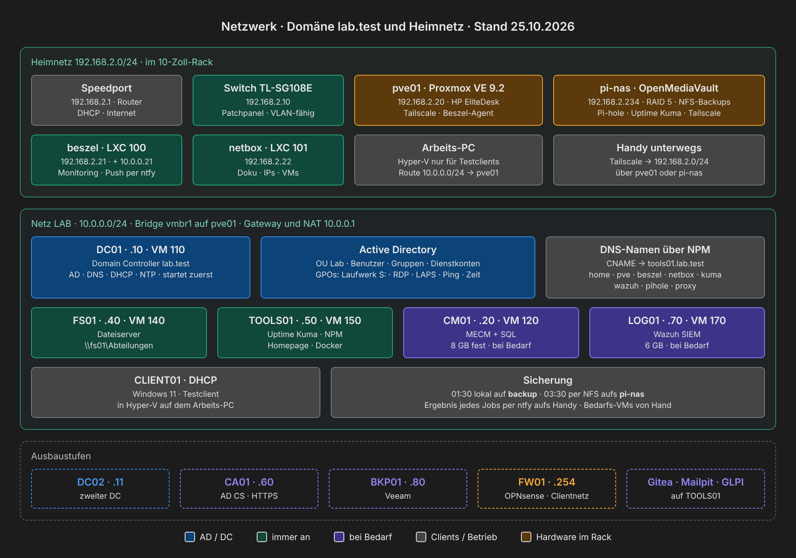
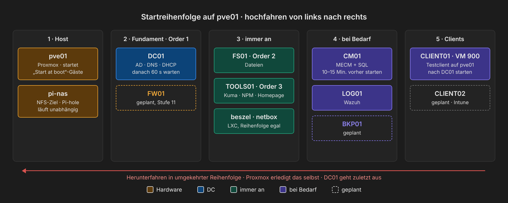
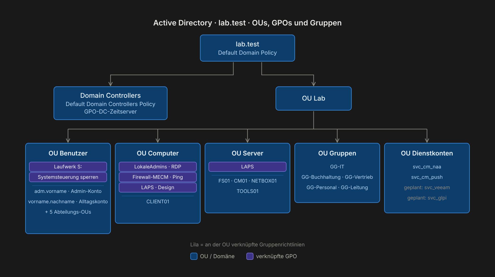

# Aufbau



## Netz

| Was | Wert |
|---|---|
| Netz | `10.0.0.0/24`, Bridge `vmbr1` auf pve01 mit NAT |
| Gateway | `10.0.0.1` (pve01) |
| DNS | `10.0.0.10` (DC01), Weiterleiter ins Internet |
| DHCP | `10.0.0.100` – `10.0.0.200` auf DC01 |
| Domäne | `lab.test`, NetBIOS `LAB` |
| Namensauflösung vom Arbeits-PC | NRPT-Regel: `*.lab.test` über DC01, Rest normal · Route `10.0.0.0/24` über `192.168.2.20` |

### DNS

- Forward-Zone `lab.test` mit A-Einträgen für alle Server
- Reverse-Zone `0.0.10.in-addr.arpa` mit PTR-Einträgen
- CNAMEs `home`, `pve`, `beszel`, `netbox`, `kuma`, `wazuh`, `pihole`, `proxy` → `tools01.lab.test` (dahinter Nginx Proxy Manager, [Kapitel 18](anleitung/18-betrieb.md#schritt-5--namen-statt-ip-und-port-nginx-proxy-manager-dc01))

## Server

**Lab-Netz auf pve01** ([Kapitel 17](anleitung/17-umzug-hyperv-proxmox.md)):

| VM | ID | IP | OS | Aufgabe | Betrieb |
|---|---|---|---|---|---|
| DC01 | 110 | 10.0.0.10 | Windows Server 2025 | AD DS, DNS, DHCP, PDC-Emulator / Zeitquelle | immer an, startet zuerst |
| CM01 | 120 | 10.0.0.20 | Windows Server 2025 | MECM (Site `LAB`), SQL Server, 6 Kerne, 8 GB fest, VirtIO | bei Bedarf |
| FS01 | 140 | 10.0.0.40 | Windows Server 2025 | Dateiserver, Datenplatte E: | immer an |
| TOOLS01 | 150 | 10.0.0.50 | Ubuntu Server | Docker-Dienste (unten) | immer an |
| LOG01 | 170 | 10.0.0.70 | Ubuntu Server | Wazuh 4.14 (SIEM) | bei Bedarf |
| CLIENT01 | – | DHCP | Windows 11 Pro | Testclient, in Hyper-V auf dem Arbeits-PC | bei Bedarf |

**Heimnetz** ([Kapitel 15](anleitung/15-proxmox-host.md), [16](anleitung/16-pi-nas.md), [18](anleitung/18-betrieb.md)):

| Gerät | IP | OS | Aufgabe | Betrieb |
|---|---|---|---|---|
| pve01 | 192.168.2.20 | Proxmox VE 9.2 auf HP EliteDesk 805 G6 Mini | Hypervisor, Gateway `vmbr1`, Tailscale Subnet Router | immer an |
| beszel | 192.168.2.21 (+ 10.0.0.21) | LXC 100 auf pve01 | Monitoring-Hub, Push per ntfy | immer an |
| netbox | 192.168.2.22 | LXC 101 auf pve01 | NetBox 4.7 | immer an |
| pi-nas | 192.168.2.234 | Raspberry Pi OS + OpenMediaVault 8 | RAID 5, NFS-Ziel für Backups, Pi-hole, zweites Uptime Kuma, Tailscale | immer an |
| Switch | 192.168.2.10 | TL-SG108E | Managed Switch im Rack ([Hardware](hardware.md)) | immer an |



**Startreihenfolge:** pve01 startet DC01 zuerst (60 s Verzögerung), dann FS01 und TOOLS01. CM01 und LOG01 nur bei Bedarf und immer nach DC01. Herunterfahren umgekehrt, DC01 zuletzt.

**Arbeitsspeicher:** Windows-Server mit Ballooning (DC01, FS01 je 4 GB, mindestens 2 GB), Linux-VMs und CM01 (SQL Server) fest. Siehe [Entscheidungen](entscheidungen.md).

## Active Directory



```
lab.test
├── Domain Controllers   → DC01 · GPO-DC-Zeitserver, Ping
└── Lab
    ├── Benutzer         → Laufwerk S:
    │   └── IT, Buchhaltung, Vertrieb, Personal, Leitung
    ├── Computer         → CLIENT01 · RDP, lokale Admins, LAPS, Ping, Design
    ├── Server           → FS01, CM01 · LAPS, Ping
    ├── Gruppen          → GG-IT, GG-Buchhaltung, GG-Vertrieb, GG-Personal, GG-Leitung
    └── Dienstkonten     → svc_cm_push, svc_cm_naa
```

- Neue Computerkonten landen per `redircmp` in `Lab/Computer` statt im Standardcontainer.
- Regel: Jeder Benutzer ist in genau **einer** Abteilungsgruppe, sonst bekommt er das falsche Laufwerk.
- Admin-Konto und Alltagskonto sind getrennt.
- Domänenweit: Kennwort mind. 12 Zeichen, Chronik 24, Sperre nach 10 Fehlversuchen für 15 Minuten. AD-Papierkorb ist aktiv.

## Gruppenrichtlinien

| GPO | Verknüpft mit | Was sie tut |
|---|---|---|
| GPO-Benutzer-Laufwerk-S | Lab/Benutzer | S: je Abteilung, Zielgruppenadressierung auf die GG-Gruppe, Aktion *Ersetzen* |
| GPO-Computer-RDP | Lab/Computer | GG-Buchhaltung und GG-Vertrieb in *Remotedesktopbenutzer* |
| GPO-RDP-Freigabe | Lab/Computer, Lab/Server | RDP einschalten, Firewall-Ausnahme nur für `10.0.0.0/24` |
| GPO-Computer-LokaleAdmins | Lab/Computer | MECM-Push-Konto als lokaler Administrator |
| GPO-Computer-LAPS | Lab/Computer, Lab/Server | Windows LAPS, Kennwortsicherung im AD |
| GPO-Computer-Ping | Lab/Computer, Lab/Server, Domain Controllers | ICMPv4 Echo eingehend erlauben (für Uptime Kuma) |
| GPO-Computer-Design | Lab/Computer | Hintergrundbild aus NETLOGON, per Files-Preference lokal kopiert |
| GPO-DC-Zeitserver | Domain Controllers | NTP-Quelle `de.pool.ntp.org` |
| Default Domain Policy | Domäne | Kennwort- und Sperrrichtlinie |

## Dateiserver

- Freigabe `\\fs01\Abteilungen` → `E:\Shares\Abteilungen`
- Freigaberecht: *Authenticated Users* Vollzugriff, gesteuert wird nur über NTFS
- Pro Abteilungsordner:

| Principal | Recht | Gilt für |
|---|---|---|
| Administrators | Vollzugriff | Ordner, Unterordner, Dateien |
| SYSTEM | Vollzugriff | Ordner, Unterordner, Dateien |
| CREATOR OWNER | Vollzugriff | nur Unterordner und Dateien |
| GG-&lt;Abteilung&gt; | Ändern | Ordner, Unterordner, Dateien |

- Zugriffsbasierte Aufzählung ist an: Jeder sieht in der Freigabe nur seinen eigenen Abteilungsordner.

## MECM

- Primärer Standort `LAB` auf CM01
- AD System Discovery, Client-Push mit eigenem Dienstkonto
- Kommunikation per *Enhanced HTTP* mit selbstsigniertem Zertifikat, bis eine eigene CA Zertifikate ausstellt

## Dienste auf TOOLS01 (Docker)

| Dienst | Zweck |
|---|---|
| Nginx Proxy Manager | Reverse Proxy, Namen statt IP und Port |
| Uptime Kuma | Überwachung per Ping, Port und DNS (auch für die Windows-Server) |
| Homepage | Startseite mit allen Diensten und Proxmox-Widget |
| Beszel-Agent | Werte für Beszel inklusive Container |

Netdata (ersetzt durch Beszel) und Warpgate sind seit dem 25.10.2026 abgeschaltet.

Alle Dienste liegen unter `~/tools/<dienst>` mit eigener `docker-compose.yml` und `restart: unless-stopped`.
