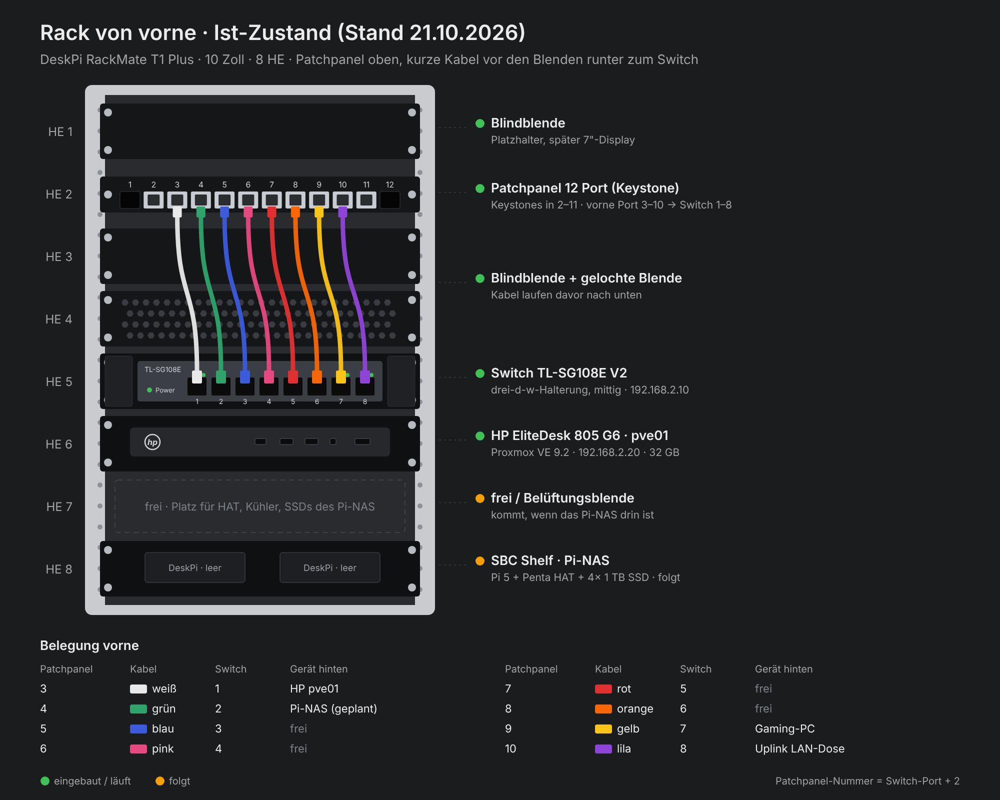
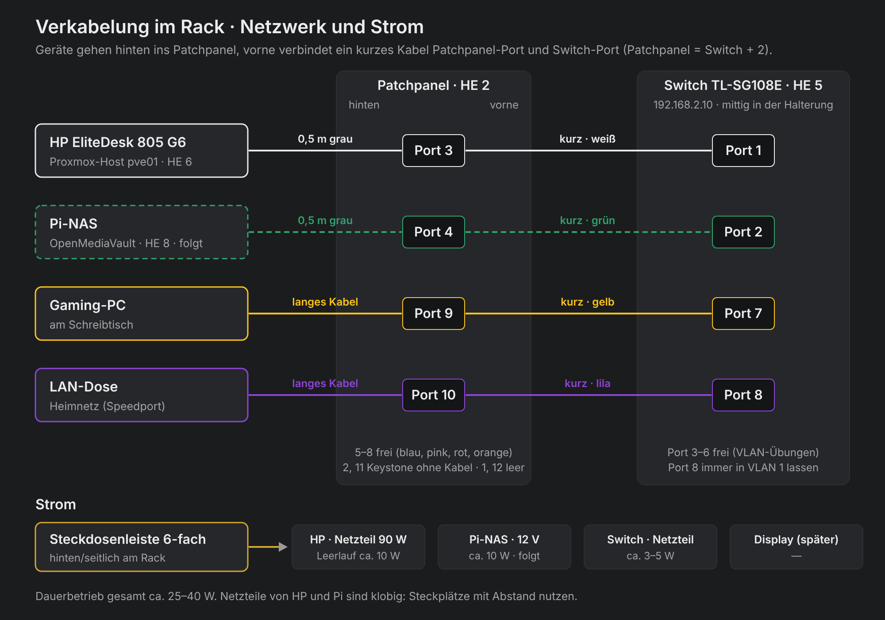

# Hardware: Mini-PC im 10-Zoll-Rack

[Übersicht](../README.md#inhaltsverzeichnis) · [Roadmap](roadmap.md) · [Entscheidungen](entscheidungen.md)

 

> **Ziel:** Das Lab läuft dauerhaft auf einem eigenen, sparsamen Mini-PC statt auf dem großen PC. Mini-PC, Switch und NAS sitzen ordentlich verkabelt in einem kleinen 10-Zoll-Rack.
> **Stand:** 21.10.2026 · Rack aufgebaut, Patchpanel (HE 2), Switch (HE 5), Mini-PC (HE 6) und SBC Shelf (HE 8) eingebaut, alles über das Patchpanel verkabelt. Auf dem Mini-PC läuft Proxmox VE ([Kapitel 15](anleitung/15-proxmox-host.md)). Das NAS läuft seit 22.10. auf dem Tisch ([Kapitel 16](anleitung/16-pi-nas.md)), der Platz im Rack ist noch offen.

Die Anleitung (Kapitel 0–14) funktioniert weiterhin auf einem einzigen PC mit Hyper-V. Diese Seite beschreibt Rack, Verkabelung und Switch für den Umzug auf eigene Hardware. Es ist optional. Auf dem Mini-PC läuft **Proxmox VE** statt Hyper-V: Die Windows-Server laufen dort als KVM-VMs, Linux-Dienste können als schlanke LXC-Container laufen.

## Komponenten

| Teil | Aufgabe | Position (von oben) |
|---|---|---|
| DeskPi RackMate T1 Plus | 10-Zoll-Rack, 8 HE, 260 mm tief | – |
| Blindblende 1 HE | Abschluss oben | 1 |
| Keystone-Patchpanel, 12 Ports | Geräte hinten anstecken, vorne kurze Kabel zum Switch | 2 |
| Blindblende + gelochte Blende | Abstand, die Patchkabel laufen davor nach unten | 3–4 |
| TP-Link TL-SG108E (V2) | Managed Switch mit 802.1Q-VLANs, in einer 3D-gedruckten 10-Zoll-Halterung | 5 |
| HP EliteDesk 805 G6 Mini auf Fachboden | Proxmox-Host `pve01`: Ryzen 5 PRO 4650GE (6 Kerne, 12 Threads), 32 GB DDR4, 2× NVMe + 1× SATA-SSD | 6 |
| frei bzw. Belüftungsblende | Platz für HAT, Kühler und SSDs des NAS | 7 |
| Raspberry Pi 5 + Radxa Penta SATA HAT auf SBC Shelf | NAS mit OpenMediaVault, 4× 1 TB SSD, Backup-Ziel | 8 |

> [!NOTE]
> Das Patchpanel sitzt bewusst oben mit Abstand zum Switch. So fallen die kurzen Kabel sauber vor den Blenden nach unten. Die Patchpanel-Nummern sind dadurch um 2 versetzt: Patchpanel 3–10 gehen auf Switch 1–8.

Im Dauerbetrieb braucht alles zusammen etwa 30–40 W.

## Verkabelung

**Prinzip:** Jedes Gerät wird **hinten** ins Patchpanel gesteckt. **Vorne** verbindet ein kurzes Kabel jeden Patchpanel-Port mit dem passenden Switch-Port. Vorne sieht man dann nur eine ordentliche Reihe, und zum Umstecken muss man hinten nichts anfassen.

| Switch-Port | Patchpanel | Gerät | Hinweis |
|---|---|---|---|
| 1 | 3 | Mini-PC (Proxmox-Host) | Später Trunk: Heimnetz untagged, Lab-VLANs tagged |
| 2 | 4 | NAS | Bleibt im Heimnetz |
| 3–6 | 5–8 | frei | Für VLAN-Übungen |
| 7 | 9 | Arbeits-PC | |
| 8 | 10 | Uplink zur LAN-Dose | Immer untagged in VLAN 1, sonst ist die Verwaltung des Switches weg |

**Keystones einsetzen:** Beim DeskPi-Panel werden die Keystone-Kupplungen **von hinten** eingesetzt, mit der **Federlasche nach oben**. Von vorne passen sie nicht durch, der vordere Rand dient als Anschlag. Erst unten einhaken, dann oben eindrücken, bis es klickt.

Patchpanel und Switch müssen nicht gleich viele Ports haben. Die übrigen Keystone-Plätze bekommen Blindstopfen oder später HDMI/USB-Module.

## Switch einrichten (TL-SG108E)

> **Dauer:** ca. 15 Minuten · **Wo:** am Arbeits-PC, gearbeitet wird mit der Weboberfläche

Ab Werk hat der Switch die feste IP `192.168.0.1`. Liegt dein Heimnetz in einem anderen Bereich (z. B. `192.168.2.x`), erreichst du die Weboberfläche zunächst nicht. Es gibt zwei Wege:

**Weg A · Easy Smart Configuration Utility (ohne Internet-Unterbrechung)**

1. Utility von der TP-Link-Seite für deine Hardware-Version herunterladen (Version steht auf dem Aufkleber, z. B. „Ver: 2.0").
2. Switch zwischen LAN-Dose und PC hängen. Das Utility findet ihn per Broadcast, auch im falschen IP-Bereich.
3. **IP Setting:** DHCP aus, feste IP aus deinem Heimnetz außerhalb des DHCP-Bereichs (z. B. `192.168.2.10`), Maske `255.255.255.0`, Gateway = dein Router. Mit dem aktuellen Login bestätigen.

**Weg B · Manuell**

1. PC kurz auf die feste IP `192.168.0.2` / `255.255.255.0` stellen (*Einstellungen → Netzwerk und Internet → Ethernet → IP-Zuweisung → Bearbeiten*).
2. Im Browser `http://192.168.0.1` öffnen und unter **System → IP Setting** die neue IP eintragen.
3. PC zurück auf **Automatisch (DHCP)** stellen.

**Danach in der Weboberfläche:**

1. **System → System Info:** Firmware prüfen. Für V2 ist `20160526` die neueste.
2. **System → User Account:** Kennwort ändern (empfohlen).
3. **Monitoring → Loop Prevention:** einschalten.
4. Links **Save Config** klicken. Ohne das sind alle Änderungen nach einem Stromausfall weg.
5. **System → Backup and Restore:** Konfiguration sichern. Die Datei enthält die Zugangsdaten im Klartext, also nicht in ein öffentliches Repo legen.

**Prüfen:** Unter **Switching → Port Setting** muss bei jedem belegten Port in der Spalte *Speed Actual* `1000MF` stehen.

## Proxmox auf dem Mini-PC

Aufrüsten, Proxmox installieren, Speicher, Monitoring mit Beszel und Fernzugriff mit Tailscale stehen Schritt für Schritt in **[Kapitel 15 · Proxmox auf eigener Hardware](anleitung/15-proxmox-host.md)**.

## Montage-Tipps

- **3 Löcher an der Schiene = 1 HE**, von oben gezählt. Ein 1-HE-Gerät wird im 1. und 3. Loch seiner HE verschraubt.
- **Von unten nach oben** einbauen, dann stößt man beim Schrauben nirgends an.
- **Schrauben erst handfest** anziehen und am Ende festziehen. So lässt sich noch um ein Loch korrigieren.
- Das NAS ragt mit HAT, Kühler und SSDs über 1 HE hinaus. Deshalb liegt es ganz unten und die HE darüber bleibt frei bzw. bekommt eine Belüftungsblende.
- Das DeskPi SBC Shelf hat zwei Pi-Plätze mit kleinen Adapterplatinen (KL-P24), die USB-C und HDMI nach vorne führen. Fürs NAS werden sie nicht gebraucht: Der Pi bekommt Strom über das 12-V-Netzteil am Penta HAT. Dann **nicht zusätzlich** per USB-C einspeisen.
- Den Pi am besten auf dem Tisch aufs Shelf schrauben und das Shelf danach einbauen.
- **Nachgemessen:** Mit HAT, Kühler und stehenden SSDs passt das NAS bei mir nicht in die 2 HE unter dem Fachboden des Mini-PCs. Lösung ohne alles umzubauen: gelochte Blende aus HE 4 raus, Switch nach HE 4, Fachboden mit Mini-PC nach HE 5. Dann sind HE 6–8 frei (ca. 13 cm).

## Häufige Fehler

| Problem | Ursache | Lösung |
|---|---|---|
| Nur ca. 90 Mbit/s statt Gigabit | Port handelt nur 100 Mbit aus (*Speed Actual* `100MF`), fast immer wegen eines alten oder defekten Kabels | Kabel gegen Cat5e/Cat6 tauschen |
| Weboberfläche nicht erreichbar | PC und Switch in verschiedenen IP-Bereichen | Easy Smart Utility oder PC kurz auf `192.168.0.2` |
| Einstellungen nach Neustart weg | Nicht gespeichert | Nach jeder Änderung **Save Config** |
| Mini-PC zeigt nach Neustart kein Bild, Tastatur bleibt dunkel | Start hängt vor dem HP-Logo, vermutlich wegen eines angesteckten USB-Geräts | Nur Strom, Netzwerk und Monitor anstecken, Rest nach dem Start ([Details](fehlerbehebung.md#mini-pc-startet-nach-neustart-nicht-mehr)) |
| Nach VLAN-Änderung kein Zugriff mehr auf den Switch | Uplink- oder PC-Port aus VLAN 1 genommen | Reset-Knopf ca. 10 s halten, neu einrichten, Uplink in VLAN 1 lassen |
