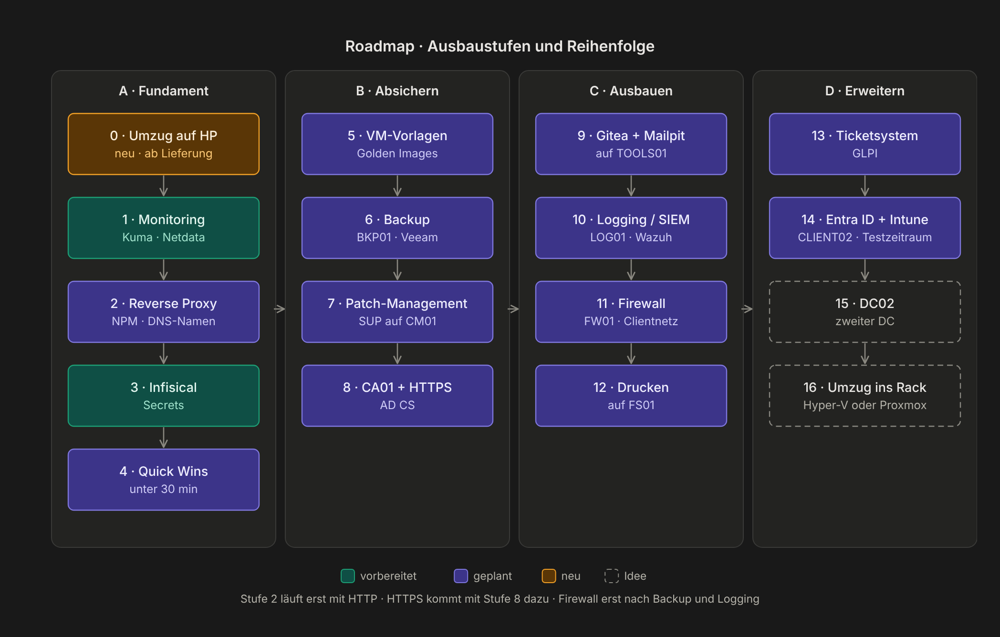
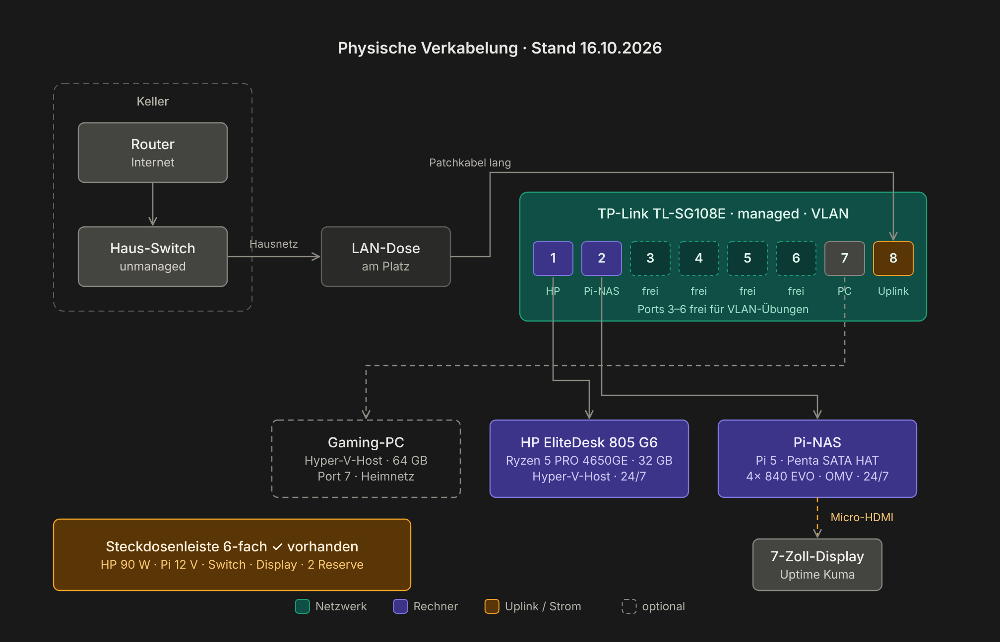
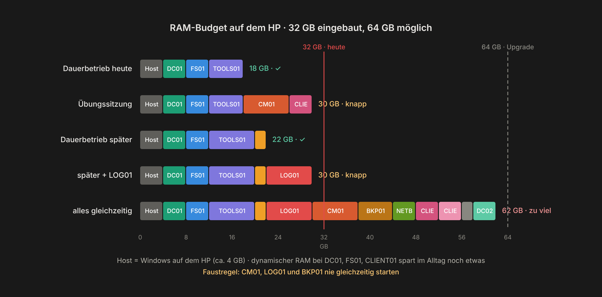

# Roadmap

Jede Stufe baut auf der vorherigen auf: Vorlagen vor neuen Servern, Backup vor riskanten Umbauten, Logging vor der Firewall (damit man sieht, was geblockt wird).

| # | Ausbaustufe | Neue VM | Status |
|---|---|---|---|
| 0 | Umzug auf Mini-PC im 10-Zoll-Rack | – | ab Lieferung |
| 1 | Monitoring (Uptime Kuma, Netdata) | – | ✅ |
| 2 | Reverse Proxy und DNS-Namen | – | ✅ |
| 3 | Infisical für Kennwörter | – | ✅ |
| 4 | Quick Wins (AD-Papierkorb, Lizenzdaten, Monitore) | – | teilweise |
| 5 | VM-Vorlagen | – | geplant |
| 6 | Backup und Restore (Veeam) | BKP01 | geplant |
| 7 | Patch-Management über MECM | – | geplant |
| 8 | Eigene CA und HTTPS (auch für MECM) | CA01 | geplant |
| 9 | Gitea und Mailpit | – | geplant |
| 10 | Logging / SIEM (Wazuh) | LOG01 | geplant |
| 11 | Firewall (OPNsense) und getrenntes Clientnetz | FW01 | geplant |
| 12 | Drucken (virtuelle Drucker, Point and Print) | – | geplant |
| 13 | Ticketsystem und Inventar (GLPI) | – | geplant |
| 14 | Entra ID und Intune, Co-Management | CLIENT02 | geplant |
| 15 | Zweiter Domain Controller (Replikation, FSMO) | DC02 | Idee |

## Geplante Hardware

Das Lab zieht auf einen eigenen Mini-PC in einem 10-Zoll-Rack um. So wird verkabelt, und so reicht der Arbeitsspeicher:

## Weitere Ideen

- Helpdesk-Delegation: eigene Gruppe darf nur Kennwörter zurücksetzen und Konten entsperren
- Joiner / Mover / Leaver als Prozess und Skript
- MECM: Anwendungen verteilen, Betriebssystem per Tasksequenz ausrollen
- NTLM-Nutzung im Lab auswerten (Vorbereitung auf NTLM-Abschaltung)
- AD-Sicherheitscheck mit PingCastle, Angriffspfade mit BloodHound CE
- Monatlicher Notfall-Tag: etwas absichtlich kaputt machen und wiederherstellen
